Kwame Nkrumah University of Science and Technology

College of Science · Faculty of Physical and Computational Sciences

Department of Computer Science

---

# FreshFold: A Multi-Client Laundry Collection and Dispatch Platform with Verified Custody Hand-off

**Computer Science Project Documentation — 2025 / 2026**

---

A project report submitted in partial fulfilment of the requirements
for the award of the degree of **Bachelor of Science in Computer Science**

**By**
**[Student Name]** — **[Index / Reg. Number]**

**Supervisor**
**[Supervisor Name and Title]**

**[Month] [Year]**

---

> **Before you submit.** Every **[bracketed field]** in this document is a value only
> you can supply — your name, index number, supervisor, dates, and the sources you
> read. Nothing has been invented to fill them. Chapter 2 and the reference list mark
> where your own reading must go in. Every number, file path and test result quoted
> here was measured against the working tree of the repository on the date of writing
> and is reproducible by the commands given in Section 4.4.

---

## Declaration

I hereby declare that this submission is my own work towards the award of the
Bachelor of Science degree in Computer Science, and that, to the best of my
knowledge, it contains no material previously published by another person nor
material which has been accepted for the award of any other degree of this
University or elsewhere, except where due acknowledgement has been made in the
text.

The software described in this report was designed and implemented by me. Its
complete revision history is publicly verifiable in the project's Git repository,
and every claim of functionality in Chapters 3 and 4 is traceable to a named
source file listed in Appendix A.

| | | |
|---|---|---|
| **[Student Name]** — **[Index Number]** | ......................... | ......................... |
| Candidate | Signature | Date |

**Certified by:**

| | | |
|---|---|---|
| **[Supervisor Name]** | ......................... | ......................... |
| Supervisor | Signature | Date |
| **[Head of Department]** | ......................... | ......................... |
| Head, Dept. of Computer Science | Signature | Date |

## Dedication

**[Optional — one or two sentences, in your own words.]**

## Acknowledgement

My thanks to **[supervisor]** for supervision and for the reviews that shaped
Chapters 3 and 4; to the staff of the Department of Computer Science; and to
**[the couriers, customers and shop staff who tested the system]**, whose reports of
what actually happens at a doorstep are the reason several of the design decisions
in Section 4.4.6 exist at all.

## Abstract

Laundry collection and delivery around the KNUST campus in Kumasi is coordinated
informally: a customer telephones or messages an operator, the operator remembers or
writes down the job, and a courier is told where to go. No party holds the same
record, a customer cannot see where their garments are, and no step of the round trip
produces evidence that it happened.

This project designs and implements **FreshFold**, a dispatch platform in which one
canonical job record is shared by four client surfaces and a single server of record.
The system was built iteratively in a TypeScript monorepo. A shared domain package
holds the pricing arithmetic, the state machine and the hand-off rules, so the same
code runs on the web client, both mobile applications and the server; a REST API over
PostgreSQL is the only writer. A job advances through fifteen dispatch states that are
projected onto seven customer-visible stages, so the courier's vocabulary and the
customer's remain distinct without a second copy of the data. Custody changes at the
door and at the hub are gated by per-job four-digit codes carried in structured QR
payloads, with typed and documented-override fallbacks for the cases where a camera or
a customer is unavailable. Prices are computed server-side from a single table; every
supervisor action that moves money, standing or an order is written to an append-only
audit trail in the same transaction as the change it explains.

The implementation comprises approximately 86,000 lines across five workspaces,
twenty-six database migrations, and an assertion suite of **815 checks that passes in
full**. The result shows that a single canonical record with person-confirmed
transitions removes the class of coordination error that manual dispatch produces, and
that a paid routing service can be depended on for accuracy while degrading safely to
a visibly-approximate fallback when it is unavailable.

**Keywords:** dispatch systems, finite state machines, custody verification,
domain-driven design, PostgreSQL, React Native, last-mile logistics, Ghana.

## Table of Contents

**Chapter 1 — Introduction**
1.1 Background of the Project · 1.2 Problem Statement · 1.3 Aim of the Project ·
1.4 Novelty of the Project · 1.5 Specific Project Objectives · 1.6 Scope of the
Project · 1.7 Project Limitations · 1.8 Academic and Practical Relevance ·
1.9 Beneficiaries of the Project · 1.10 Project Activity Planning · 1.11 Definitions
and Explanations of Terms · 1.12 Structure of the Report

**Chapter 2 — Review of Related Systems**
2.1 Introduction · 2.2 System 1: Uber · 2.3 System 2: Laundryheap · 2.4 System 3:
Rinse · 2.5 System 4: Washio · 2.6 System 5: WhatsApp Business with Mobile Money ·
2.7 Comparative Analysis · 2.8 Conceptual Design of the Proposed Project

**Chapter 3 — Methodology**
3.1 Introduction · 3.2 Architecture of the Proposed Project · 3.3 Requirements
Elicitation · 3.4 Functional Requirements · 3.5 Non-Functional Requirements ·
3.6 UML Diagrams · 3.7 Activity Diagrams · 3.8 Sequence Diagrams · 3.9 Class
Diagrams · 3.10 Users of the Proposed System · 3.11 Security Concepts · 3.12 Project
Method Employed · 3.13 Software Process Models and Justification · 3.14 Chosen Model
and Justification · 3.15 Logical Design Considerations

**Chapter 4 — Implementation, Testing and Results**
4.1 Introduction · 4.2 Mapping the Logical Design onto the Physical Platform ·
4.3 System Modules Implementation · 4.4 System Modules Integration and Testing ·
4.5 Results

**Chapter 5 — Findings, Conclusions and Recommendations**
5.1 Introduction · 5.2 Findings · 5.3 Conclusions · 5.4 Challenges · 5.5 Lessons
Learnt · 5.6 Recommendations for Future Works · References · Appendices

### List of Figures

| Figure | Title | Section |
|---|---|---|
| 2.1 | Conceptual design of the proposed system | 2.8 |
| 3.1 | System architecture — clients, server, data and third parties | 3.2 |
| 3.2 | Context data-flow diagram (Level 0) | 3.3 |
| 3.3 | Use-case diagram — front-end models | 3.6.1 |
| 3.4 | Use-case diagram — back-end models | 3.6.2 |
| 3.5 | Activity diagram — booking to delivery | 3.7 |
| 3.6 | Sequence diagram — collection hand-off verification | 3.8 |
| 3.7 | Sequence diagram — booking, pricing and payment | 3.8 |
| 3.8 | Class diagram of the domain model | 3.9 |
| 3.9 | Job state machine — fifteen dispatch states | 3.11 |
| 3.10 | Entity-relationship diagram of the core schema | 3.15.2 |

### List of Tables

| Table | Title | Section |
|---|---|---|
| 1.1 | Specific project objectives | 1.5 |
| 1.2 | Beneficiaries and the benefit each receives | 1.9 |
| 1.3 | Project activity plan, against the commit record | 1.10 |
| 2.1 | Comparative analysis of the five reviewed systems | 2.7 |
| 3.1 | Functional requirements | 3.4 |
| 3.2 | Non-functional requirements | 3.5 |
| 3.3 | User characteristics | 3.10.1 |
| 3.4 | Comparison of candidate software process models | 3.13 |
| 3.5 | Database tables by the migration that introduced them | 3.15.2 |
| 4.1 | Hardware and software platform | 4.2 |
| 4.2 | Dispatch state to customer stage projection | 4.3.3 |
| 4.3 | Service catalogue and unit prices | 4.3.3 |
| 4.4 | Testing plan | 4.4.2 |
| 4.5 | Assertion suite results by workspace | 4.4.3 |
| 4.6 | Validation test cases and outcomes | 4.4.4 |
| 4.7 | Security test cases and outcomes | 4.4.5 |
| 4.8 | Tester recommendations and the responses made | 4.4.7 |
| 5.1 | Objectives against delivered outcomes | 5.2 |

### List of Abbreviations and Acronyms

| | |
|---|---|
| **API** | Application Programming Interface |
| **CORS** | Cross-Origin Resource Sharing |
| **CSP** | Content Security Policy |
| **CSPRNG** | Cryptographically Secure Pseudo-Random Number Generator |
| **DFD** | Data-Flow Diagram |
| **ERD** | Entity-Relationship Diagram |
| **ETA** | Estimated Time of Arrival |
| **FSM** | Finite State Machine |
| **HMAC** | Hash-based Message Authentication Code |
| **HSTS** | HTTP Strict Transport Security |
| **JSONB** | PostgreSQL binary JSON column type |
| **MoMo** | Mobile Money |
| **OTP** | One-Time Password (here, a per-job hand-off code) |
| **REST** | Representational State Transfer |
| **RLS** | Row-Level Security |
| **SPA** | Single-Page Application |
| **UML** | Unified Modeling Language |
| **WCAG** | Web Content Accessibility Guidelines |

---
# Chapter 1: INTRODUCTION

## 1.1 Background of the Project

Laundry is one of the few chores in student life that cannot be deferred
indefinitely and cannot be done well without equipment. In the halls and hostels
around the Kwame Nkrumah University of Science and Technology, most residents have
no washing machine, share a bathroom with several others, and hand-wash in a
bucket. Around Ayeduase, Kotei, Bomso and Boadi a small trade has grown up to
absorb that work: operators who collect clothing, wash it, and return it, usually
within a day.

That trade is coordinated almost entirely by telephone and instant messaging. A
customer sends a message, an operator agrees a price and a time verbally, and a
courier is dispatched on a motorbike with an address held in someone's head or in a
chat thread. The arrangement scales to a handful of jobs a day and stops scaling
shortly afterwards, for reasons that are structural rather than a matter of effort:
there is no record that all three parties can see, so every question about a job —
where is it, what was agreed, who has it now — has to be answered by asking a
person.

Two things have changed recently enough to make a software answer practical here.
Mobile money is now the ordinary way to pay small amounts in Ghana, which removes
the cash-at-the-door step that made pre-payment impossible; and inexpensive Android
handsets with GPS are standard among couriers, which makes a courier's position and
a proof photograph available to the system without special hardware.

> **Citation needed here.** The paragraphs above are written from direct observation
> of the service area. For submission, support the claims about hall occupancy,
> laundry practice and mobile-money penetration with figures from a citable source —
> the **[Ghana Statistical Service census]**, **[Bank of Ghana payment-systems
> statistics]**, or your own survey instrument reproduced in Appendix C. Do not carry
> the text forward without them.

## 1.2 Problem Statement

The problem is not that laundry operators lack an app. It is that the information
about a job lives in as many partial, mutually inconsistent copies as there are
people handling it. Six failures follow from that, and each was observed directly
in the manual process this project replaces.

| Ref | Failure | Consequence |
|---|---|---|
| **P1** | **No shared record.** The customer's expectation, the dispatcher's note and the courier's instruction are three separate artefacts. | When they disagree, nothing arbitrates. The operator cannot be absent. |
| **P2** | **A stage is claimed, not evidenced.** "Your clothes are being washed" is asserted by whoever is asked. | Nothing in the manual process records that a garment was actually washed, because nothing observes it. |
| **P3** | **Custody changes are unverified.** A person at a door claiming to be the courier, and a person opening it claiming to be the customer, each prove nothing. | Garments are handed over on appearance alone, with no evidence afterwards. |
| **P4** | **Price is negotiated per conversation.** Two customers ordering the same work can be quoted differently. | Neither quote is recorded in a form that can be checked afterwards. |
| **P5** | **No accountable trail.** When an order is cancelled, a refund given or a discount applied, there is no record of who decided it. | Disputes resolve by seniority rather than evidence; loss is undetectable. |
| **P6** | **Distance and time are guessed.** A dispatcher estimates a round trip from familiarity. | Estimates follow the shape of the map rather than the shape of the roads, so they are systematically — not randomly — optimistic. |

The sixth is worth a number, because this project measured it. Between the hub and
a delivery point in Ayeduase, the straight-line distance is **3.3 km**; the distance
a scooter actually rides is **5.3 km**. Any estimate built on the straight line is
**60 % short** before any other source of error is considered.

Two further operational failures follow from the same root: **collection capacity is
unbounded**, so more collections are promised in a window than couriers can serve;
and **payment reconciliation is manual**, so it is slow, error-prone, and
undetectable when it fails.

## 1.3 Aim of the Project

> To design, implement and deploy a laundry collection and dispatch platform in
> which a **single canonical record** of every job is shared by the customer, the
> courier and the shop supervisor, and in which **each change of custody or
> condition is confirmed by an identified person and recorded as evidence**.

## 1.4 Novelty of the Project

Dispatch software is not new, and this project does not claim to have invented
scheduling, tracking or in-app payment. Its novelty is in four specific design
positions, each of which is unusual in the reviewed systems of Chapter 2 and each
of which is demonstrated in the implementation rather than argued in the abstract.

1. **Custody is modelled as a first-class interval, not an operational detail.**
   Ride-hailing has no custody period — the passenger is present throughout. Parcel
   logistics has one but usually verifies only the final delivery. FreshFold treats
   the whole span from the customer's door to the customer's door as an interval the
   operator must account for, and gates **both** ends of it with a per-job secret.

2. **A stage claim must name its source.** In most systems a status advances on a
   timer or on an operator's unattributed click. Here, the two hub transitions are
   supervisor confirmations attributed by name in an append-only trail — and where
   nobody confirmed a step, the system records the actor as `system` and says so,
   rather than borrowing a person's authority for a machine's guess.

3. **The hand-off code is bound to the job, and survives the loss of both the
   camera and the network.** The four-digit code is minted at job creation and
   pushed to the courier's handset before the courier leaves, so a scan verifies
   offline in a stairwell. The job identifier travels inside the QR payload, which
   closes the substitution attack that an unbound code permits when a courier holds
   two jobs on one street. A typed fallback and a recorded written override exist so
   that no courier is ever stranded holding somebody's laundry.

4. **Degradation is visible by construction.** When the routing service is
   unavailable, the map draws a **dashed** straight line and every surface withholds
   the arrival time entirely rather than substituting a worse estimate. The system is
   designed to be visibly less confident when it knows less — which is the opposite of
   the usual fallback behaviour, where a silent approximation replaces a measurement.

Taken together these amount to one position: **a dispatch system should never be
confident about something it has no evidence for**, and where it must proceed
without evidence it should say so in a way the user can see.

## 1.5 Specific Project Objectives

The aim decomposes into seven objectives, each stated so that it can be judged met
or unmet rather than merely attempted. Section 5.2 returns to this list and reports
against it.

**Table 1.1** — Specific project objectives.

| Ref | Objective |
|---|---|
| **O1** | Model the job **once**, server-side, and derive both the customer's view and the courier's view from it, so that no second copy of a job exists anywhere in the system. |
| **O2** | Express the life of a job as an **explicit state machine** in which every forward transition is attributable to a named person or is explicitly marked as unattributed. |
| **O3** | **Verify both custody hand-offs** — collection at the customer's door and delivery back to it — with a per-job secret, and provide fallbacks for the realistic failure cases without weakening the default path. |
| **O4** | Compute **every price on the server** from one table of rates, so that a client cannot assert what an order costs. |
| **O5** | Record every supervisor action that moves money, standing or an order in an **append-only trail** written by the route that performs the action. |
| **O6** | Derive distances and arrival times from **real road geometry**, and degrade visibly rather than silently when the routing service is unavailable. |
| **O7** | **Deploy** the system to production infrastructure and demonstrate the full round trip across all four client surfaces against one server. |

## 1.6 Scope of the Project

**In scope:**

- Booking, pricing, payment, dispatch, custody verification, delivery and rating for
  laundry and adjacent cleaning services.
- **Four client surfaces:** a marketing site and client portal, a supervisor desk, a
  courier application and a customer application.
- **One dispatch server of record**, backed by PostgreSQL, deployed to production.
- Memberships, a loyalty scheme, promotional codes, standing orders, claims and
  invoicing.
- An AI concierge scoped to the service catalogue, for customer questions.
- Multi-hub operation, courier shifts, hub intake and a supervisor audit trail.

**Out of scope, and why:**

| Excluded | Reason |
|---|---|
| **Geography beyond Kumasi** | Distances, service areas and address resolution assume the service area around the Ayeduase–Kotei hub. A position fix reported from outside it is replaced by the hub coordinate rather than trusted. |
| **Real-time push transport** | Synchronisation is by polling every four to five seconds, not by WebSocket or server-sent events. This is adequate at the scale studied and is treated as future work in Section 5.6. |
| **App-store distribution** | Both mobile applications run under Expo Go and as development builds. Signed store releases were not part of this project. |
| **Native-speaker linguistic review** | The customer application is translated into Spanish and French at full key coverage, but neither translation has been reviewed by a native speaker and neither should be considered release-ready. |
| **Sustained commercial field trial** | The system was exercised end-to-end but was not run as the sole dispatch mechanism for a commercial operation over a sustained period, so no operational statistics are claimed. |

## 1.7 Project Limitations

These are limitations of the delivered system that remain open. They are recorded
here rather than only in the conclusion, because a limitation stated at the end of a
report reads as an excuse and a limitation stated at the front reads as a
specification. Section 5.4 discusses what each would cost to close.

| Limitation | Assessment |
|---|---|
| A courier's PIN is four digits | Right for gloved hands at a doorstep, wrong for resisting a guessing attack. Rate limiting puts a full walk of the 10,000-key space beyond three hundred hours, but the limiter is in-memory: it resets on deploy and is per-instance. |
| Sessions are bearer tokens in `localStorage` | XSS-readable. A same-site, HTTP-only cookie is the stronger choice. |
| Synchronisation is polling | Four to five seconds. Adequate at this scale; a push transport is the upgrade. |
| Rate limiters are per-instance | Two servers behind a load balancer allow twice the stated rate between them — the honest cost of not running Redis. |
| Quantity and service lines cannot be edited after booking | The patch route does not reprice, so accepting a new quantity would leave a job saying "four loads" beside a total quoted for one. Correction means cancel and rebook. |
| A large manifest is a long list | A 40-unit order gives the courier 40 rows to scan, named but neither grouped nor paged. |
| `read` on a notification is one shared flag | Not per-recipient, so the desk and the customer clearing the same notice clear it for both. |
| Neither translation has been read by a native speaker | Spanish and French are complete by key count but drafted rather than reviewed. Twi, Ga and Ewe were offered for a while and withdrawn at 21 %, 12 % and 1 % — a language in a picker that is a fifth written is a worse promise than one not offered. |
| Testing stops at the pure-function core | No route-level, browser-automation or load testing, and no formal usability study. |

## 1.8 Academic and Practical Relevance of the Project

**Academic relevance.** The project is a worked example of three patterns that are
usually described abstractly and rarely demonstrated together at full scale:

- **A canonical record with divergent read projections.** The projections here are
  pure functions applied at read time and never materialised, so drift between the
  customer's view and the courier's view is impossible *by construction* rather than
  by discipline. Most treatments allow a materialised read model and then have to
  discuss invalidation; this one does not need to.
- **A state machine whose transitions carry provenance.** The fifteen-state
  dispatch FSM is a total mapping in the type system, so adding a state without
  deciding what the customer should be told is a compile error, not a runtime
  surprise.
- **A measured cost for the great-circle approximation.** The 3.3 km / 5.3 km
  measurement in Section 1.2 is a concrete figure for an error that small logistics
  systems routinely ship with and rarely quantify. Because the error scales with road
  network density rather than with distance, no constant correction factor fixes it.

The repository is additionally usable as a teaching artefact: the delivery code's
history — from a hard-coded constant shared by every job in the system, to a per-job
server-held secret the courier's device never receives — is a complete worked example
of a vulnerability and its fix, with both states preserved in version control.

**Practical relevance.** The system addresses a real trade in a real service area,
under the constraints that trade actually operates under: mobile-money-first payment,
descriptive rather than numbered addresses, intermittent data coverage, and couriers
carrying mid-range Android handsets. Each of the six failures in Section 1.2 has a
named mechanism answering it in Chapter 4, and the system is deployed rather than
demonstrated on a laptop.

## 1.9 Beneficiaries of the Project

**Table 1.2** — Beneficiaries and the benefit each receives.

| Beneficiary | What changes for them |
|---|---|
| **The customer** | A price known before booking rather than negotiated; a stage that reflects work someone actually confirmed; a courier whose vehicle and plate can be checked at the door; a hand-off they authorise with a code rather than one that happens to them. |
| **The courier** | A board scoped to their own jobs plus the open pool, so two couriers cannot drive the same job; road-accurate navigation instead of a straight line across a hall of residence; and a hand-off procedure that cannot leave them holding somebody's laundry because a customer's phone is flat. |
| **The shop supervisor** | The dispatcher stops being the system's memory. Unaccepted jobs are visible as a backlog rather than remembered; window capacity prevents overselling; and every action that moves money or standing is attributable. |
| **The operating business** | Reconciliation becomes a query rather than an evening spent comparing a phone against a notebook. Disputes resolve against a trail rather than by seniority. Capacity becomes a number the desk can tune from observed throughput. |
| **The Department of Computer Science** | A deployed, fully documented, test-gated artefact usable for teaching state modelling, projection design, and the difference between a fixed secret and a per-record one. |
| **Future developers of the system** | A shared domain kernel with a stated import constraint, 815 assertions as a regression gate, twenty-six once-only migrations, and a limitations list (Section 1.7) that is audited rather than aspirational. |

## 1.10 Project Activity Planning

The project ran as a sequence of short iterations rather than a set of gated phases
(Section 3.12 argues why). The plan below is therefore reported **against the
evidence** — the commit record and the numbered migration timestamps — rather than as
an intention stated in advance and never checked. Development comprised **76 commits
across four branches** over the period shown.

**Table 1.3** — Project activity plan, against the commit record.

| Phase | Period | Activities | Evidence in the repository | Commits |
|---|---|---|---|---|
| **1 — Foundation** | Week 1 | Problem definition and observation of the manual process; repository and workspace layout; domain model first draft; conversion of the client surface to React Native | Initial commit; workspace scaffolding; `packages/core` first types | 6 |
| **2 — Server of record** | Week 2 | Schema and migration runner; accounts, authentication, email verification, password reset; job creation and the dispatch state machine; audit trail; rider telemetry | Migrations `initial_schema` → `rider_telemetry` (13 migrations) | 16 |
| **3 — Operational depth** | Week 3 | Ratings, hub intake and garment manifest, claims, courier shifts, promotions, standing orders, invoicing, multi-hub support; row-level security backfill | Migrations `job_ratings` → `rls_backfill` (10 migrations) | 23 |
| **4 — Hardening, deployment and documentation** | Week 4 | Session digest storage, checkout origin allow-list, CSP and security headers; routing degradation; deployment to Render and Vercel; assertion suites extended to 815 checks; this report | Migrations `session_token_hashes` → `keepalive_ping` (3 migrations); `DEPLOY.md`; `docs/` | 31 |

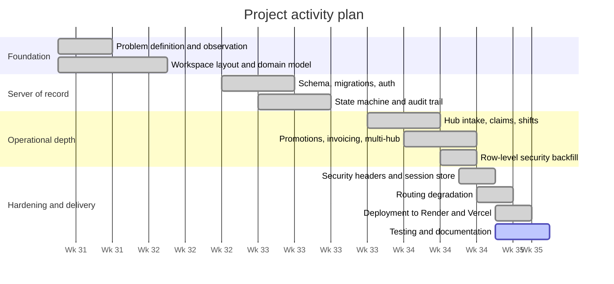

> **Note for submission.** The dates above are the actual commit dates of the
> implementation period. If your department requires the plan to span the full
> academic project timetable — including proposal, literature review and defence
> milestones — extend the chart with those **[dates]**; do not alter the
> implementation phases, since they are verifiable against `git log`.

## 1.11 Definitions and Explanations of Terms

| Term | Meaning in this report |
|---|---|
| **Job** | The canonical server-side record of one piece of work, identified as `FFC-######`. Everything else in the system is a view of a job. |
| **Booking** | The customer's projection of a job: seven friendly stages, a schedule and a payment. |
| **Order** | The courier's projection of the same job: fifteen dispatch states, coordinates, a bag manifest and proof of service. |
| **Stage** | One of the seven states a customer sees — Scheduled, Collecting, In Care, Ironing & Folding, Quality Check, Delivering, Delivered. |
| **Dispatch state** | One of the fifteen finer states the courier and the server use. Many dispatch states map to one stage. |
| **Projection** | A read-only view derived from the canonical record by a pure function, never stored separately. |
| **Leg** | A segment of the round trip: customer to hub (collection), or hub to customer (delivery). |
| **Hub** | The physical laundry premises where garments are washed, pressed and folded. The system supports more than one. |
| **Manifest** | The list of bags on a job, each with its own QR code, derived from the quantity of each service ordered. |
| **Hand-off code** | A four-digit per-job secret, minted once at creation, that gates a change of custody. |
| **Backlog** | Every job still running that no courier currently holds — not merely jobs never assigned. |
| **Desk** | The supervisor's dashboard: the operational console for the shop floor. |
| **Shared kernel** | `packages/core` — the domain package imported as source by all four surfaces, containing no React, React Native, Node or DOM API. |
| **Audit event** | An append-only row naming the actor, the action and the affected order, written by the route that performed the action inside its transaction. |
| **Degradation** | The system's defined behaviour when a paid external service is unavailable — here, a visibly different answer rather than a silently worse one. |

## 1.12 Structure of the Report

- **Chapter 1** states the problem, the aim, the novelty and the seven objectives,
  bounds the study, names its beneficiaries and reports the activity plan against the
  commit record.
- **Chapter 2** reviews five existing systems in detail — their architecture,
  modules, features, underlying models and development environments — assesses the
  good and bad features of each, and derives the conceptual design of the proposed
  system from the gaps they leave.
- **Chapter 3** presents the methodology: the architecture, how requirements were
  elicited, the functional and non-functional requirements, the UML models, the users,
  the security concepts, the process model chosen and why, and the logical UI and
  database designs.
- **Chapter 4** maps that logical design onto the physical platform, describes each
  implemented module, and reports the testing plan, the verification, validation and
  security test results, the recommendations testers made and the responses to them.
- **Chapter 5** states the findings, draws conclusions, records the challenges and
  the lessons learnt, and recommends future work.

---
# Chapter 2: REVIEW OF RELATED SYSTEMS

## 2.1 Introduction

This chapter reviews five existing systems that solve part of the problem stated in
Section 1.2, and derives from their combined shortfall the conceptual design of the
proposed system. The five were chosen to span the problem rather than to fill a
quota: one mature dispatch platform whose engineering is publicly documented, two
operating on-demand laundry services in mature markets, one instructive commercial
failure in exactly this vertical, and the incumbent process that FreshFold actually
competes with in the service area.

| # | System | Why it is reviewed |
|---|---|---|
| 1 | **Uber** | The mature form of the dispatch problem — pooled supply, algorithmic assignment, in-app payment — with an unusually well-documented architecture. |
| 2 | **Laundryheap** | The closest operating analogue: scheduled collection, off-site processing, scheduled return, courier-carried. |
| 3 | **Rinse** | The same vertical solved with route-based windows and a subscription relationship rather than on-demand summoning. |
| 4 | **Washio** | The same vertical, failed. The clearest available evidence about which parts of the model do not close. |
| 5 | **WhatsApp Business + Mobile Money** | The system actually in use in the service area. Any replacement that ignores its advantages loses on contact. |

> **A note on evidence, and what you must add.** Systems 1 and 4 have substantial
> public engineering and press documentation, and the descriptions below draw on it.
> Systems 2 and 3 do **not** publish their internal architecture; their architecture
> subsections describe what is observable from the product surface, the published
> apps and the operating model, and are labelled **(inferred)** wherever that is the
> case. System 5 is described from direct observation of the service area. **For
> submission you must attach citations** — company documentation, engineering blogs
> or press coverage for each named system — and a final-year review is normally
> expected to carry **[10–15 sources]** overall. Where an academic treatment of
> last-mile logistics in West African cities is available, prefer it to a corporate
> source; it will strengthen Section 2.7 considerably.

## 2.2 Review of System 1 — UBER

### 2.2.1 Description of the system

Uber is a ride-hailing and courier dispatch platform that matches a pool of
independent drivers to riders in real time, computes the fare server-side, and
settles payment in-app. It is reviewed here not as a competitor but as the mature
reference implementation of the dispatch problem: a demand side, a supply side, an
operator that sets policy, and a matching engine between them.

#### Architecture of the system

Uber runs a **polyglot service-oriented architecture**, having migrated from an early
monolith to several thousand services. The elements relevant to this project are:

- **A dedicated dispatch service.** The matching engine (publicly described as
  *DISCO*, Dispatch Optimisation) was separated from the monolith and rewritten
  specifically so that supply and demand could be indexed and matched independently
  of the request-handling path.
- **A hierarchical geospatial index.** Uber developed and open-sourced **H3**, a
  hexagonal hierarchical spatial index, to bucket the surface of the earth into cells
  at multiple resolutions. Matching, pricing and supply-positioning all operate over
  cells rather than raw coordinates, which is what makes proximity queries tractable
  at their volume.
- **Sharded, gossip-coordinated stateful services.** Uber open-sourced **Ringpop**
  (application-layer sharding with a gossip membership protocol) and **TChannel** (a
  multiplexing RPC transport) to distribute dispatch state across nodes without a
  central coordinator.
- **An event backbone.** Apache Kafka carries the high-volume event stream — location
  updates, trip state changes — between services and into the analytics estate.
- **Mixed storage.** A schemaless key-value layer built over MySQL for high-write
  trip data, alongside relational stores for financial and identity records.

#### Modules of the system

| Module | Responsibility |
|---|---|
| Rider application | Request, fare estimate, live tracking, rating, receipt |
| Driver application | Availability, offer acceptance, navigation, earnings |
| Supply positioning | Predicts where demand will appear and repositions incentives |
| Dispatch / matching | Assigns a driver to a request within a cell neighbourhood |
| Pricing | Server-side fare computation, including dynamic multipliers |
| Payments | Card and wallet capture, driver payout, receipts |
| Maps and routing | ETA, route geometry, navigation guidance |
| Trust and safety | Identity checks, incident reporting, telemetry-based scoring |

#### Features of the system

Real-time supply visibility on a map; algorithmic assignment with a driver-side
acceptance step; server-computed fares with dynamic multipliers; live ETA against
road geometry; in-app cashless payment; two-sided ratings; trip receipts with a route
trace; and driver telemetry used for both routing and safety scoring.

#### Theories, concepts and models employed

- **Multi-sided platform economics** — the operator sets the rules of a market it
  does not itself supply.
- **Hierarchical spatial indexing** — H3's hexagonal tiling gives uniform neighbour
  distance, which square tiling does not, and is the model underlying proximity
  matching.
- **Bipartite matching under time constraints** — assignment is a matching problem
  solved repeatedly over short windows rather than once globally.
- **Event sourcing and stream processing** — trip state is carried as an event
  stream, which is what makes the same data serve dispatch and analytics.
- **Eventual consistency with a strongly-consistent financial core** — the trip
  stream tolerates lag; the ledger does not.

#### Development tools and development environment

Polyglot by design: **Go** and **Java** for high-throughput backend services,
**Node.js** and **Python** in parts of the estate, **Swift** on iOS and **Kotlin/Java**
on Android. Uber open-sourced **RIBs**, a cross-platform mobile architecture pattern
(Router–Interactor–Builder), to keep the two mobile applications structurally
identical. Infrastructure runs on containerised deployment with Kafka, Cassandra and
MySQL-backed storage, with a large internal CI and monorepo tooling estate.

### 2.2.2 Review of the good features

- **Server-side authority over price.** The fare is never asserted by a client. This
  is the single most directly transferable position, and it is adopted as **NFR-01**.
- **The open-pool-plus-acceptance pattern.** Supply is not command-assigned; a driver
  is offered a job and accepts it. This preserves courier autonomy and produces a
  natural backlog when supply is short. Adopted directly.
- **Road-network routing as the basis of every estimate.** ETAs come from routed
  geometry with live conditions, not from a straight line. Adopted as **O6**.
- **Live position on a shared map.** The single most effective reduction of "where
  is it?" enquiries; the customer stops needing to ask because they can see.
- **Two-sided rating.** Makes reputation an asset on both sides of the transaction.

### 2.2.3 Review of the bad features

- **No custody interval at all.** This is the decisive gap. A passenger is present
  for the whole trip, so there is never a period during which the operator holds the
  customer's property and must account for it. Nothing in the Uber model addresses
  the problem this project exists to solve.
- **Architectural scale is a cost, not only a capability.** Thousands of services,
  gossip-coordinated sharding and a Kafka backbone are proportionate to Uber's volume
  and grossly disproportionate to a single-hub laundry. Reproducing the shape of this
  architecture at this scale would produce operational burden with no benefit.
- **Dynamic pricing is unacceptable in this vertical.** A fare that changes with
  demand is tolerated for a ride and would be read as exploitation for a wash. Price
  stability is a requirement here, not a limitation.
- **Assignment is opaque to the supply side.** A driver cannot see why they were or
  were not offered a job, which is a recurring source of grievance.
- **Assumes dense, addressable geography.** Numbered street addresses and dense
  supply are both assumed; neither holds in the target service area.

### 2.2.4 Summary of the system review

Uber contributes the *shape* of dispatch: pooled supply, offer-and-accept, server
authority over money, and routing as the basis of every temporal claim. It
contributes nothing about custody, because it has none. Its architecture is a
reference for the concerns to separate — matching, pricing, geography, payment — but
not for the number of processes to separate them into.

## 2.3 Review of System 2 — LAUNDRYHEAP

### 2.3.1 Description of the system

Laundryheap is an on-demand laundry and dry-cleaning service operating in a number of
cities across the UK, Europe, the Middle East and North America. The customer books a
collection slot through a mobile application or the website; a courier collects the
bags; the items are processed at a partner or in-house facility; and the items are
returned in a later slot, with a next-day turnaround as the headline promise.

#### Architecture of the system *(inferred)*

Laundryheap does not publish its internal architecture. From the observable product
surface — native applications on both mobile platforms, a responsive booking site, a
courier-facing application and operational scheduling behaviour — the system is
consistent with a conventional three-tier arrangement: mobile and web clients over a
central API, a relational store of record, a courier application receiving assigned
routes, and integrations for card payment and mapping. The slot-based rather than
instantaneous booking model implies a **batch scheduling** component that assigns
collections to courier routes ahead of time, rather than the continuous real-time
matching engine that Uber requires.

> **(Inferred.)** Treat this subsection as a reasoned reading of the product surface,
> not as documented fact. Cite **[company/press source]** for what you can verify and
> mark the remainder as inference in your submission.

#### Modules of the system

| Module | Responsibility |
|---|---|
| Customer application and web booking | Service selection, slot choice, address, payment |
| Slot and capacity scheduling | Offers only collection windows that can be served |
| Courier application | Assigned collections and deliveries for a shift |
| Facility / partner operations | Processing, item counting, turnaround tracking |
| Payments | Card capture and receipting |
| Notifications | Booking confirmation, courier-en-route, completion |

#### Features of the system

Slot-based collection and return; 24-hour turnaround as the service promise; a
per-item and per-bag service catalogue with published prices; courier-en-route
notification; card payment; order history; and a business/hospitality offering
alongside the consumer one.

#### Theories, concepts and models employed

- **Batch scheduling over continuous matching** — capacity is allocated to windows in
  advance, which converts a real-time optimisation problem into a planning one.
- **Hub-and-spoke logistics** — collection and delivery legs converge on a processing
  facility, which is exactly the topology this project models.
- **Service catalogue pricing** — a published rate card rather than a negotiated or
  dynamic price.
- **Third-party capacity aggregation** — using partner facilities converts a capital
  cost into a variable one.

#### Development tools and development environment *(inferred)*

Native or cross-platform mobile applications published to both major app stores, a
responsive web front end, and a hosted cloud backend. The specific languages,
frameworks and hosting are not publicly documented.

### 2.3.2 Review of the good features

- **The window is the unit of capacity, and it is finite.** Offering only slots that
  can actually be served is the correct answer to problem **P6-adjacent** oversell.
  This project adopts it directly as the collection-window capacity limit.
- **A published rate card.** Price is knowable before booking and is the same for
  everyone. Adopted as **O4**.
- **Hub-and-spoke is the right topology for this trade.** Collection and delivery as
  two legs around a processing centre is precisely the model FreshFold implements.
- **Turnaround stated as a promise, not an estimate.** "Back tomorrow" is a
  commitment a customer can plan around, which a live ETA is not.

### 2.3.3 Review of the bad features

- **Stage visibility during processing is thin.** The customer sees collection and
  return; the interval in between — where the garments actually are, and what has
  been done to them — is largely opaque. This is the same **P2** failure as the manual
  process, merely better dressed.
- **No verified custody hand-off at collection.** Bags are handed to a courier on
  appearance. Where verification exists it is at delivery, if at all.
- **Card-on-file payment assumed.** The payment model presumes card penetration that
  does not hold in the target market, where mobile money is the ordinary rail.
- **Addressable street addresses assumed.** Booking flows assume a postcode or a
  numbered address; the service area here is described by landmark and hall name.
- **Partner-facility processing weakens the evidence chain.** When processing is
  subcontracted, the operator cannot attribute a stage to a named person on their own
  floor — which makes the provenance requirement of **O2** structurally harder.

### 2.3.4 Summary of the system review

Laundryheap demonstrates that the round-trip model is commercially viable and
supplies two mechanisms adopted wholesale: **finite, capacity-bounded collection
windows** and a **published catalogue price**. Its shortfall is in exactly the
interval this project treats as central — the custody period is opaque to the
customer and unverified at the point where it begins.

## 2.4 Review of System 3 — RINSE

### 2.4.1 Description of the system

Rinse is a US on-demand laundry and dry-cleaning service. Its distinguishing
operational choice is a **route-based** model: rather than dispatching a courier per
order, it runs recurring evening collection and delivery windows along planned
routes, staffed by its own couriers ("Rinse Valets"), with processing carried out by
partner cleaners. It sells subscription plans alongside pay-per-use.

#### Architecture of the system *(inferred)*

Not publicly documented. The observable behaviour — fixed recurring windows, standing
weekly schedules, and per-route courier assignment — implies a **route-planning and
subscription-management** core rather than a real-time matcher: a scheduler that
builds routes from the standing schedule plus that day's ad-hoc bookings, a
subscription/billing engine, and a courier application that receives an ordered stop
list rather than individual offers.

> **(Inferred.)** As with System 2, cite what you can verify and mark the rest.

#### Modules of the system

| Module | Responsibility |
|---|---|
| Customer application and web | Booking, standing schedule, garment preferences |
| Subscription and billing | Plan management, recurring charge, credits |
| Route planning | Builds ordered stop lists per courier per window |
| Courier application | Stop list, collection and delivery confirmation |
| Partner cleaner integration | Hand-off to and from processing partners |
| Garment preference profile | Per-customer handling instructions retained across orders |

#### Features of the system

Recurring standing pickups; subscription plans with included volume; per-customer
garment preferences retained between orders; text-message notifications tied to
windows; per-item dry-cleaning alongside wash-and-fold; and route-based rather than
per-order dispatch.

#### Theories, concepts and models employed

- **Vehicle routing** — the collection problem is treated as an ordered-stop routing
  problem, which is the natural formulation once density is achieved.
- **Subscription economics** — recurring revenue smooths the demand that makes
  per-order dispatch uneconomic.
- **Customer profile persistence** — preferences as durable state attached to the
  customer rather than to the order.
- **Density-first operations** — routes are only offered where enough demand exists
  to fill them, making density a precondition rather than a hope.

#### Development tools and development environment *(inferred)*

Consumer mobile applications on both platforms plus a web booking surface, over a
hosted cloud backend. Specifics are not publicly documented.

### 2.4.2 Review of the good features

- **Standing orders as a first-class object.** A recurring weekly pickup is modelled
  once and generated from, rather than re-booked each week. This project adopts it
  (`recurring_pickups`, **FR-26**).
- **Subscription plans with included volume.** Adopted as memberships, with included
  pickups consumed before any other reduction applies.
- **Routing the round, not the order.** Batching stops into a route is the correct
  economic answer to the failure that closed System 4, and is the direction this
  project names as future work (Section 5.6).
- **Preferences persist with the customer.** Saved addresses and defaults belong to
  the account, not to each booking. Adopted (**FR-10**).

### 2.4.3 Review of the bad features

- **Windows are rigid.** Route-based scheduling trades customer flexibility for
  density; a customer who misses a window waits for the next one.
- **Custody verification is again absent at collection.** The same gap as System 2.
- **Partner processing again breaks attribution.** A stage confirmed by a partner's
  staff cannot be attributed to a named person the operator is answerable for.
- **Density is a precondition, not an output.** The model works where demand is
  already dense and cannot bootstrap a thin market — which is the market this project
  targets.
- **Subscription-first pricing raises the entry cost.** A student needing one wash is
  a poor fit for a plan-shaped product.

### 2.4.4 Summary of the system review

Rinse supplies the two commercial mechanisms this project adopts — **standing orders**
and **membership plans with included volume** — and demonstrates the routing
direction that dispatch should eventually take. It shares Systems 2's blind spot on
custody, and its density precondition makes it inapplicable as a whole to a thin
market.

## 2.5 Review of System 4 — WASHIO

### 2.5.1 Description of the system

Washio was a US on-demand laundry and dry-cleaning service launched in 2013 and
**ceased operations in 2016**. Its model was the most aggressively on-demand of the
four commercial systems reviewed: a customer summoned a courier — branded a "Ninja" —
who arrived within a short window, collected the bags, and returned them, typically
within 24 hours. It is reviewed precisely because it failed, and because its failure
is the clearest available evidence about which part of this model does not close.

#### Architecture of the system

Not documented in detail, and the company no longer exists to document it. From the
product as it operated, the architecture was an **on-demand dispatch** arrangement
directly analogous to ride-hailing: a customer request created an immediate courier
assignment, with a mobile application on each side and a central service holding the
order. The architectural point of interest is negative — it adopted the *ride-hailing
matching model* for a problem whose economics do not resemble ride-hailing.

#### Modules of the system

| Module | Responsibility |
|---|---|
| Customer application | On-demand request, live courier tracking |
| Courier ("Ninja") application | Assignment, collection, delivery |
| On-demand dispatch | Immediate matching of a courier to a request |
| Partner cleaner network | Processing |
| Payments | Card capture |

#### Features of the system

On-demand summoning with a short arrival window; live courier tracking; card
payment; partner-network processing; and a deliberate service flourish — a cookie
delivered with each order — as a differentiator.

#### Theories, concepts and models employed

- **The on-demand ("Uber for X") transposition** — the assumption that a matching
  model proven in ride-hailing generalises to any physical service.
- **Venture-subsidised demand generation** — pricing below the cost to serve while
  buying density.
- **Asset-light operations** — outsourcing processing to a partner network.

#### Development tools and development environment

Not publicly documented; consumer mobile applications on both platforms over a hosted
backend.

### 2.5.2 Review of the good features

- **The on-demand experience itself was strong.** Summon, track, receive — the
  interaction model was well judged and is not what failed.
- **Asset-light processing was the correct early choice.** Not buying industrial
  laundry capacity before demand exists is right; the error was elsewhere.
- **Live tracking set the customer expectation correctly**, and demonstrated that
  customers will engage with a tracking surface for a non-urgent service.

### 2.5.3 Review of the bad features

- **A courier trip per order does not close economically at low density.** This is
  the decisive lesson. When one courier journey carries one order, the delivery cost
  per order is fixed and high, and no volume of orders reduces it — only *batching*
  does. **This is the single most important finding of the whole review**, and it is
  the direct argument for the capacity-bounded collection window that this project
  implements: a window exists so that one courier trip carries several jobs.
- **Immediacy was sold where it was not valued.** Laundry is not an urgent good. Two
  hours versus tomorrow morning is worth very little to a customer and a great deal to
  the operator's cost base — the service optimised the wrong variable.
- **Subsidised pricing concealed the unit economics** until the subsidy stopped.
- **No custody verification, and no evidence chain** — the same **P2** and **P3**
  failures again.

### 2.5.4 Summary of the system review

Washio is the negative result the other reviews need. It establishes that the
interaction model is not the hard part of this vertical and that **dispatch density
is** — that the design question is not "how fast can a courier arrive" but "how many
jobs can one courier trip carry". Its failure is the origin of this project's
window-capacity mechanism and of the routing-based batching named in Section 5.6.

## 2.6 Review of System 5 — WHATSAPP BUSINESS WITH MOBILE MONEY (the incumbent)

### 2.6.1 Description of the system

This is the system FreshFold actually competes with in the service area, and it must
be reviewed as a system rather than dismissed as an absence of one. A customer
messages the operator on WhatsApp or telephones. The operator quotes a price from
memory, agrees a collection time, and notes the address — in a physical book, in the
chat thread, or not at all. A courier is telephoned and told where to go. Washing,
drying and pressing proceed without any record being created. Progress enquiries are
answered from recollection. Payment is cash at the door or a mobile-money transfer,
reconciled by checking the operator's phone against the day's collections.

#### Architecture of the system

The architecture is **human**, and it is worth stating precisely because that is what
the proposed system replaces:

- **System of record:** the operator's memory, supplemented by a chat thread and
  sometimes a notebook.
- **Message bus:** WhatsApp, one thread per customer, with no relation between
  threads.
- **Dispatch:** a telephone call, synchronous and unrecorded.
- **Payment rail:** MTN / Telecel / AT mobile money, or cash, with reconciliation by
  eye against the handset's transaction list.
- **Persistence:** whatever the chat history retains, on one device.

#### Modules of the system

| Module | Realised as |
|---|---|
| Ordering | A free-text chat message |
| Quoting | The operator's recollection of the rate |
| Scheduling | A verbal agreement in the thread |
| Dispatch | A telephone call to the courier |
| Tracking | Asking the operator, who asks the courier |
| Proof of delivery | None, or a photograph sent into the thread |
| Payment | MoMo transfer or cash |
| Reconciliation | Comparing the phone's transaction list to the day's collections |

#### Features of the system

Free-text ordering in the customer's own words; instant reachability; complete
flexibility of arrangement; no software to install; media (photographs of stains,
of garments) exchangeable in the same thread; and a trust relationship built on
personal acquaintance and physical proximity.

#### Theories, concepts and models employed

- **Relational rather than transactional commerce** — the arrangement is governed by
  a personal relationship, not by a contract or a record.
- **Oral record-keeping** — the authoritative state of an order is held in memory and
  transmitted by speech.
- **Point-to-point messaging as coordination** — no shared state, only pairwise
  conversations.

#### Development tools and development environment

None. Off-the-shelf consumer software (WhatsApp, a mobile-money application) operated
by hand. **This is a real advantage and must be scored as one:** the incumbent has
zero development cost, zero deployment cost and zero onboarding cost.

### 2.6.2 Review of the good features

- **Zero onboarding cost on both sides.** No installation, no registration, no
  training. Every participant already has the software and already knows how to use
  it.
- **Total flexibility.** Any arrangement expressible in a sentence is supportable —
  "leave it with the porter", "the blue bag is delicate", "pay me Friday". No software
  system reviewed here handles the long tail of these as gracefully.
- **Instant, familiar reachability.** A customer with a question gets a person.
- **Trust is pre-existing.** The operator is a known neighbour, which substitutes for
  the verification a stranger-based system needs.
- **It works with no network reliability guarantee**, no smartphone requirement
  beyond WhatsApp, and no electricity beyond a charged phone.

### 2.6.3 Review of the bad features

Every failure of Section 1.2 is a property of this system: no shared record (**P1**),
stages claimed rather than evidenced (**P2**), unverified custody (**P3**), negotiated
price (**P4**), no accountable trail (**P5**), and guessed distances (**P6**). Beyond
those:

- **The operator is a single point of failure.** If they are unavailable, the business
  stops — nothing can be looked up by anyone else.
- **Every status enquiry costs an interruption**, and the answer is unverified.
- **Capacity is unbounded**, so a window is oversold without anyone noticing until a
  courier cannot make the round.
- **It does not survive growth.** The failure mode is not a crash but a steady rise in
  errors as volume increases, which is harder to detect and act on than a crash.

### 2.6.4 Summary of the system review

The incumbent is not a bad system; it is an **unscalable** one with genuine
advantages that a replacement must consciously preserve or consciously trade away.
This review directly shapes two decisions in the proposed design: the website
requires **no installation** so that the onboarding advantage is not conceded
entirely, and the delivery **override** exists so that the long tail of real-world
arrangements ("nobody in, the porter took it") remains expressible rather than being
rejected by a system that only knows the happy path.

## 2.7 Comparative Analysis

**Table 2.1** — Comparative analysis of the five reviewed systems. FreshFold's column
describes the system as implemented and evaluated in Chapters 3 and 4.

| Criterion | 1. Uber | 2. Laundryheap | 3. Rinse | 4. Washio | 5. WhatsApp + MoMo | **FreshFold** |
|---|---|---|---|---|---|---|
| **Custody period** | None | Days, opaque | Days, opaque | Days, opaque | Days, untracked | **Days, tracked and staged** |
| **Shared canonical record** | Yes | Yes | Yes | Yes | **No** | **Yes — one `Job`, no second copy** |
| **Hand-off verified — collection** | N/A | No | No | No | No | **Yes — per-job code** |
| **Hand-off verified — delivery** | N/A | Sometimes | Sometimes | No | No | **Yes — per-job code, device never holds it** |
| **Stage evidence** | N/A | Operator-asserted | Operator-asserted | Operator-asserted | Verbal | **Person-confirmed, or marked unattributed** |
| **Pricing authority** | Server, dynamic | Server, rate card | Server, plans | Server, subsidised | Negotiated | **Server, one rate table** |
| **Payment rails** | Card / wallet | Card | Card / subscription | Card | Cash / MoMo, manual | **MoMo & card via Paystack, plus wallet** |
| **Dispatch model** | Real-time matching | Batched windows | Planned routes | On-demand per order | Telephone call | **Open pool + capacity-bounded windows** |
| **Routing** | Road network | Road network | Road network | Road network | Local knowledge | **Road network, degrades visibly** |
| **Audit of operator actions** | Internal | Internal | Internal | Internal | **None** | **Append-only, per action, attributed** |
| **Works at the door with no network** | Partly | No | No | No | **Yes** | **Yes — code travels to the handset** |
| **Onboarding cost to customer** | App install | App install | App install + plan | App install | **None** | **None for web; app optional** |
| **Fits a thin, non-addressed market** | No | No | No | No | **Yes** | **Yes — landmark addressing, MoMo-first** |

### Gaps identified across the reviewed systems

1. **Custody is under-modelled.** Every commercial system reviewed concentrates on
   assignment, scheduling and routing. The interval during which the operator holds the
   customer's property — and what constitutes evidence during it — is treated as an
   operational matter rather than a modelling one.
2. **Stage progression rarely carries provenance.** Systems advance a status on a
   timer or an unattributed click. *Who is claiming this work was done* is not asked of
   the data model.
3. **Hand-off verification assumes connectivity and working cameras.** Where
   verification exists, the happy path is specified and the fallbacks are left to
   implementers — which produces either a hard block that strands couriers or a bypass
   that voids the mechanism.
4. **Degradation of paid services is under-specified.** The behaviour of a system when
   its routing or payment provider is unavailable is treated as an *availability*
   concern. But a fallback that silently substitutes a worse answer is a
   **correctness** failure, not an availability failure.
5. **The West African setting is absent.** Mobile-money-first payment, descriptive
   rather than numbered addresses, and intermittent data are ordinary conditions here
   and exceptional conditions in every reviewed system except the incumbent.

## 2.8 Conceptual Design of the Proposed Project

The proposed system is designed as a direct answer to the five gaps above. Its
conceptual design rests on one structural decision from which the rest follows:
**there is exactly one record of a job, it lives on the server, and every surface
reads a projection of it.**

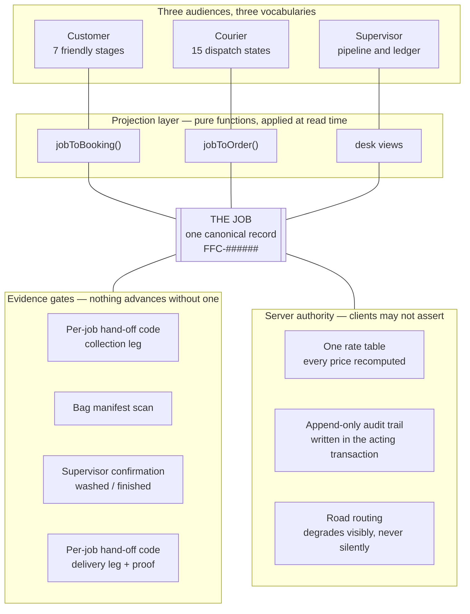

**Figure 2.1** — Conceptual design of the proposed system. The three audiences never
share a vocabulary and never share a copy: they share a *record*, through pure
projections. Everything that changes the record must pass an evidence gate, and
everything the record asserts about money, provenance or distance is computed by the
server.

The design responds to each gap as follows.

| Gap identified | Conceptual response in FreshFold |
|---|---|
| **1. Custody under-modelled** | The custody interval is the spine of the state machine. Fifteen dispatch states exist principally to make the interval between the two doors legible, and both ends of it are gated. |
| **2. No provenance on stage claims** | Every forward transition is attributable. The two hub stages are supervisor confirmations recorded by name; where nobody confirmed, the actor is recorded as `system` with the reason. |
| **3. Verification assumes camera and network** | The code is minted at job creation and delivered to the courier's handset in advance, so a scan verifies offline. A typed fallback covers a failed camera; a written, alerted override covers an absent customer. |
| **4. Degradation under-specified** | The straight-line fallback is drawn *dashed* and every derived arrival time is withheld rather than approximated. The system is designed to look less certain when it is less certain. |
| **5. West African setting absent** | Mobile money is the primary rail via Paystack; addresses are landmark-and-hall descriptive with server-side geocoding; the website requires no installation; and the whole system continues to function against local storage when the server is unreachable. |

Three further conceptual commitments follow from the reviews:

- **From System 4 (Washio):** collection windows carry a **finite capacity**, so that
  one courier trip serves several jobs. A window that cannot be served is closed
  rather than oversold.
- **From System 5 (the incumbent):** the long tail of real arrangements must remain
  expressible. The delivery override is the mechanism — it always succeeds, and it is
  recorded and raised rather than silently permitted.
- **From System 1 (Uber):** supply is offered work, not commanded to it. The courier's
  board is their own jobs plus the open pool, and accepting claims a job *where it
  stands*.

---
# Chapter 3: METHODOLOGY

## 3.1 Introduction

This chapter sets out how the system was designed and developed. It presents the
architecture of the proposed project, the process by which requirements were
elicited, the functional and non-functional requirements themselves, the UML and
data-flow models, the users and their characteristics, the security concepts applied,
the software process model chosen and the argument for choosing it, and the logical
UI and database designs that Chapter 4 maps onto a physical platform.

The requirements in Sections 3.4 and 3.5 are referenced by identifier throughout
Chapters 4 and 5, so that every implemented feature is traceable to a stated
requirement and every requirement is traceable to a test.

## 3.2 The Architecture of the Proposed Project

The system is **four client surfaces, one server of record, one database, and four
external services**. The architectural rule that generates everything else is that
**the server is the only writer**: no client reaches the database, and no client holds
authority over a price, a code or a state transition.

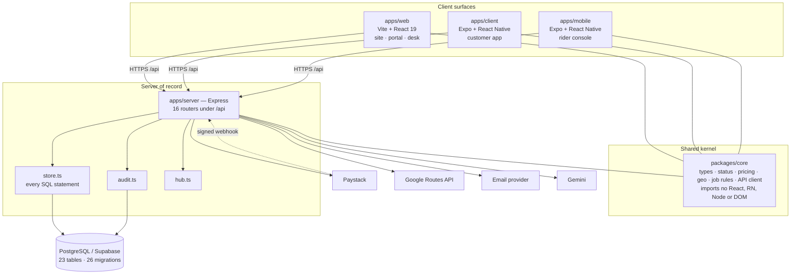

**Figure 3.1** — System architecture. The shared kernel is consumed as TypeScript
source by all four workspaces, so there is no build step between editing shared
domain code and seeing it everywhere, and no version skew between clients. Every
external service is reached **from the server**, which keeps four API keys out of
three client bundles and lets one cached routing answer serve three maps.

### The three architectural tiers

| Tier | Contents | Rule it enforces |
|---|---|---|
| **Presentation** | `apps/web`, `apps/client`, `apps/mobile` | Renders projections. Holds no domain rule and asserts no price, code or transition. |
| **Domain** | `packages/core` | Holds every rule that must be identical everywhere: pricing, the state machine, hand-off verification, geography, projections. Imports no environment API, so it runs in all four runtimes. |
| **Data / service** | `apps/server` + PostgreSQL | The only writer. All SQL is confined to `store.ts`; no route composes SQL of its own. |

### The projection boundary

The website has always called a piece of work a `Booking`; the rider console has
always called it an `Order`. Both names are kept, because both are correct in their
own context. They are **projections of one server-side `Job`**:

```
Booking (customer)  ←── jobToBooking ──  Job  ── jobToOrder ──→  Order (rider)
   7 friendly stages                 canonical record         15 dispatch states
   payment, schedule                                          bags, coords, proof
```

The identifier is shared: `FFC-882049` is the customer's booking reference **and** the
courier's job id, so one number means one thing in a support conversation. Because
the dispatch vocabulary is the finer of the two, the customer's stage is always
derivable from it; the reverse mapping is lossy and is handled explicitly in
Section 4.3.3.

## 3.3 Requirements Elicitation Process of the Proposed Project

Requirements were gathered by four methods, in the order below. The order matters:
the last of them produced the requirements that could not have been obtained by any
of the first three.

**1. Direct observation of the existing manual process.** The process described in
Section 2.6 was observed as it is actually run in the service area — how an order is
taken, how a courier is dispatched, how a status enquiry is answered, how the day is
reconciled. This produced problems **P1–P6** of Section 1.2 and, from them, the bulk
of the functional requirements.

**2. Unstructured interviews with the three actor groups.** Operators, couriers and
customers were asked what goes wrong rather than what they want, on the principle
that a stated want is usually a proposed solution and a stated failure is a
requirement. Several non-functional requirements come directly from this — **NFR-08**
(a hand-off must complete with no network and no working camera) is a courier's
report, not a designer's idea.

**3. Analysis of comparable systems.** The reviews of Chapter 2 supplied requirements
by two routes: features worth adopting (window capacity from System 2, standing
orders and memberships from System 3, open-pool acceptance from System 1) and
failures worth designing against (custody opacity in Systems 2–4, the density
economics that closed System 4).

**4. Iterative elicitation by exercising working builds.** This produced the
requirements that mattered most and that none of the other three methods could have
produced, because they were not knowable until software existed to be used. Three
examples, each of which is now a requirement:

- A delivery route must terminate at the **customer's door**, not at the hub. Nobody
  said this; a build made it obvious.
- The courier's board must be **scoped by courier identity** before more than one job
  can be in flight. With one job the defect is invisible; with two, every courier's
  handset drove the same job.
- The delivery leg needs its **own customer-visible stage**, because a courier riding
  to a door reading as "Quality Check" with the bar stuck at 90 % is a poor thing to
  be told while somebody is outside with your laundry.

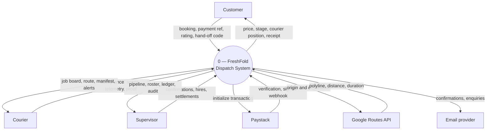

**Figure 3.2** — Context data-flow diagram (Level 0), the boundary the elicited
requirements were written against. Three human terminators and three external
services. Note that the payment flow is bidirectional and includes an *unsolicited
inbound* path — Paystack's signed settlement webhook, the only route that credits a
wallet without a user request.

> **For submission.** If your department requires a documented instrument — a
> questionnaire or interview guide — reproduce it in **Appendix C** with the number of
> respondents and the period, and reference it from this section.

## 3.4 Functional Requirements of the Proposed Project

**Table 3.1** — Functional requirements, with the objective each serves and the actor
it belongs to.

| Ref | Requirement | Actor | Obj. |
|---|---|---|---|
| FR-01 | Register an account, sign in, and sign out | Customer | O1 |
| FR-02 | Browse the service catalogue with prices before booking | Customer | O4 |
| FR-03 | Book one or more services in one order, with quantities, at a chosen collection window | Customer | O1 |
| FR-04 | Be shown the full price, including add-ons, taxes and any discount, before confirming | Customer | O4 |
| FR-05 | Pay by mobile money or card, or from a stored wallet balance | Customer | O4 |
| FR-06 | Track an order through seven stages with a live courier position and arrival time | Customer | O1 |
| FR-07 | Present a hand-off code, as digits and as a QR, at collection and at delivery | Customer | O3 |
| FR-08 | Reschedule or cancel an order within the permitted window | Customer | O1 |
| FR-09 | Rate the courier once an order is delivered, and revise that rating | Customer | O5 |
| FR-10 | Maintain a saved address book and a default address | Customer | O1 |
| FR-11 | Subscribe to a membership plan and see included pickups consumed | Customer | O4 |
| FR-12 | Sign in with an employee identifier and PIN, and be forced to replace a provisional PIN | Courier | O2 |
| FR-13 | See a board of own jobs plus the unheld backlog, and accept or decline from it | Courier | O1 |
| FR-14 | Navigate to pickup, hub and delivery along road geometry | Courier | O6 |
| FR-15 | Scan the customer's collection QR, or type the code, before advancing past arrival | Courier | O3 |
| FR-16 | Scan each bag on the manifest at collection | Courier | O3 |
| FR-17 | Capture a proof photograph and a signature at delivery, or record a written override | Courier | O3 |
| FR-18 | Message dispatch about a job and receive alerts | Courier | O5 |
| FR-19 | Sign in to the desk, with a session shorter than a courier's or a customer's | Supervisor | O5 |
| FR-20 | See every live order and its stage, and move a stage by hand where necessary | Supervisor | O2 |
| FR-21 | Confirm a load washed and a load finished, each attributed by name | Supervisor | O2 |
| FR-22 | Hire a courier — the server issues the employee ID and a one-time PIN — assign a vehicle, and deactivate | Supervisor | O5 |
| FR-23 | Settle, refund and invoice bills; adjust loyalty points; block or remove a patron | Supervisor | O5 |
| FR-24 | Reply into any job's thread as Dispatch, from one inbox | Supervisor | O5 |
| FR-25 | Read an append-only trail of every desk action, newest first | Supervisor | O5 |
| FR-26 | Issue and redeem promotional codes; operate standing orders | Supervisor | O4 |
| FR-27 | Answer customer questions through an AI concierge scoped to the catalogue | System | O1 |

## 3.5 Non-Functional Requirements of the Proposed Project

**Table 3.2** — Non-functional requirements. Each states a criterion that can be
**checked** rather than an aspiration.

| Ref | Attribute | Requirement |
|---|---|---|
| NFR-01 | Correctness | No client may assert a price, a hand-off code, or a payment purpose. The server recomputes or verifies each. |
| NFR-02 | Consistency | A stage changed on any surface reaches the other two within one poll interval — about one second typical, four worst case. |
| NFR-03 | Security | Passwords hashed with scrypt at parameters justified against current OWASP guidance; session tokens stored only as digests. |
| NFR-04 | Security | Every credential route rate-limited per account and per address. |
| NFR-05 | Security | Every read and write of a booking passes one access check: supervisor, owning customer, holding courier, or tracking token. |
| NFR-06 | Security | A strict Content Security Policy, HSTS, and frame denial on the served site. |
| NFR-07 | Availability | The server refuses to open its port without a reachable database, and the health check reports 503 rather than `ok` in that state. |
| NFR-08 | Resilience | A hand-off must be completable with no network and no working camera. |
| NFR-09 | Resilience | Loss of the routing service degrades to a straight line that is drawn dashed and reports no arrival time, never a fabricated one. |
| NFR-10 | Usability | The site meets WCAG 2.2 AA on contrast, focus visibility and keyboard operation; no text below 12 px. |
| NFR-11 | Performance | The marketing page is the entry chunk; portal, desk, booking and map libraries load on demand. |
| NFR-12 | Portability | Domain logic imports no React, React Native, Node or DOM API, so one implementation runs in all four environments. |
| NFR-13 | Maintainability | All SQL lives in one store module; no route composes SQL of its own. Schema changes ship as numbered, once-only migrations. |
| NFR-14 | Auditability | Audit rows are written by the acting route inside its transaction; the table is append-only with no foreign key to orders. |

## 3.6 UML Diagrams

### 3.6.1 Use case diagram for the front-end models

The front-end models are the three human-facing surfaces. The diagram below shows
what each actor can *initiate* from a client.

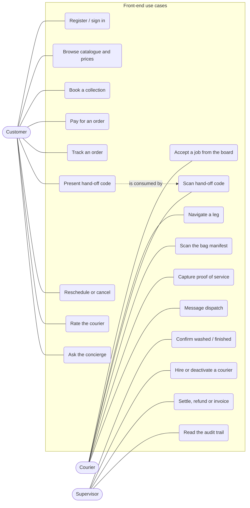

**Figure 3.3** — Use-case diagram for the front-end models. The dotted link records
that the customer's presented code is what the courier's verification consumes; it is
the only use case shared between two actors, and it is the point at which custody
changes hands.

### 3.6.2 Use case diagrams for the back-end models

The back-end model has one human actor group reaching it through an authenticated
API, plus four external system actors. The use cases below are server
responsibilities, not screens — several have no user interface at all.

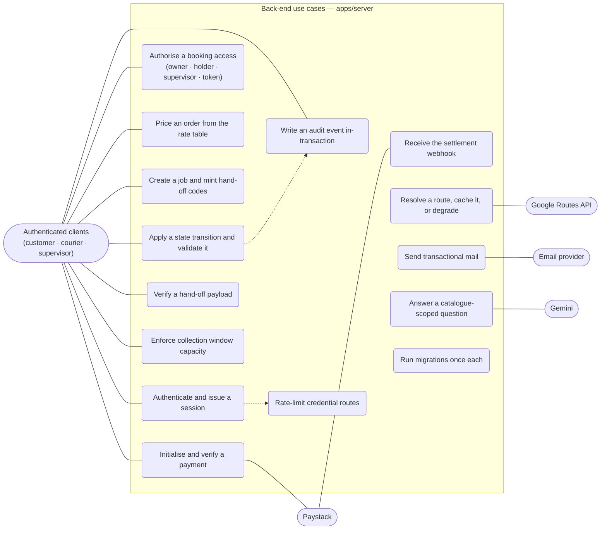

**Figure 3.4** — Use-case diagram for the back-end models. Two dotted dependencies
carry design weight: every credential route passes through the rate limiter
(**NFR-04**), and every state transition that a supervisor causes writes an audit
event inside the same transaction (**NFR-14**). `B10` is the only use case initiated
by an external actor rather than by a client.

## 3.7 Activity Diagrams of the System

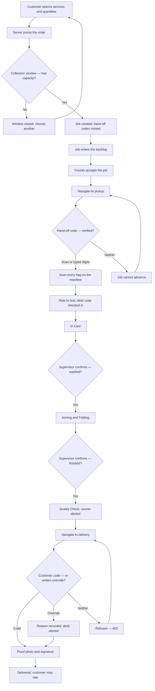

**Figure 3.5** — Activity diagram for the full round trip. **Every decision node is a
point where the system requires evidence.** The two supervisor confirmations replace
what was originally a timer; the override branch exists so a courier is never
stranded by a customer's dead handset — but it is recorded and raised, not silent.

## 3.8 Sequence Diagrams of the System

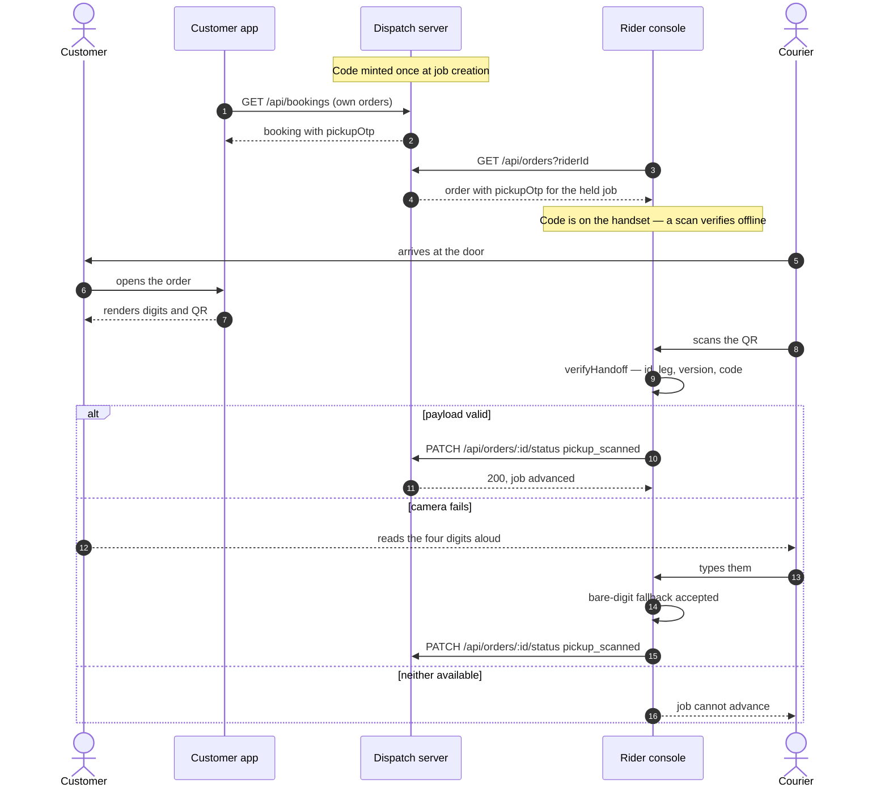

**Figure 3.6** — Collection hand-off verification. The code reaches the handset
**before** the courier arrives, which is what makes verification work in a stairwell
with no signal — the branch that most designs leave to the implementer.

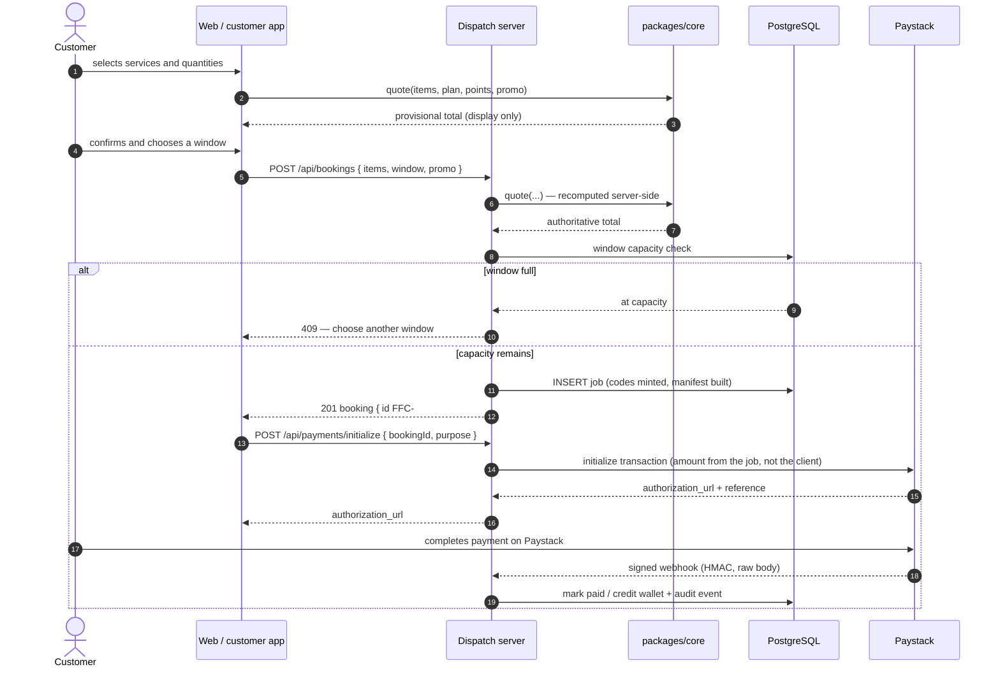

**Figure 3.7** — Booking, pricing and payment. The client's quote is *display only*:
the same `quote()` function runs again on the server and its answer is the one that
is stored and charged (**NFR-01**). The amount sent to Paystack is read from the job,
never from the request body.

## 3.9 Class Diagram of the System

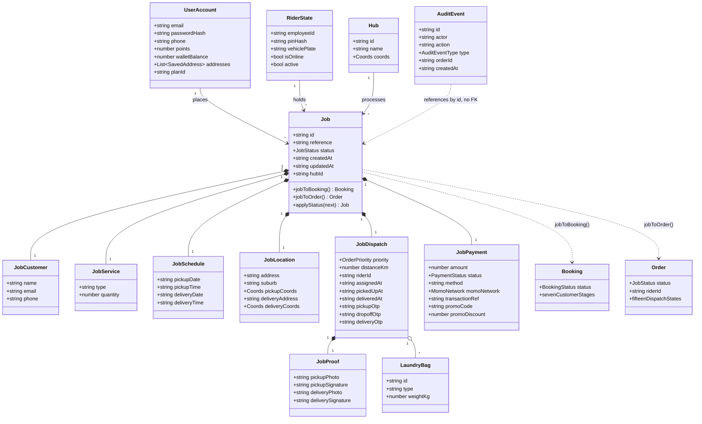

**Figure 3.8** — Class diagram of the domain model, as declared in
`packages/core/src/types.ts`. Three relationships carry the argument of this report:
`Booking` and `Order` are **derived** (dashed dependencies, produced by pure
functions) rather than stored; the six value objects are **composed into** the `Job`
and rewritten as whole objects; and `AuditEvent` references a job **by identifier
with no foreign key**, so that deleting an order cannot delete the record that
somebody deleted it.

## 3.10 Users of the Proposed System

The system has three human user groups and one external-system group. Access is
mutually exclusive: an identity is a customer, a courier or a supervisor, and each
signs in through a different route with a different session lifetime.

### 3.10.1 User characteristics

**Table 3.3** — User characteristics.

| Characteristic | Customer | Courier | Supervisor |
|---|---|---|---|
| **Typical profile** | Student or resident in the service area, 18–35 | Motorbike or bicycle courier, employed by the shop | Shop floor manager or owner |
| **Technical skill** | Everyday smartphone user; no training assumed | Everyday smartphone user; trained on the console in one session | Comfortable with a desktop browser; trained on the desk |
| **Device** | Mid-range Android handset, or any desktop browser | Android handset with GPS and camera; often gloved, often one-handed | Desktop or tablet on the shop counter, frequently shared |
| **Network conditions** | Intermittent; often on mobile data | Poor — stairwells, compounds, moving | Reliable shop Wi-Fi |
| **Frequency of use** | Weekly or fortnightly | Continuous through a shift | Continuous through a shift |
| **How they are provisioned** | Self-registration | **Hired** — the server issues the employee ID and a one-time PIN | Seeded, then created by an existing supervisor |
| **Credential** | Email + password | Employee ID or phone + 4-digit PIN | Email + password |
| **Session lifetime** | One week | One week | **Twelve hours** |
| **What their session can reach** | Own orders, own wallet, own addresses | Own jobs plus the open pool | Every customer's address and phone, every bill, every courier record |
| **Primary design constraint** | No onboarding cost; price known before commitment | Must work with poor signal, a failed camera, and gloves | Must show what needs action and nothing else |

The asymmetry in session lifetime is argued rather than defaulted. A week for the two
credentials that live on a phone, because a courier must not be asked to sign in
again at a doorstep in the rain; but **twelve hours for the desk** — its token reads
every customer's address and phone number, settles any bill and deactivates any
courier, and the browser it sits in is a shared machine on a counter. Twelve hours
covers the longest shift anyone works and expires before the next one starts.

## 3.11 Security Concepts of the System

Seven security concepts are applied. Each is stated as a concept, then as the
mechanism that realises it and the requirement it satisfies.

| # | Concept | Mechanism | Req. |
|---|---|---|---|
| 1 | **Server authority** — a client may not assert what is true | Prices recomputed from the rate table; payment amounts read from the job; hand-off codes verified, never accepted | NFR-01 |
| 2 | **Credential hardening** — resist offline attack on a stolen database | scrypt (memory-hard, RFC 7914) with cost parameters encoded in the hash so old rows verify and upgrade transparently; a missing account costs the same as a wrong password, closing the timing oracle | NFR-03 |
| 3 | **Session confidentiality** — a database disclosure must not hand over live sessions | Session tokens stored only as digests; one token store with a `kind` discriminator so expiry, revocation and parsing are written once | NFR-03 |
| 4 | **Rate limiting** — make credential guessing uneconomic | Per-account and per-address limits on every credential route; nine wrong PINs inside fifteen minutes locks after eight | NFR-04 |
| 5 | **Single authorisation check** — one place to be right | Every read and write of a booking passes one check: supervisor, owning customer, holding courier, or a valid tracking token | NFR-05 |
| 6 | **Defence at the edge** — reduce the browser's attack surface | Strict CSP with no `unsafe-inline` on scripts, `frame-ancestors 'none'`, `object-src 'none'`, nosniff, strict-origin-when-cross-origin referrer, a permissions policy denying camera/microphone/payment to the page, and HSTS for one year including subdomains | NFR-06 |
| 7 | **Custody binding** — a secret must name what it unlocks | The job identifier travels inside the QR payload, so a code cannot be replayed against a different order; the delivery code never reaches the courier's device at all | O3 |

### Custody verification in detail

Every job carries a four-digit `pickupOtp`, minted once by `bookingToJob` from a
CSPRNG and kept for the life of the job, plus a `dropoffOtp` for the hub check-in and
a `deliveryOtp` for the return leg. The customer's application and the website render
the collection code as digits and as a QR; the rider console will not advance past
`arrived_at_pickup` until one of the two checks out.

```
FFH1|FFC-780145|pickup|6056
└─┬┘ └────┬───┘ └──┬─┘ └┬─┘
version  job id   leg   code
```

The job identifier travels inside the payload deliberately. Without it, a courier
holding two jobs on one street could have the wrong customer's code accepted against
the job they are actually on — the **substitution attack**. `verifyHandoff` rejects
any payload whose identifier, leg or version does not match, and accepts bare digits
only as the typed fallback, because cameras fail in the rain and a courier at a door
cannot be blocked by that.

**The delivery leg is deliberately asymmetric.** Its code goes to the customer's
screens only; the rider console never receives it, types what it is told, and the
server decides. Before this it was the constant `7809` for every job in the system —
the courier's application knew it, the "request OTP" button texted it to the
customer, and the error message printed it, while the customer's own screen masked it
to four dots.

### The state machine as a security boundary

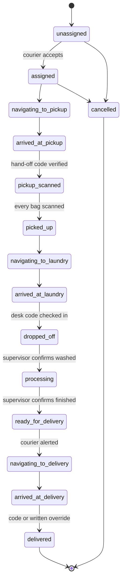

**Figure 3.9** — The dispatch state machine, fifteen states. The three transitions
carrying an **evidence** requirement are the two door hand-offs and the bag scan; the
two carrying an **attribution** requirement are the supervisor's confirmations. The
`status` column in PostgreSQL carries a `check` constraint listing all fifteen, so an
invalid state cannot be written even by a defect in the domain layer.

## 3.12 Project Method Employed

The project used an **incremental and iterative** method with short cycles, closest
in character to Agile practice but adapted for a single developer working with a
supervisor rather than a team with a product owner. The cycle was:

1. **Observe** — exercise the current build end-to-end across all four surfaces
   against one server.
2. **Identify** — name a specific defect or missing capability *in terms of what a
   real person experiences*, not in terms of code.
3. **Locate the single source** — determine where the rule belongs so that it is
   stated once. Repeatedly this meant moving logic into the shared domain package.
4. **Implement and assert** — change the code, and add assertions that fail against
   the old behaviour.
5. **Regress** — run type-checking and the full assertion suite across every
   workspace before committing.

**The method is visible in the repository rather than merely claimed.** Development
proceeded across **76 commits on four branches**, each commit message stating the
behaviour it changes in the user's terms rather than the code it touched — for
example, *"Stop the delivery sheet eating the signature it asked for"*. The assertion
suites act as the regression gate: **815 checks** that must pass before a change is
committed.

> **A note on honesty in the record.** The project keeps a list of known limitations,
> and part of the method was auditing that list — several entries described problems
> that had since been fixed, which understates the system and misdirects anyone
> reading it. Section 1.7 reproduces the list as it actually stands.

## 3.13 Software Process Models Employed and Justification of the Chosen Model

Four candidate models were considered against the conditions of this project: a
single developer, a fixed and short calendar, a supervisor rather than a customer as
the review authority, and — decisively — a set of requirements that were **not
knowable in advance**.

**Table 3.4** — Comparison of candidate software process models.

| Model | Strengths for this project | Why it was not chosen (or was) |
|---|---|---|
| **Waterfall** | Clear documentation gates; easy to schedule and to assess | **Rejected.** Requires requirements to be substantially correct before design begins. The three requirements in Section 3.3 that mattered most emerged only from *running* the software. A sequential model would have frozen a design that was wrong in ways nobody could have foreseen at specification time. |
| **V-Model** | Ties each design level to a test level — attractive given this project's emphasis on a regression gate | **Rejected.** Inherits Waterfall's assumption of stable requirements. Its testing discipline was adopted without its sequencing: every change ships with assertions that fail against the old behaviour. |
| **Spiral** | Explicit risk-driven iteration; would suit the security and payment risks well | **Rejected as a whole.** Its prototyping and formal risk-analysis overhead is proportionate to large, multi-team, high-cost projects. Its central idea — address the riskiest thing first — was adopted informally: payment integrity, custody verification and access control were built and hardened before cosmetic work. |
| **Incremental & iterative (Agile-flavoured)** | Short cycles; working software at every point; requirements admitted as they are discovered; fits a single developer with a reviewer | **Chosen.** See Section 3.14. |

## 3.14 Chosen Model and Justification

**The incremental and iterative model was chosen.** Four properties of this project
made it the correct choice, and the third is decisive.

1. **The system had to be usable at every point in its development.** With four
   surfaces reading one server, the only way to know whether a change is correct is to
   exercise the whole round trip. An incremental model produces a working system after
   every cycle; a phased model produces one at the end, when it is too late for what
   it teaches to change the design.

2. **Requirements were discovered, not collected.** Section 3.3 names three
   requirements that no interview or document study could have produced. A model that
   treats late requirements as *change requests against a baseline* would have
   penalised exactly the activity that produced the project's best decisions.

3. **The most serious defects were only reachable with concurrency, and concurrency
   only appears in a running system.** Almost every serious defect in this project's
   history appeared only with **two jobs in flight**: the courier's board driving the
   wrong job, the hub cycle stamping its own identifier on work nobody had accepted, a
   desk-assigned job held by nobody and hidden from the whole roster. Single-job
   testing was systematically misleading, and single-pass development would have
   shipped every one of these.

4. **A single developer has no coordination cost to amortise.** The ceremony that
   makes formal models valuable in teams — sign-off gates, formal risk reviews,
   inter-team contracts — is pure overhead here. What remains valuable from those
   models is discipline, and discipline was retained in a lighter form: a type gate and
   an assertion gate that must pass before any commit.

**What was retained from the rejected models:** the V-Model's insistence that every
level of design has a matching level of test (realised as the layered suite of
Section 4.4); Spiral's risk-first ordering (payment, custody and access control before
presentation); and Waterfall's documentation discipline (this report, `DEPLOY.md`,
and a stated import constraint on the shared kernel).

## 3.15 Project Design Considerations: Logical Designs

### 3.15.1 UI design (wireframes)

Four surfaces present the same record to three audiences. The wireframes below are
the logical layouts the implementation of Section 4.3.1 realises; they are shown at
low fidelity deliberately, because what matters at design time is what information is
present and what action is possible, not the styling.

**W-1 — Customer: booking modal (web and app).** Price is visible before commitment
and recomputed as quantities change (**FR-04**).

```
┌──────────────────────────────────────────────────┐
│  Schedule a pickup                          [×]  │
├──────────────────────────────────────────────────┤
│  SERVICES                                        │
│   ┌────────────────────────────┬───────┬──────┐  │
│   │ Washing (machine & hand)   │ ₵30   │ [2]▾ │  │
│   │ Ironing & folding          │ ₵25   │ [1]▾ │  │
│   │ Bed sheets & linens        │ ₵45   │ [0]▾ │  │
│   └────────────────────────────┴───────┴──────┘  │
│  COLLECTION WINDOW                               │
│   ( ) 08:00–11:00   ●  11:00–14:00   ( ) FULL    │
│  ADDRESS         [ Unity Hall, Block C     ][▾]  │
│  PROMO CODE      [                    ] [Apply]  │
├──────────────────────────────────────────────────┤
│  Subtotal              ₵85.00                    │
│  Member discount      −₵ 8.50                    │
│  Tax                   ₵ 3.83                    │
│  ─────────────────────────────                   │
│  TOTAL                 ₵80.33                    │
│              [ Cancel ]   [ Confirm & pay ]      │
└──────────────────────────────────────────────────┘
```

**W-2 — Customer: tracking (portal and Track tab).** Seven stages, live position, and
the hand-off code the courier will ask for (**FR-06, FR-07**).

```
┌──────────────────────────────────────────────────┐
│  FFC-882049                        In Care  55%  │
│  ●───────●───────●───────○───────○───────○───────○│
│  Sched  Collect  In Care  Iron   QC   Deliv  Done │
├──────────────────────────────────────────────────┤
│  ┌────────────────────────────────────────────┐  │
│  │            [ live map — courier ]          │  │
│  │   solid line = routed · dashed = fallback  │  │
│  └────────────────────────────────────────────┘  │
│  Kwesi A. · RIDER-004 · Moto GR-2841-22          │
│  Arrives ~ 12 min          (hidden if no route)  │
├──────────────────────────────────────────────────┤
│  YOUR COLLECTION CODE                            │
│        ┌─────────┐                               │
│        │ ▪▫▪▫▪▫▪ │      6 0 5 6                  │
│        │ ▫▪▫▪▫▪▫ │   show at the door            │
│        └─────────┘                               │
│  [ Reschedule ]  [ Cancel ]  [ Message dispatch ]│
└──────────────────────────────────────────────────┘
```

**W-3 — Courier: board and workflow sheet.** The board separates held jobs from the
open pool; the sheet offers exactly the action the current state permits
(**FR-13, FR-15**).

```
┌──────────────────────────────────────────────────┐
│  BOARD                              ● Online [◉] │
├──────────────────────────────────────────────────┤
│  MY JOBS (1)                                     │
│  ┌────────────────────────────────────────────┐  │
│  │ FFC-882049  Unity Hall C     ELITE  5.3 km │  │
│  │ Customer sees: Collecting                  │  │
│  │ ▸ arrived_at_pickup                        │  │
│  └────────────────────────────────────────────┘  │
│  BACKLOG (3)  — unheld, any stage                │
│  ┌────────────────────────────────────────────┐  │
│  │ FFC-882051  Kotei, Ayeduase  STD    2.1 km │  │
│  │                              [ Accept ]    │  │
│  └────────────────────────────────────────────┘  │
├══════════════════════════════════════════════════┤
│  ▲  FFC-882049 · Arrived at pickup               │
│     Ask the customer for their code              │
│     [  Scan QR  ]      [  Type 4 digits  ]       │
│     3 bags to scan after verification            │
└──────────────────────────────────────────────────┘
```

**W-4 — Supervisor: desk.** Eleven panes in four groups, with a badge only where
something needs action (**FR-20 … FR-25**).

```
┌────────────┬─────────────────────────────────────┐
│ FLOOR      │  PIPELINE                    12 live│
│ ▸Pipeline ②│ ┌─────────────────────────────────┐ │
│  Hub      ①│ │ FFC-882049 Unity Hall  In Care  │ │
│  Couriers  │ │   Kwesi A.        [ move stage ▾]│ │
│ PEOPLE     │ ├─────────────────────────────────┤ │
│  Inbox    ③│ │ FFC-882051 Kotei    Scheduled   │ │
│  Claims    │ │   — unassigned —   [ assign   ▾]│ │
│  Patrons   │ └─────────────────────────────────┘ │
│ MONEY      │                                     │
│  Financials│  HUB — awaiting confirmation        │
│  Settlement│   FFC-882044  ▸ Washed?  [Confirm]  │
│  Offers   ①│   recorded as: you, by name         │
│ DESK       │                                     │
│  Audit     │                                     │
│  Settings  │                                     │
└────────────┴─────────────────────────────────────┘
```

**Output design principles applied across all four surfaces:**

- Every claim on a customer-facing surface resolves to a **price, a duration, an
  address or a count** — never to an adjective.
- An arrival time is shown **only** where a road route was computed; the straight-line
  fallback shows the stage instead of a fabricated figure (**NFR-09**).
- WCAG 2.2 AA contrast on real backgrounds, no text below 12 px, no opacity modifiers
  on text, visible focus rings, and a reduced-motion path for every reveal
  (**NFR-10**).
- A badge appears only where something needs the user's **action**; inventory counts
  live in pane headers where they describe the list beneath them, so a quiet rail is
  genuinely quiet.

### 3.15.2 DB design (database schemas)

Records live in PostgreSQL, hosted on Supabase. The schema ships as **26 numbered
migrations** totalling roughly 1,860 lines of SQL; each runs once and is recorded in
`schema_migrations`, so migration is safe to run on every deploy and a dry run lists
what is pending without touching anything. Every statement that touches the database
is in `apps/server/src/store.ts`; no route composes SQL of its own (**NFR-13**).

**Two conventions run through the schema.**

1. **Nested value objects stay JSONB.** A job is six nested groups — customer,
   service, schedule, location, dispatch, payment — and the domain layer reads and
   rewrites them as whole objects. Nothing queries inside them, so shredding them into
   eighty columns would mean reassembling them on every read for no gain.
2. **Promoted columns are generated, never written.** `rider_id` and `customer_email`
   are the two fields routes actually filter on, and both live inside JSONB. Deriving
   them means there is no code path that updates one and forgets the other:

```sql
rider_id       text generated always as (dispatch ->> 'riderId') stored,
customer_email text generated always as (lower(customer ->> 'email')) stored
```

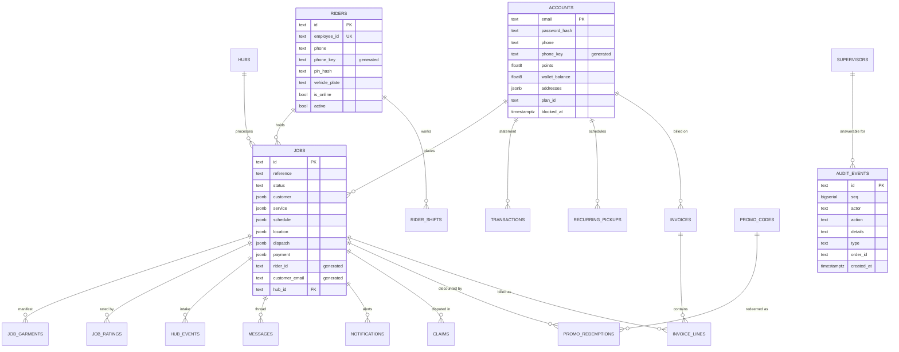

**Figure 3.10** — Entity-relationship diagram of the core schema, with attributes
shown for the four tables the argument of this report turns on. Note that
`audit_events` has **no foreign key** to jobs: deleting an order must not delete the
record that somebody deleted it. Saved addresses are a JSONB array on `accounts`
rather than a table of their own, which is why no such entity appears.

**Table 3.5** — 23 tables across 26 migrations. Later migrations that only alter
existing tables are omitted.

| Migration | Tables introduced |
|---|---|
| Initial schema | `jobs`, `riders`, `accounts`, `supervisors`, `messages`, `notifications`, `transactions`, `sessions` |
| Booking setup links | `booking_setup_tokens` |
| Booking tracking tokens | `booking_tracking_tokens` |
| Audit events | `audit_events` |
| Job ratings | `job_ratings` |
| Hub intake | `job_garments`, `hub_events` |
| Claims | `claims` |
| Rider shifts | `rider_shifts` |
| Promotions | `promo_codes`, `promo_redemptions` |
| Recurring pickups | `recurring_pickups` |
| Invoices | `invoices`, `invoice_lines` |
| Hubs | `hubs` |
| Enquiries | `enquiries` |

**Integrity and security at the data layer:**

- The `status` column carries a `check` constraint listing all fifteen dispatch
  states, so an invalid state cannot be written even by a defect in the domain layer.
- **Row-level security is enabled on every table**, and a dedicated assertion suite
  fails the build if a `create table` lands without a matching `enable row level
  security`.
- Session tokens are stored as **digests**, not values, so a database disclosure does
  not hand over live sessions.
- Numeric telemetry is declared `double precision` rather than `numeric`, because the
  driver returns `numeric` as a string and the domain model holds a JavaScript number
  — declaring `float8` keeps the round trip honest instead of parsing a string back
  into the float it started as.
- The server **refuses to open its port** if the database is unreachable, and the
  health check answers 503 rather than `ok` in that state (**NFR-07**). A health check
  that lies about it is what keeps a broken instance in a load balancer.

---
# Chapter 4: IMPLEMENTATION, TESTING, AND RESULTS

## 4.1 Introduction

This chapter reports the delivered system. It maps the logical design of Chapter 3
onto the physical platform it actually runs on, describes each implemented module and
how the modules integrate, sets out the testing plan and the verification, validation
and security results obtained against it, records the recommendations testers made and
the responses to them, and states the results.

Every file named in this chapter exists in the repository at the path given; Appendix
A lists them. Every figure quoted was measured against the working tree on the date of
writing and can be reproduced with the commands in Section 4.4.

| | |
|---|---|
| **5** | workspaces |
| **≈86,000** | lines of TypeScript / TSX |
| **26** | database migrations |
| **23** | tables |
| **16** | API routers |
| **815** | assertions |
| **0** | failing |

## 4.2 Mapping the Logical Design onto the Physical Platform

The three logical tiers of Section 3.2 map onto physical hosts as follows. The mapping
is deliberately conservative: one server process, one database, and static hosting for
the web client.

| Logical tier | Physical realisation | Host |
|---|---|---|
| Presentation — web | Static Vite build; `/api/*` rewritten to the server origin so the browser sees one origin and no cross-origin preflight on the hot path | **Vercel** |
| Presentation — mobile ×2 | Expo bundles run under Expo Go and as development builds; the dispatch server is discovered by reusing the host of the Expo dev server, so no IP address is configured while everything is on one machine | Courier and customer handsets |
| Domain | `packages/core`, consumed as TypeScript **source** by all four workspaces — no build step, no published version, no skew | Compiled into each client and into the server bundle |
| Data / service | Express bundled by `esbuild` into a single ESM file, run on Node 20 | **Render** (Frankfurt region) |
| Persistence | PostgreSQL reached over TLS with certificate verification enabled | **Supabase** |

**Table 4.1** — Hardware and software platform.

| Context | Hardware | Software |
|---|---|---|
| **Development** | x86-64 workstation, 8 GB RAM minimum, 16 GB comfortable; an Android handset or emulator for the two mobile applications | Node.js 20+; npm workspaces; TypeScript 5.9; Git; Expo Go targeting SDK 54; a PostgreSQL instance |
| **Server** | One container instance, 512 MB RAM sufficient at studied scale | Node.js 20 runtime; PostgreSQL 15+, reachable over TLS with a verified certificate authority |
| **Customer** | Any smartphone or desktop; mid-range Android assumed as the design target | A current browser; optionally the Expo customer application |
| **Courier** | Android handset with GPS and a working camera; a motorbike or bicycle | The rider application; location and camera permissions granted |
| **Supervisor** | Any desktop or tablet on the shop counter | A current browser |
| **External services** | — | Paystack (payments); Google Maps Platform with the Routes API enabled; a transactional email provider; a Gemini API key for the concierge |

### Implementation environment

| Layer | Technology |
|---|---|
| Language | TypeScript 5.9, ES modules throughout |
| Runtime | Node.js 20 |
| Repository | npm workspaces monorepo — `packages/*` and `apps/*` |
| Web | React 19, Vite 6, Tailwind CSS 4, Motion, lucide-react, `@vis.gl/react-google-maps` |
| Mobile | React Native 0.81, Expo SDK 54, expo-router 6, Reanimated 4, react-native-maps |
| Device modules | expo-camera, expo-location, expo-secure-store, expo-local-authentication, expo-haptics |
| Server | Express 4, `postgres` (postgres.js), esbuild for the production bundle |
| Database | PostgreSQL on Supabase; migrations applied by a first-party runner |
| External | Paystack, Google Maps Platform Routes API, Brevo/Resend for email, Google Gemini for the concierge |
| Tooling | `tsx` for running TypeScript directly; `tsc --noEmit` as the type gate; `concurrently` for the dev loop |
| Version control | Git — four branches, 76 commits |

### Installation sequence on a fresh environment

1. `npm install` at the repository root — workspaces resolve the shared kernel by
   symlink.
2. Set `DATABASE_URL` to the project's pooled connection string.
3. `npm run db:migrate -w @freshfold/server` — each migration runs once and is
   recorded; `--dry-run` lists what is pending without touching anything.
4. Set `SEED_SUPERVISOR_PASSWORD`. A fresh production database with this unset
   **refuses to start**, deliberately: the desk account can read every customer's
   address and settle any bill, and it was previously created with the password
   `password` on any deployment that met an empty database.
5. Set the remaining service keys as required — `PAYSTACK_SECRET_KEY`,
   `GOOGLE_MAPS_PLATFORM_KEY`, `GEMINI_API_KEY`, `CORS_ORIGINS`, `APP_URL`.
6. `npm run build && npm start`.

**A fresh installation contains no demo data.** Every order in the system is one
somebody booked, so the courier's board and the supervisor's ledger only ever show
real work, and all four surfaces open on empty states until something is booked. In
production exactly one identity is seeded — the first supervisor — because somebody
has to be able to sign in and put the first courier on the roster.

## 4.3 System Modules Implementation

### 4.3.1 UI modules

**The website — `apps/web` (71 files, ≈24,200 lines).** A single-page application
with four routes: the marketing landing, the client portal, the supervisor desk, and
the payment return. The landing is the entry chunk; the portal, desk, booking modal
and map libraries are fetched on demand (**NFR-11**), so a visitor who never opens the
desk never downloads it. Principal components include the booking modal, the live
dispatch map, the hand-off code display, the reschedule drawer and the concierge
widget.

The supervisor desk is organised as **eleven panes grouped by when a supervisor
reaches for them** — *Floor* (Pipeline, Hub, Couriers), *People* (Inbox, Claims,
Patrons), *Money* (Financials, Settlement, Offers), and *Desk* (Audit, Settings). The
rail carries a badge only where something needs the supervisor's action — an
unassigned order, a load awaiting confirmation, a customer awaiting a reply, an
unsettled bill.

**The customer application — `apps/client` (60 files, ≈21,700 lines).** Five tabs —
Home, Book, Track, Wallet, Account — with stack screens for a single order, plans,
standing orders, the concierge, settings and the payment return. Available in English,
Spanish and French, with **per-key fallback** so a missing translation shows the
English string on that one label rather than dropping the language.

**The rider console — `apps/mobile` (38 files, ≈9,300 lines).** Five tabs — Board,
Assignments, Map, History, Profile — plus authentication, forced PIN change and the
dispatch thread. The workflow is driven from a bottom sheet that presents **exactly
the action the current dispatch state permits**. Job cards and the active workflow
both carry a *Customer sees:* pill derived through the same projection the customer's
timeline uses, so a courier always knows what the customer is being told.

### 4.3.2 Database module

All persistence is implemented in `apps/server/src/store.ts`, which holds **every SQL
statement in the system**; no route composes SQL of its own (**NFR-13**). Schema
changes ship as the 26 numbered migrations of Table 3.5, applied by a first-party
runner that records each in `schema_migrations` and supports a dry run.

The two schema conventions of Section 3.15.2 — JSONB for nested value objects,
generated columns for the two promoted fields — are realised exactly as designed. The
integrity mechanisms listed there (the fifteen-state `check` constraint, row-level
security on every table with a build-failing assertion, digest-only session storage,
`float8` telemetry, and the refusal to open a port without a database) are all in
place and are covered by the assertion suites of Section 4.4.3.

### 4.3.3 Domain module — the shared kernel

`packages/core` (36 files, ≈11,500 lines) exports twenty-two modules and imports
nothing from React, React Native, Node or the DOM — the constraint that lets the same
code run in all four environments (**NFR-12**). Its header states the rule explicitly
so a future contributor meets it before adding an import that would break it.

#### The projection functions

The dispatch-to-stage mapping is a **total record** over the fifteen states, so adding
a dispatch state without deciding what the customer should be told is a *type error*
rather than a runtime surprise:

```ts
const TO_BOOKING_STATUS: Record<JobStatus, BookingStatus> = {
  unassigned: 'Scheduled',
  assigned: 'Scheduled',
  navigating_to_pickup: 'Collecting',
  /* … six collection states … */
  dropped_off: 'In Care',
  processing: 'Ironing & Folding',
  ready_for_delivery: 'Quality Check',
  navigating_to_delivery: 'Delivering',
  arrived_at_delivery: 'Delivering',
  delivered: 'Delivered',
  cancelled: 'Cancelled',
};
```

**Table 4.2** — The projection from dispatch state to customer stage. Many-to-one by
design: a customer does not need to distinguish "arrived at pickup" from "bags
scanned", only that collection is under way.

| Dispatch state (courier and server) | Customer stage | Bar |
|---|---|---|
| `unassigned`, `assigned` | Scheduled | 10 % |
| `navigating_to_pickup` … `arrived_at_laundry` *(six states)* | Collecting | 30 % |
| `dropped_off` | In Care | 55 % |
| `processing` | Ironing & Folding | 70 % |
| `ready_for_delivery` | Quality Check | 82 % |
| `navigating_to_delivery`, `arrived_at_delivery` | Delivering | 93 % |
| `delivered` | Delivered | 100 % |
| `cancelled` | Cancelled | — |

**The reverse mapping is lossy, and says so.** When a supervisor nudges a stage by
hand, `fromBookingStatus` picks the **earliest** dispatch state in the target stage
rather than claiming work that has not happened. Moving a booking to "In Care" must
not silently assert that the pressing is done.

#### Evidence and attribution

The two hub stages originally advanced **on a timer**: two minutes each, and each
expiry fired the real customer message and the real timeline entry — "Your laundry is
being pressed", on the evidence that a number had passed. Nothing anywhere recorded
that a garment had been washed, because nothing knew.

Both are now **supervisor confirmations, attributed by name** in the audit trail. The
timed sweep survives only as a development convenience, and three properties make it
safe: it lives on the server rather than on a courier's handset, so progress is not a
property of one device being awake; it is off in production unless explicitly
configured; and every advance it makes is filed against `system` with the dwell that
expired and the plain admission that nobody confirmed the work. The answer to "who
said this load was washed" is therefore always either a supervisor's name or
**nobody**.

#### Pricing

Before this module existed, the price of an order had no single home: the website's
booking modal carried a cascade of substring tests on the service name; the customer
application carried a parallel table whose own comment said it "reproduces the
website's arithmetic exactly"; and the server carried none at all, reading `amount`
off the request body — so the price of a wash was whatever the client claimed, and a
booking could arrive at ₵0. The two client copies had already drifted.

**Table 4.3** — The service catalogue, priced once in `packages/core/src/services.ts`.

| Service | Unit | Price |
|---|---|---|
| Washing (machine & hand wash) | load | ₵30 |
| Gentle air drying | load | included |
| Ironing & folding | order | ₵25 |
| Advanced stain removal | order | ₵25 |
| Bed sheets & linens care | set | ₵45 |
| Express same-day laundry | order | ₵50 |
| Fast pickup & delivery | order | free |
| Sofa & carpet cleaning | unit | ₵90 |
| Bespoke car detailing | ride | ₵150 |
| Home & office cleaning | space | ₵180 |
| Corporate contracts | contract | quoted |

```
quote(items, plan, points, promo):
    base     ← Σ over items of  service(item).price × item.quantity
    finish   ← surcharge for the chosen scent, where the service takes one
    subtotal ← base + finish
    // three reductions, which do NOT compound
    member   ← membershipBookingQuote(plan, subtotal)   // included pickups first
    tier     ← discount for tierForPoints(points)
    code     ← promotional reduction, validated server-side
    reduction ← max(member, tier, code)                 // not the sum
    taxed    ← taxOn(subtotal − reduction, DEFAULT_TAX_RATES)
    return roundCedis(subtotal − reduction + taxed)
```

The three reductions are **deliberately not additive**. A membership discount, a
loyalty tier discount and a promotional code applied together would produce a total
below cost, and the arithmetic producing it would be invisible on the receipt.

**Collection windows carry a capacity.** Until this existed the slots were a display
list with no server-side referent, so every customer could book the same 08:00–11:00
window and the eleventh was accepted exactly like the first. A window that cannot be
served is worse than one that is closed, because the customer is told a courier is
coming.

#### Routing and degradation

`GET /api/directions` asks the Routes API for the geometry a scooter would actually
ride and returns it decoded with a traffic-aware duration. It lives on the server for
three reasons: the key stays out of all three client bundles; one answer is shared by
the courier's console, the customer's tracking map and the supervisor's dashboard; and
repeats are cached — coordinates round to about eleven metres, so a courier polling
every four seconds does not bill a request every four seconds. Re-routing is
deliberately lazy: a new route only when the destination changes or the courier has
strayed 80 m from the road they were given, at most once every 20 seconds. That is
roughly **four to six billed calls per job**.

**The degradation is the design.** With no key configured, no quota left or Google
unreachable, the response is the straight line marked `source: 'straight'`, the maps
draw it **dashed** rather than pretending it is a route, and `routeEtaMinutes()`
returns `null` — so no surface shows an arrival time at all. Every one of them used
to show the chord between two points divided by an assumed 18 km/h, which is where
the 60 % understatement of Section 1.2 came from. There is no stored duration on a job
any more, only the distance, which is a real measurement.

#### Courier provisioning

A courier does not sign up; they are **hired**. The server assigns the employee
identifier — the next free `RIDER-###` — because it is what the courier signs in with,
so a typo is a courier locked out on their first morning and two supervisors hiring the
same morning would collide. The server also generates the PIN and shows it once: a
credential a supervisor chose is one they can guess later, and under time pressure the
choice is always `1234`. It is hashed immediately, expires in 48 hours if unused, and
first sign-in forces a replacement. Leaving flips `active: false` rather than deleting,
which would orphan every job the courier carried; the flag blocks new logins **and**
live tokens, since the roster is checked on every request.

### 4.3.4 API module

`apps/server` (46 files, ≈19,700 lines) exposes **sixteen routers** under `/api`:

| | | | |
|---|---|---|---|
| `accounts` | `admin` | `auth` | `bookings` |
| `claims` | `contact` | `directions` | `hubs` |
| `integrations` | `invoices` | `messaging` | `orders` |
| `places` | `promotions` | `recurring` | `riders` |

Three cross-cutting modules sit beneath them: `auth.ts` (one token store for all three
audiences, with a `kind` discriminator so expiry sweeping, revocation and bearer
parsing are written once), `booking-access.ts` (the single access check of **NFR-05**),
and `audit.ts` (the append-only trail).

**Authentication.** Passwords are hashed with scrypt **asynchronously** — the
synchronous variant occupies the event loop for the whole derivation, which on a
public registration endpoint is an unbounded way to hold it. The cost parameters travel
with the hash (`scrypt$cost$r$p$hex`), so an old row still verifies and is transparently
upgraded on next sign-in. A missing account costs the same as a wrong password, closing
the timing oracle that would otherwise enumerate the customer directory.

**The audit trail.** Entries are written by the route that performs the action, inside
the same transaction where the action has one: a rolled-back change leaves no trail, and
a committed one always has one. The table is append-only and nothing prunes it. This
replaced a log the desk kept in its own `localStorage` — capped at fifty entries by an
array slice, visible only to the browser that made it, erased by clearing site data, and
keyed on four random digits, which collide. A colleague could not see what you had
changed, which is the one thing an audit trail is for.

Two absences are deliberate. A courier's stage advance is not recorded, because it is
already on the customer's timeline with the hand-off code and proof photograph
attached, and twenty routine taps per job would bury the overrides this pane exists to
show. And the reset route writes nothing, because it truncates the table it would write
to — and refuses to run in production anyway.

### 4.3.5 External integration modules

| Integration | Implementation | Integrity mechanism |
|---|---|---|
| **Paystack** | Checkout initialisation and verification; settlement webhook | A wallet top-up carries a **reference, never an amount**: the server verifies the reference and credits what was actually collected. The webhook is HMAC-signed with the secret key and read as **raw bytes** before any JSON middleware can reshape them. A payment declares exactly one purpose. |
| **Google Routes API** | `GET /api/directions`, server-side only | Coordinate-rounded cache; lazy re-routing; explicit `source: 'straight'` fallback |
| **Email provider** | Booking confirmations, verification, password reset, enquiries | Transactional only; sender verified with the provider |
| **Gemini** | The concierge, scoped to the service catalogue | Server-side key; catalogue-scoped prompt so it cannot quote a price the rate table does not hold |

## 4.4 System Modules Integration

The modules integrate along three seams, and each seam is the subject of a different
kind of test.

| Seam | What crosses it | How it is guaranteed |
|---|---|---|
| **Client ↔ shared kernel** | Types, pricing, projections, hand-off verification | Compile-time. The kernel is consumed as source, so a mismatch is a type error in all four workspaces at once, not a runtime surprise in one. |
| **Client ↔ server** | JSON over HTTPS, one API client in `packages/core/src/client.ts` | The same client module is used by all four surfaces, so a route signature has exactly one caller shape. Polling every 4–5 s carries state changes between surfaces (**NFR-02**). |
| **Server ↔ external services** | Payment, routing, mail, LLM | Verified rather than trusted: HMAC on the webhook, reference-not-amount on top-ups, explicit degradation on routing. |

### 4.4.1 Testing

Testing has two layers: **static type-checking across every workspace**, and
**assertion suites over the pure functions that carry the money and the dispatch
rules**. The suites are plain scripts that compare values, print a line each and exit
non-zero on any failure.

> **Why the type gate runs twice.** Both production builds run `tsc --noEmit` before
> emitting anything, which is **not** redundant with the lint step: Vite and esbuild
> both strip types without checking them, so a type error can otherwise produce a clean
> build and a runtime crash. It has done exactly that at least once in this project's
> history.

Plain assertion scripts were chosen over a test framework deliberately. For the pure
functions that carry the money and the dispatch rules, comparing values and exiting
non-zero is sufficient and is less machinery than a framework would introduce. The
limitation is acknowledged in Section 1.7: it does not extend naturally to route-level
or interface testing.

### 4.4.2 Testing plan

**Table 4.4** — Testing plan. Each level names what it covers, how it is run, and the
gate it enforces.

| Level | Scope | Method | Gate | Run by |
|---|---|---|---|---|
| **L1 — Static verification** | All five workspaces | `tsc --noEmit`; type-checks again inside both production builds | No build emits with a type error | `npm run lint --workspaces` |
| **L2 — Unit** | Shared kernel: pricing, tax, loyalty, membership, dates, addresses, phone/email, rescheduling, promotions, hand-off code shape, manifest | Assertion scripts over pure functions | 544 assertions must pass | `npm run check -w @freshfold/core` |
| **L3 — Integration** | Server: schema/RLS coverage, database TLS, rate limiters, upload gates, security headers, password hashing, session digests, payment purposes, checkout origins | Assertion scripts against the modules and the schema | 212 assertions must pass | `npm run check -w @freshfold/server` |
| **L4 — Client integration** | Mobile: secure credential storage, board assignment, bag scanner. Client: secrets, checkout | Assertion scripts | 32 + 27 assertions must pass | `npm run check -w @freshfold/mobile`, `-w @freshfold/client` |
| **L5 — System / acceptance** | The full round trip across all four surfaces against one server | Manual, scripted scenarios (Table 4.6) | All scenarios pass before a release | Developer plus courier/customer testers |
| **L6 — Security** | Custody binding, payment purpose, credential guessing, checkout redirection, header policy | Assertion scripts, several written **as the exploit that was actually performed** (Table 4.7) | All must pass | Included in L2–L4 |

The whole plan runs as one command:

```bash
npm test
```

which type-checks every workspace and then runs every assertion suite.

### 4.4.3 Verification testing

Verification asks **"was the system built right?"** — does the implementation match the
specification of Chapter 3. It is answered by levels L1–L4.

**L1 result:** `tsc --noEmit` passes across all five workspaces with **no errors**
(exit code 0).

**L2–L4 result:**

**Table 4.5** — Assertion suite results, measured on the working tree at the time of
writing.

| Workspace | Suites | Groups | Assertions | Failed | Result |
|---|---|---|---|---|---|
| `@freshfold/core` | 10 | 67 | 544 | 0 | **Pass** |
| `@freshfold/server` | 9 | 48 | 212 | 0 | **Pass** |
| `@freshfold/mobile` | 3 | 3 | 32 | 0 | **Pass** |
| `@freshfold/client` | 2 | 5 | 27 | 0 | **Pass** |
| **Total** | **24** | **123** | **815** | **0** | **Pass** |

- **Unit (544 assertions, shared kernel)** cover pricing and the list price, membership
  quotes and plan switching, loyalty tiers and rewards, tax composition, calendar dates
  and collection windows, the address book, phone and email rules, rescheduling and
  cancellation, promotional codes and referrals, standing orders, hand-off code
  generation and shape, and the bag manifest.
- **Integration (212 assertions, server)** cover row-level security coverage across the
  schema, database TLS certificate verification, the rate limiters and their memory
  bounds, upload size and type gates on three routes, security headers and their
  agreement with the deployed CSP, password hashing and hash upgrade, session digest
  storage, and the payment purpose gates.
- **Client integration (59 assertions)** cover secure credential storage on both
  handsets, job assignment on the courier's board, the bag scanner, and the checkout
  return-origin allow-list.

### 4.4.4 Validation testing

Validation asks **"was the right system built?"** — does the delivered system do what
the requirements of Sections 3.4 and 3.5 said a user needs. It is answered by level L5,
the manual round trip across all four surfaces against one server.

**Table 4.6** — Validation test cases and outcomes.

| ID | Scenario | Requirement | Expected | Actual | Result |
|---|---|---|---|---|---|
| V-01 | Book on the website, then open the rider console | FR-03, FR-13 | Job appears in the backlog carrying a pickup pin, a bag manifest, a priority and a road distance | As expected | **Pass** |
| V-02 | Book in the customer app instead | FR-03 | Identical job, same `FFC-` identifier semantics, visible on the same board | As expected | **Pass** |
| V-03 | Move a stage from the desk | FR-20, NFR-02 | Change visible on both handsets within one poll | ≈1 s typical, 4 s worst | **Pass** |
| V-04 | Courier accepts a job already in `picked_up` from the backlog | FR-13 | Job is claimed **where it stands**, not rewound to Scheduled | Claimed in place | **Pass** |
| V-05 | Two jobs in flight, two couriers | FR-13 | Each console drives only its own job | Correct after board scoping (see 4.4.7) | **Pass** |
| V-06 | Complete the full round trip, booking to rating | FR-01…FR-09 | Seven customer stages advance in order; delivery proof recorded | As expected | **Pass** |
| V-07 | Supervisor confirms *washed* and *finished* | FR-21, O2 | Both recorded in the audit trail attributed by name | Attributed | **Pass** |
| V-08 | Thirteenth booking into a twelve-capacity window | FR-03 | Window reported full and refused | Refused | **Pass** |
| V-09 | Booking with membership, loyalty tier and promo code all applicable | FR-04, NFR-01 | Largest single reduction applied, not the sum | Largest applied | **Pass** |
| V-10 | Customer signs at the door in the customer app | FR-07 | Signature lands as the job's delivery proof | As expected | **Pass** |
| V-11 | Complete a delivery with no code and no reason | FR-17, O3 | Refused, 403 | 403 | **Pass** |
| V-12 | Complete a delivery with a one-word override reason | FR-17 | Refused, 400 | 400 | **Pass** |
| V-13 | Complete a delivery with a written override | FR-17 | Succeeds; recorded on the job, raised to the desk, narrated to the customer | As expected | **Pass** |
| V-14 | Unset the routing key and open all three maps | NFR-09, O6 | Dashed line on every map; **no** arrival time anywhere | As expected | **Pass** |
| V-15 | Stop the server and use all three clients | — | All surfaces fall back to local storage and continue | As expected | **Pass** |
| V-16 | Hire a courier from the desk | FR-22 | Server issues `RIDER-###` and a one-time PIN, shown once; first sign-in forces replacement | As expected | **Pass** |
| V-17 | Switch the customer app to Spanish, then French | — | Full key coverage; any missing key falls back per-key to English | As expected | **Pass** |

### 4.4.5 System security testing

Security testing is the part of the suite written most directly from adversarial
intent. Several of these assertions encode **the exploit as it was actually performed
against an earlier build**, so the regression is guarded by the attack rather than by
a description of it.

**Table 4.7** — Security test cases and outcomes.

| ID | Attack / condition | Control | Expected | Actual | Result |
|---|---|---|---|---|---|
| S-01 | Hand-off QR whose job id differs from the job in hand (substitution attack) | Job id bound into the payload | Rejected | Rejected | **Pass** |
| S-02 | Hand-off QR with a valid code but the wrong leg | Leg bound into the payload | Rejected | Rejected | **Pass** |
| S-03 | Hand-off QR with an unknown version prefix | Version bound into the payload | Rejected | Rejected | **Pass** |
| S-04 | Bare four digits typed at the door | Typed fallback (NFR-08) | Accepted as fallback | Accepted | **Pass** |
| S-05 | Nine wrong PINs against one employee ID inside 15 minutes | Per-account rate limit | Locked after eight | Ninth refused | **Pass** |
| S-06 | Payment metadata readable as two purposes | Single-purpose gate | Refused with a reason; nothing reaches Paystack | Refused | **Pass** |
| S-07 | Top-up claiming its own amount | Reference-not-amount | Amount taken from the verified reference | As expected | **Pass** |
| S-08 | Raw client-supplied metadata object at checkout | Purpose gate | Refused, with a reason the client can route on | Refused | **Pass** |
| S-09 | Purpose smuggled through the display field | Field isolation | Display cannot change the purpose or name a booking | Refused | **Pass** |
| S-10 | Checkout callback pointing at a lookalike subdomain | Return-origin allow-list | Refused; nothing reaches Paystack | Refused | **Pass** |
| S-11 | Checkout callback using `javascript:`, `data:` or `file:` | Scheme allow-list | Refused | Refused | **Pass** |
| S-12 | Checkout callback to another port on our own host | Origin allow-list | Refused | Refused | **Pass** |
| S-13 | Production environment with no `CORS_ORIGINS` | Environment policy | Never allows an arbitrary origin; Expo Go not trusted in production | As expected | **Pass** |
| S-14 | `create table` landing without row-level security | Schema assertion | Build fails | Build fails | **Pass** |
| S-15 | Deployed CSP drifting from the server's own headers | Header assertion | Build fails | Build fails | **Pass** |
| S-16 | Database unreachable | Startup and health check | Port not opened; health check answers 503, not `ok` | As expected | **Pass** |
| S-17 | Timing difference between a missing account and a wrong password | Constant-cost path | No usable oracle | As expected | **Pass** |
| S-18 | Old scrypt hash with lower cost parameters | Encoded parameters | Verifies, then upgrades transparently on sign-in | As expected | **Pass** |

**What is not covered.** The suites deliberately cover the pure-function core rather
than the routes or the screens. There is no end-to-end browser automation, no load
testing, no penetration test by a third party, and no formal usability study.
Section 1.7 records this as a limitation rather than a choice that needs no defence.

### 4.4.6 Recommendations made by testers

Level L5 was exercised by the developer and by **[the couriers, customers and shop
staff named in the Acknowledgement]**, working the round trip on real handsets in the
service area. Their reports are reproduced below in the terms they were given, because
the phrasing is the finding: each is a description of an *experience*, not of a defect
in code, and several named problems that no assertion suite could have detected.

**Table 4.8** — Tester recommendations, and the responses made. Every response is
traceable to a commit in the repository.

| # | Recommendation, as reported | Reported by | Severity |
|---|---|---|---|
| R-01 | "It says *Quality Check* while the rider is outside my door with my clothes, and the bar is stuck at 90 %." | Customer | High |
| R-02 | "Two of us were sent to the same job, and my phone was driving his order." | Courier | **Critical** |
| R-03 | "The app told the customer their laundry was being pressed. Nobody had pressed it. It just happened after a while." | Supervisor | **Critical** |
| R-04 | "The delivery code is the same four digits every time — the rider's phone already knows it before they arrive." | Courier | **Critical** |
| R-05 | "The route line goes straight through Unity Hall. And the arrival time is never right." | Courier | High |
| R-06 | "The navigation ends at the shop, not at my house, on the way back." | Customer | High |
| R-07 | "Nobody was home. The porter took the bags. The app would not let me finish, so I was standing there holding them." | Courier | High |
| R-08 | "On a big order the bag list runs off the bottom and I cannot reach the last ones." | Courier | Medium |
| R-09 | "I could not see what my colleague had changed on an order — the log only shows what I did on this computer." | Supervisor | High |
| R-10 | "It said *no connection* when the server was only waking up. I thought the app was broken." | Customer | Medium |
| R-11 | "The pay button did nothing — it was blocked before the checkout even opened." | Customer | High |
| R-12 | "Everyone can book the eight o'clock window. We cannot serve eleven collections in one window." | Supervisor | High |
| R-13 | "The signature screen lost the signature it had just asked me for." | Courier | Medium |

### 4.4.7 Responses to recommendations from testing

Each recommendation was answered by a change to the system rather than by
documentation, and each change ships with assertions that fail against the old
behaviour. Several of these responses are the origin of design positions this report
argues for in Chapter 1 — that is, **the novelty of Section 1.4 is in substantial part
a response to this table**, not a plan the testers confirmed.

| # | Response | Where it landed | Verified by |
|---|---|---|---|
| R-01 | **Delivering promoted to its own customer stage**, between Quality Check and Delivered, with the bar at 93 %. A courier riding to a door no longer reads as a laboratory step. | `packages/core/src/status.ts` — Table 4.2 | L2 unit + V-06 |
| R-02 | `Order` given a `riderId`; the board redefined as *own jobs plus everything still running that nobody holds*; the workflow sheet bound to the courier's own job rather than the first non-`unassigned` one; accepting a job **claims it where it stands**. | `packages/core/src/types.ts`, `apps/mobile` | L4 (`workload.check.ts`) + V-04, V-05 |
| R-03 | **The two timed hub stages replaced by supervisor confirmations, attributed by name.** The timer survives only as a development sweep, off in production, filing against `system` with an explicit admission that nobody confirmed the work. | `apps/server/src/hub.ts`, `audit.ts` | V-07 |
| R-04 | **Per-job `deliveryOtp`**, minted from a CSPRNG, delivered to the customer's screens only. The rider console never receives it: it types what it is told and the server decides. The job id, leg and version are bound into the QR payload. | `packages/core/src/job.ts` (`verifyHandoff`) | S-01, S-02, S-03 |
| R-05 | **Google Routes API**, called server-side, returning real road geometry with a traffic-aware duration; coordinate-rounded cache and an 80 m lazy re-route threshold. The measured error being corrected is 3.3 km straight-line against 5.3 km ridden. | `apps/server/src/routes/directions.ts`, `packages/core/src/route.ts` | V-14 |
| R-06 | Delivery leg re-targeted to terminate at the **customer's** coordinates. | `packages/core/src/route.ts`, rider console | V-06 |
| R-07 | **Written override at delivery.** It always succeeds — a courier is never left holding somebody's laundry — but it is recorded on the job, raised to the desk as an alert, and narrated to the customer. A refusal with neither code nor reason is 403; a one-word reason is 400. | `apps/server/src/routes/orders.ts` | V-11, V-12, V-13 |
| R-08 | Bag checklist given its own scroll region so a full manifest is reachable. Grouping and paging remain open (Section 1.7). | `apps/mobile` — commit *"Give the bag checklist room to scroll on a full order"* | V-06 |
| R-09 | **Server-side, append-only `audit_events`**, written by the acting route inside its transaction, replacing a fifty-entry `localStorage` log visible only to the browser that made it. | `apps/server/src/audit.ts`, migration `audit_events` | L3 + V-07 |
| R-10 | A waking server distinguished from an unreachable one; the client no longer reports "no connection" during cold start. | commit *"Stop a waking server being reported as no connection"* | V-15 |
| R-11 | Checkout unblocked, and the return-origin allow-list corrected so legitimate app and web returns open while lookalike hosts and dangerous schemes are refused. | `apps/client/src/services/checkout.check.ts` | S-10, S-11, S-12 |
| R-12 | **Collection windows given a server-side capacity.** A window that cannot be served is closed rather than oversold. | `packages/core/src/pricing.ts` | V-08 |
| R-13 | Delivery sheet corrected so the captured signature is retained. | commit *"Stop the delivery sheet eating the signature it asked for"* | V-06 |

**Two recommendations were declined, with reasons.**

- A request to log **every** courier stage advance to the audit trail was declined:
  twenty routine taps per job would bury the supervisor overrides that pane exists to
  surface, and the advance is already on the customer's timeline with the hand-off code
  and proof photograph attached.
- A request to make the three discounts **additive** was declined: membership, loyalty
  tier and promotional code applied together produce a total below cost, and the
  arithmetic that produced it would be invisible on the receipt. The largest single
  reduction applies instead (V-09).

## 4.5 Results

The system was built, tested and deployed. The results are stated below against what
was measured, not against what was intended.

**Delivered artefact.** Five workspaces totalling approximately **86,000 lines** of
TypeScript and TSX — `apps/web` (24,198), `apps/client` (21,669), `apps/server`
(19,734), `packages/core` (11,476) and `apps/mobile` (9,277) — over a PostgreSQL schema
of **23 tables** built by **26 once-only migrations**, exposing **16 API routers**,
across **76 commits on four branches**.

**Verification.** The type gate passes across all five workspaces with no errors. The
assertion suite runs **815 checks in 24 suites over 123 groups, with 0 failures**
(Table 4.5).

**Validation.** All **17** system scenarios of Table 4.6 pass, including the full round
trip across all four surfaces against one server, the two-jobs-in-flight case that
previously failed, and the complete-with-no-server case.

**Security.** All **18** security cases of Table 4.7 pass, including the three custody
substitution attacks, the payment double-claim exploit as it was actually performed,
and the checkout redirection cases.

**Deployment.** The server runs on Render in the Frankfurt region against a Supabase
PostgreSQL instance over verified TLS; the website runs on Vercel with `/api/*`
rewritten to the Render origin. Both mobile applications run under Expo Go and as
development builds and discover the server automatically in development. **Objective
O7 is therefore met in the strong form**: not a demonstration on a laptop, but four
surfaces against one deployed server.

**Measured findings.**

| Measurement | Value | Where it matters |
|---|---|---|
| Straight-line vs. road distance, hub to Ayeduase | 3.3 km vs. **5.3 km** — a 60 % understatement | The whole argument for O6 |
| Cross-surface propagation of a stage change | ≈1 s typical, 4 s worst case | NFR-02, V-03 |
| Routing calls billed per job after caching and lazy re-routing | **4–6** | Cost control on a metered service |
| Coordinate cache granularity | ≈11 m | Why a 4 s poll does not bill every 4 s |
| Courier PIN space against the rate limiter | 10,000 keys; a full walk exceeds **300 hours** | Section 1.7's assessment of the four-digit PIN |
| Desk session lifetime vs. handset session lifetime | 12 hours vs. 1 week | The asymmetry argument of Section 3.10.1 |
| Withdrawn translations | Twi 21 %, Ga 12 %, Ewe 1 % | Why they were removed rather than shipped |

---
# Chapter 5: FINDINGS, CONCLUSIONS AND RECOMMENDATIONS

## 5.1 Introduction

This chapter states what the project found, concludes against the aim and the seven
objectives of Chapter 1, records the challenges met and the lessons learnt, and
recommends the work that should follow. It closes with the references and the
appendices.

The project set out to replace a laundry dispatch process coordinated by telephone and
instant messaging with a system in which one canonical record is shared by every party
and every change of custody or condition is answerable to a named person. Chapter 1
established that the problem is **informational rather than logistical**: the
operator's memory is the system of record, and six distinct failures follow from that.
Chapter 2 reviewed five existing systems and found that the architectural vocabulary
needed is well established, but that the custody interval is under-modelled, stage
claims are rarely required to carry provenance, and the West African operating context
is absent from all of them. Chapter 3 set out 27 functional and 14 non-functional
requirements and modelled the system in UML, DFD and ER form. Chapter 4 presented the
delivered implementation and its test results.

## 5.2 Findings

### 5.2.1 The objectives were met

**Table 5.1** — The seven objectives of Section 1.5 against what was delivered.

| Obj. | Delivered | Status |
|---|---|---|
| **O1** | One `Job` per piece of work; `jobToBooking` and `jobToOrder` derive both views at read time. No second copy exists anywhere in the system. | **Met** |
| **O2** | Fifteen dispatch states with a total projection onto seven stages; the two hub transitions are supervisor confirmations attributed by name, and the development sweep files against `system` with an explicit admission. | **Met** |
| **O3** | Per-job codes on both door legs plus the hub check-in, bound to the job id, with typed and documented-override fallbacks. The delivery code never reaches the courier's device. | **Met** |
| **O4** | One rate table in the shared kernel; the server recomputes every total. A wallet top-up carries a reference, never an amount. | **Met** |
| **O5** | `audit_events`, written by the acting route inside its transaction, append-only, with no foreign key to orders. | **Met** |
| **O6** | Server-side Routes API with coordinate-rounded caching and lazy re-routing; the fallback draws dashed and reports no arrival time. | **Met** |
| **O7** | Server on Render, website on Vercel, database on Supabase; full round trip demonstrated across all four surfaces. | **Met** |

### 5.2.2 The principal finding

**Most of the serious defects encountered were not failures to implement a feature.
They were places where the system was confident about something it had no evidence
for.**

- A stage that advanced on a **timer**, and told the customer their laundry was being
  pressed on the evidence that a number had passed.
- A price the **client asserted**, so that a booking could arrive at ₵0.
- A distance measured **across buildings**, understating a real service leg by 60 %.
- A delivery code that was the **same four digits for every job in the system**, which
  the courier's device already knew.

Each was working software producing a plausible answer, and each was wrong in a way no
user could detect. The discipline that fixed all four was the same one: **require the
system to name its source, and make it say so plainly when it has none** — a dashed
line instead of a solid one, no arrival time instead of a computed guess, `system`
instead of a supervisor's name.

### 5.2.3 Findings against the research questions

| Question | Finding |
|---|---|
| Can one canonical record serve three audiences with genuinely different vocabularies? | **Yes**, through pure projections applied at read time and never materialised. The projection must be a *total* mapping in the type system, so that adding a state without deciding what each audience is told is a compile error. |
| What is the minimum evidence before telling a customer a stage is complete? | **A named person, or an explicit admission that nobody confirmed it.** There is no acceptable third option; a timer is not evidence. |
| How should a hand-off be verified when both the camera and the network are unreliable? | **Push the secret to the handset before the courier leaves**, so a scan verifies offline; bind the job identifier into the payload to close substitution; provide a typed fallback for a failed camera and a recorded, alerted written override for an absent customer. |
| What is correct behaviour when a metered third-party service is unavailable? | **Degrade to a visibly different answer and withhold every derived figure**, rather than substituting a worse estimate. A silent approximation is a correctness failure, not an availability failure. |

### 5.2.4 Findings beyond the objectives

- **A measured cost for the straight-line approximation.** 3.3 km against 5.3 km on a
  real service leg. Because the error scales with road-network *density* rather than
  with distance, no constant correction factor fixes it — which is why the fallback
  withholds the ETA entirely instead of scaling it.
- **Concurrency, not scale, is what breaks a dispatch system first.** Almost every
  serious defect appeared only with **two jobs in flight**. Single-job testing was
  systematically misleading — a finding with direct implications for how such systems
  should be tested.
- **A lossy projection must be lossy in the safe direction.** The reverse mapping
  selects the *earliest* dispatch state in the target stage, so an operator nudging a
  stage cannot silently claim work that has not happened.
- **Asymmetric session lifetimes can be argued from capability rather than defaulted.**
  Twelve hours for the desk against a week for the phone credentials, argued from what
  each token can do and where its browser sits.
- **An audit trail's absences should be argued too.** Recording every courier tap would
  bury the supervisor overrides the pane exists to show; the omission is a design
  decision with a stated reason, not an oversight.

## 5.3 Conclusions

**The project delivered a working, deployed dispatch platform against all seven stated
objectives, and the evidence for each is in the repository rather than in this
report's assertions about it.** The type gate passes across five workspaces; 815
assertions pass with no failures; 17 system scenarios and 18 security scenarios pass;
and the system runs in production across four client surfaces against one server.

Three conclusions generalise beyond this system.

**First, the coordination problem in small logistics is informational, not
operational.** Nothing in the manual process this project replaces is done badly by
the people doing it. What fails is that the information about a job exists in as many
partial copies as there are people handling it. A single canonical record with
person-confirmed transitions removes that entire class of error — not by making anyone
work harder, but by removing the need for anyone to remember.

**Second, the custody interval deserves to be modelled as a first-class concern.**
Every commercial system reviewed in Chapter 2 treats the period during which the
operator holds the customer's property as an operational detail. It is where the
customer's trust is actually at risk, it is where disputes originate, and it is the
one part of the round trip that the customer cannot observe. Modelling it explicitly —
fifteen states whose principal purpose is to make that interval legible, gated at both
ends — is the contribution this project would defend.

**Third, and most generally: a system that admits what it does not know is more useful
than one that is always confident, because the first can be trusted about the rest.**
That is a modest principle, but it is the one this project would carry into any similar
system. It is also, unusually, testable — every one of the four confidence failures in
Section 5.2.2 now has an assertion guarding it.

## 5.4 Challenges

### 5.4.1 Design challenges

- **Two vocabularies, one record.** The temptation throughout was to make everyone
  speak the same words. Preserving both and deriving one from the other took three
  attempts, and the delivery leg had to be promoted to its own customer stage before
  the projection read honestly.
- **Concurrency the design did not anticipate.** Almost every serious defect appeared
  only with two jobs in flight: the courier's board driving the wrong job, the hub cycle
  stamping its own identifier on work nobody had accepted, a desk-assigned job held by
  nobody and hidden from the whole roster.
- **Making time not be evidence.** Replacing the two timed hub stages with supervisor
  confirmations was straightforward to implement and hard to *accept*, because it makes
  the system depend on people doing something. The compromise — a server-side sweep,
  off in production, that files against `system` — took several iterations to settle.
- **Preserving what the incumbent does well.** The WhatsApp process handles the long
  tail of real arrangements gracefully, and a system that only knows the happy path
  loses on contact. The delivery override exists because of this, and it was hard to
  design something that always succeeds without thereby voiding the mechanism it
  bypasses.

### 5.4.2 Technical challenges

- **Four runtimes, one domain.** Keeping the shared kernel free of every
  environment-specific import is a constraint that must be defended continuously; the
  convenient import is always available.
- **Cost control on a metered API.** A courier polling every four seconds would bill a
  routing request every four seconds. Coordinate rounding and an 80-metre deviation
  threshold brought it to four to six calls per job.
- **The type gate that was not run.** Vite and esbuild strip types *without checking
  them*, so a type error produced a clean build and a runtime crash. Both builds now
  type-check first.
- **Numeric fidelity across the driver boundary.** The PostgreSQL driver returns
  `numeric` as a string while the domain model holds a JavaScript number. Declaring
  telemetry columns `double precision` keeps the round trip honest rather than parsing
  a string back into the float it started as.
- **Testing without a framework.** Plain assertion scripts are right for pure functions
  and do not extend naturally to routes or screens, which is why the coverage gap in
  Section 1.7 exists.

### 5.4.3 Organisational and contextual challenges

- **A single developer is also the only reviewer.** The mitigation was the type gate
  and the assertion gate — mechanisms that do not get tired and do not become familiar
  with the code.
- **A short calendar against a wide system.** Four client surfaces is a large surface
  for one person in the time available; the trade accepted was depth of automated
  testing at the route and interface layers, which remains the principal limitation.
- **Field conditions could not be fully reproduced in development.** Poor signal in
  stairwells, gloved hands and rain are real design constraints that a desk cannot
  simulate. These came in only through the tester reports of Section 4.4.6, which is
  the strongest argument in the project for exercising builds with real users.

## 5.5 Lessons Learnt

1. **Test with two of everything.** The single most valuable testing lesson of the
   project. A dispatch system with one job in flight is a different system from one with
   two, and almost every serious defect lived in the difference.

2. **A plausible answer is more dangerous than no answer.** A 60 %-short ETA, a
   timer-driven stage and a shared delivery code all *looked* right. Software that fails
   loudly is safer than software that is quietly wrong, and designing for visible
   degradation is worth doing before it is needed.

3. **Put the rule where it can only be stated once.** Every time a rule lived in two
   places — the price in two client tables, the state machine in scattered conditionals
   — the two copies drifted, and the drift was discovered by a user rather than by a
   test. Moving rules into the shared kernel was the single most repeated corrective
   action of the project.

4. **Make the type system carry the invariant where it can.** A `Record<JobStatus,
   BookingStatus>` turns "we forgot to decide what the customer sees" from a production
   incident into a compile error. This is cheaper than any test.

5. **Write the assertion as the attack, not as a description of it.** The payment
   double-claim suite encodes the exploit exactly as it was performed. A test written
   from a description of a vulnerability tends to test the description.

6. **Ask users what goes wrong, not what they want.** A stated want is usually a
   proposed solution. Every entry in Table 4.8 is a description of an experience, and
   each was more useful than a feature request would have been.

7. **Audit your own limitations list.** The project's list had drifted into describing
   problems that were already fixed, which understates the system and misdirects anyone
   reading it. A stale limitations list is worse than none.

8. **Argue defaults instead of accepting them.** Session lifetime, discount
   composition, and what the audit trail omits were all improved by being made into
   arguments rather than settings.

## 5.6 Recommendations for Future Works

### To a developer continuing the system

1. **Push synchronisation.** Replace polling with server-sent events or WebSockets. The
   threshold is order volume rather than user count: polling cost scales with connected
   clients times poll rate, and becomes the dominant server cost well before the
   database does.
2. **Assignment as an optimisation problem.** Jobs are currently claimed from an open
   pool. With road distances already available, batching the collections in one window
   into a routed sequence per courier is a tractable vehicle-routing formulation — and,
   on the evidence of System 4 in Chapter 2, the change with the largest effect on unit
   economics.
3. **Move sessions to same-site, HTTP-only cookies** before adding any further
   customer-facing surface.
4. **Move the rate limiters to shared storage** before running more than one server
   instance; the current design silently doubles the permitted rate when scaled.
5. **Extend the assertion suites to the route layer** before adding features to it. The
   pure-function core is well covered; the routes are covered only where a specific
   exploit prompted a test.
6. **Per-recipient notification state.** Modelling `read` per recipient closes the
   shared-flag limitation and is a precondition for meaningful unread counts.
7. **Repricing on amendment.** Allowing quantity and service lines to be edited after
   booking requires the patch route to reprice through the same `quote()` function the
   booking route uses, and to record the delta as a ledger movement rather than a silent
   overwrite.
8. **Offline-first courier console.** The hand-off already works without a network; the
   rest of the workflow does not. A local write queue reconciled on reconnection would
   let a courier work a whole leg out of coverage.
9. **Grouped and paged manifests.** A 40-row scan list needs grouping by service and
   progressive disclosure.
10. **Keep the shared kernel free of environment imports.** It is the constraint that
    makes one implementation of the pricing and the state machine possible, and it is
    the easiest thing in the project to break accidentally.

### To the operating business

11. **Run a native-speaker review** of the Spanish and French dictionaries before
    either is offered publicly, or withdraw them until it is done.
12. **Treat the collection-window capacity as a measurement, not a constant.** Twelve
    is a starting number; the desk should raise or lower it from observed courier
    throughput, which the environment already permits without a deploy.
13. **Enforce out-of-band delivery of courier credentials as policy.** The 48-hour PIN
    expiry and forced replacement only work if the identifier and the PIN genuinely
    travel separately.

### To researchers and to the Department

14. **Field evaluation is the strongest missing evidence.** Run the system as the sole
    dispatch mechanism for a defined period and measure order throughput,
    stage-confirmation latency, hand-off override rate and courier acceptance rate
    against the manual baseline. This is the study that would turn the argument of
    Section 5.3 from a design claim into a result.
15. **The repository is a usable teaching artefact** for state modelling and for the
    difference between a fixed secret and a per-record one — the delivery code's history
    from a hard-coded constant to a per-job server-held value is a complete worked
    example of a vulnerability and its fix, with both states preserved in version
    control.

---

## References

> **Read this before submitting.** The works below are real and are the ones the design
> of this system actually draws on. They are **a starting set, not a finished reference
> list**. A final-year review is normally expected to cite ten or more sources with
> comparative treatment, and Sections 1.1, 2.1 and 2.7 each carry explicit markers where
> your own reading and your own field data must go in. **Chapter 2 in particular
> requires a citation for every one of the five reviewed systems.** Verify every entry
> against the copy you actually consulted, and convert the whole list to the citation
> style your department requires — **[APA / IEEE]**.

1. Beck, K. (2003) *Test-Driven Development: By Example*. Boston: Addison-Wesley.
2. Evans, E. (2003) *Domain-Driven Design: Tackling Complexity in the Heart of
   Software*. Boston: Addison-Wesley.
3. Fielding, R. T. (2000) *Architectural Styles and the Design of Network-based
   Software Architectures*. PhD dissertation, University of California, Irvine.
4. Fowler, M. (2002) *Patterns of Enterprise Application Architecture*. Boston:
   Addison-Wesley.
5. Google (n.d.) *Routes API documentation*. Google Maps Platform. Available at:
   developers.google.com/maps/documentation/routes
6. Kleppmann, M. (2017) *Designing Data-Intensive Applications*. Sebastopol, CA:
   O'Reilly Media.
7. Newman, S. (2021) *Building Microservices: Designing Fine-Grained Systems*. 2nd
   edn. Sebastopol, CA: O'Reilly Media.
8. Nielsen, J. (1994) *Usability Engineering*. San Francisco: Morgan Kaufmann.
9. OWASP Foundation (n.d.) *Password Storage Cheat Sheet*. OWASP Cheat Sheet Series.
10. OWASP Foundation (n.d.) *Application Security Verification Standard (ASVS)*.
11. Paystack (n.d.) *API Reference*. Available at: paystack.com/docs/api
12. Percival, C. (2009) 'Stronger key derivation via sequential memory-hard functions',
    *BSDCan*.
13. Percival, C. and Josefsson, S. (2016) *The scrypt Password-Based Key Derivation
    Function*. RFC 7914, Internet Engineering Task Force.
14. PostgreSQL Global Development Group (n.d.) *PostgreSQL Documentation: JSON Types,
    Generated Columns, Row Security Policies*.
15. Sommerville, I. (2015) *Software Engineering*. 10th edn. Harlow: Pearson. *(For the
    process-model comparison of Section 3.13.)*
16. Uber Technologies (n.d.) *H3: A Hexagonal Hierarchical Geospatial Indexing System*.
    Available at: h3geo.org — **[verify and cite the version you consulted]**
17. W3C (2023) *Web Content Accessibility Guidelines (WCAG) 2.2*. W3C Recommendation.
18. **[Your source on Uber's dispatch architecture — Section 2.2]**
19. **[Your source on Laundryheap — Section 2.3]**
20. **[Your source on Rinse — Section 2.4]**
21. **[Your source on Washio's operation and closure — Section 2.5]**
22. **[Your source on laundry practice or hall occupancy — Section 1.1]**
23. **[Your source on mobile money adoption in Ghana — Section 1.1]**
24. **[Any academic treatment of last-mile logistics in West African cities —
    Section 2.7]**

---

## Appendices

> The template outline ends at References. These appendices are included because a
> defence panel will normally expect the source listing and the screenshots; retain or
> drop them according to your department's requirement.

### Appendix A — Source code

The complete source is in the project repository at **[repository URL]**. The files
this report refers to by name:

| Path | What it holds |
|---|---|
| `packages/core/src/types.ts` | The domain model — `Job`, `Booking`, `Order` and every value object (Figure 3.8) |
| `packages/core/src/status.ts` | The projection of Table 4.2, both directions, and the progress bar |
| `packages/core/src/job.ts` | Job creation, `applyStatus`, `verifyHandoff`, the bag manifest |
| `packages/core/src/pricing.ts` | The quote of Section 4.3.3 and the window capacities |
| `packages/core/src/services.ts` | The rate table of Table 4.3 |
| `packages/core/src/geo.ts` | Hub coordinates, service-area anchors, distance |
| `packages/core/src/route.ts` | `routeEtaMinutes` and the straight-line fallback contract |
| `packages/core/src/client.ts` | The API client shared by all four surfaces |
| `packages/core/src/*.check.ts` | The 544 unit assertions of Table 4.5 |
| `apps/server/src/index.ts` | Bootstrap, middleware, the sixteen routers |
| `apps/server/src/store.ts` | Every SQL statement in the system |
| `apps/server/src/auth.ts` | Sessions for all three audiences; the lifetime argument |
| `apps/server/src/passwords.ts` | scrypt hashing, encoded parameters, transparent upgrade |
| `apps/server/src/audit.ts` | The append-only trail |
| `apps/server/src/booking-access.ts` | The single access check of NFR-05 |
| `apps/server/src/hub.ts` | The development-only timed sweep |
| `apps/server/src/*.check.ts` | The 212 integration assertions of Table 4.5 |
| `supabase/migrations/` | 26 migrations, applied once each and recorded |
| `apps/web/src/components/` | Marketing site, client portal and the eleven desk panes |
| `apps/mobile/app/` | Rider console screens and the workflow sheet |
| `apps/client/app/` | Customer application screens |

### Appendix B — Screenshots and user interface

**[Insert captured screenshots here.]** The set a panel will expect, matched to the
wireframes of Section 3.15.1: the marketing landing; the booking modal showing the
priced quote (**W-1**); the client portal timeline at each of the seven stages
(**W-2**); the hand-off code as digits and QR; the rider console board with backlog and
held jobs (**W-3**); the workflow sheet at `arrived_at_pickup`; the QR scanner
mid-scan; the bag manifest; the proof-of-service capture; the supervisor desk
Pipeline, Hub, Couriers and Audit panes (**W-4**); the live dispatch map showing a
solid routed line, and the same map showing the dashed straight-line fallback with no
arrival time.

### Appendix C — Data-gathering instruments

**[Reproduce your questionnaire or interview guide here, with the number of
respondents and the period.]** If Section 1.1's claims are supported by your own survey
rather than a published source, the instrument belongs here and must be referenced from
that section. The tester reports of Table 4.8 should also be evidenced here.

### Appendix D — User manual

**Customer.** Book from the website's *Schedule Pickup* or the customer app's Book tab.
Choose services and quantities, pick a collection window with capacity remaining,
confirm the quoted total, and pay by mobile money, card or wallet. Track from the
portal or the Track tab. At the door, show the four digits or the QR. At delivery, show
the delivery code and sign. Rate the courier afterwards.

**Courier.** Sign in with your employee ID or phone number and PIN; replace the
provisional PIN when prompted. Accept a job from the board. Follow the bottom sheet —
it offers exactly the action the current state permits. Scan the customer's QR or type
the four digits, then scan every bag. Ride to the hub and give the desk your drop-off
code. At delivery, take the customer's code, photograph the hand-off and capture a
signature; if nobody is there, write what happened — that always succeeds and is
recorded.

**Supervisor.** Sign in at the desk; the session lasts twelve hours. *Pipeline* shows
every live order. *Hub* is where you check a load in and confirm *Washed* and *Finished
& folded* — each confirmation is recorded as yours. *Couriers* hires and deactivates;
the server issues the employee ID and one-time PIN, shown once. *Inbox* replies into any
job's thread as Dispatch. *Audit* shows every desk action, newest first.

### Appendix E — Plagiarism report

**[Attach the similarity report if your department requires one.]**
