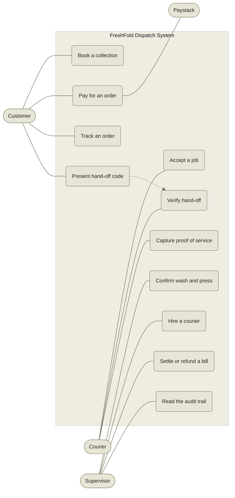
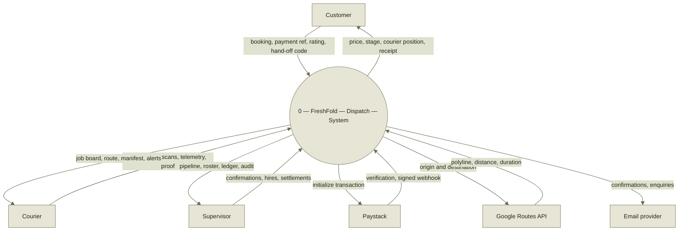
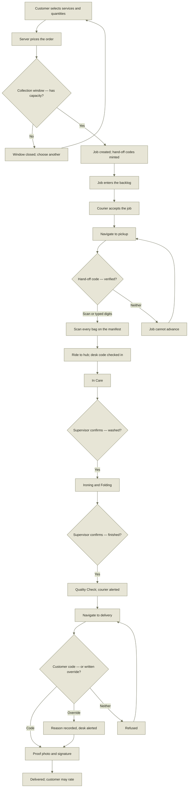
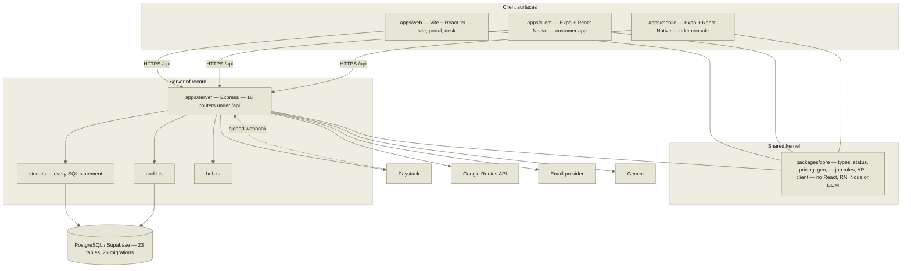
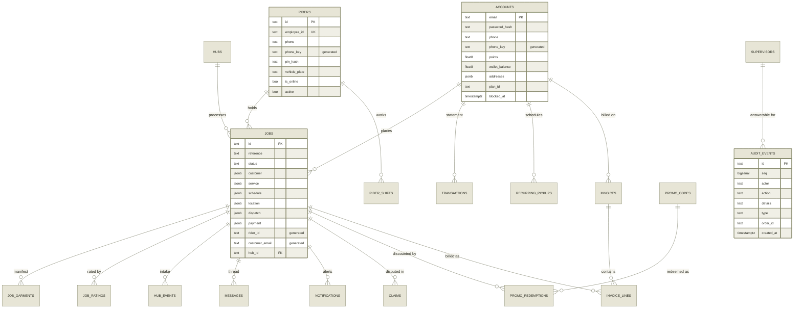
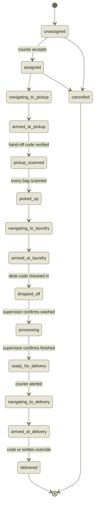
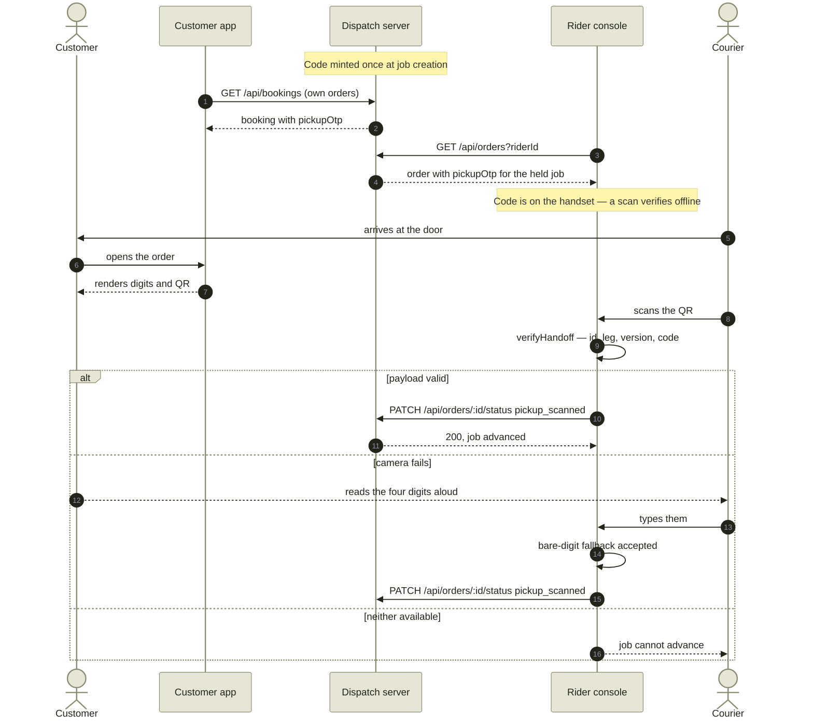

Kwame Nkrumah University of Science and Technology
College of Science * Faculty of Physical and Computational Sciences
Department of Computer Science

* * *

# FreshFold: A Multi-Client Laundry Collection and Dispatch Platform with Verified Custody Hand-off

* * *

A project report submitted in partial fulfilment of the requirements
for the award of the degree of **Bachelor of Science in Computer Science**

**By**
**[Student Name]**
**[Index / Reg. Number]**

**Supervisor**
**[Supervisor Name and Title]**

**[Month]** **[Year]**

Before you submit

Every **[dotted field]** in this report is a value only you can supply — your name, index number, supervisor, dates, and the sources you read. Nothing has been invented to fill them. Section 2.4 and the reference list mark where your own reading must go in.

### Declaration

I hereby declare that this submission is my own work towards the award of the Bachelor of Science degree in Computer Science, and that, to the best of my knowledge, it contains no material previously published by another person nor material which has been accepted for the award of any other degree of this University or elsewhere, except where due acknowledgement has been made in the text.

The software described in this report was designed and implemented by me. Its complete revision history is publicly verifiable in the project's Git repository, and every claim of functionality in Chapters 4 and 5 is traceable to a named source file listed in Appendix A.

**[Student Name]** **[Index Number]** * Candidate

Date Signature above

### Certification / Approval

I hereby certify that the preparation and presentation of this project report were supervised in accordance with the guidelines on supervision of project work laid down by the Kwame Nkrumah University of Science and Technology.

**[Supervisor Name]** Supervisor * Signature & Date

**[Head of Department]** Head, Dept. of Computer Science * Signature & Date

### Dedication

**[Optional — one or two sentences, in your own words.]**

### Acknowledgements

My thanks to **[supervisor]** for supervision and for the reviews that shaped Chapters 3 and 4; to the staff of the Department of Computer Science; and to **[the couriers, customers and shop staff who tested the system]**, whose reports of what actually happens at a doorstep are the reason several of the design decisions in Section 4.5 exist at all.

### Abstract

Laundry collection and delivery around the KNUST campus in Kumasi is coordinated informally: a customer telephones or messages an operator, the operator remembers or writes down the job, and a courier is told where to go. No party holds the same record, a customer cannot see where their garments are, and no step of the round trip produces evidence that it happened. This project designs and implements FreshFold, a dispatch platform in which one canonical job record is shared by four client surfaces and a single server of record.

The system was built iteratively in a TypeScript monorepo. A shared domain package holds the pricing arithmetic, the state machine and the hand-off rules, so the same code runs on the web client, both mobile applications and the server; a REST API over PostgreSQL is the only writer. A job advances through fifteen dispatch states that are projected onto seven customer-visible stages, so the courier's vocabulary and the customer's remain distinct without a second copy of the data. Custody changes at the door and at the hub are gated by per-job four-digit codes carried in signed QR payloads, with typed and documented-override fallbacks for the cases where a camera or a customer is unavailable. Prices are computed server-side from a single table; every supervisor action that moves money, standing or an order is written to an append-only audit trail in the same transaction as the change it explains.

The implementation comprises approximately 86,000 lines across five workspaces, twenty-six database migrations, and an assertion suite of 795 checks that passes in full. The result shows that a single canonical record with person-confirmed transitions removes the class of coordination error that manual dispatch produces, and that a paid routing service can be depended on for accuracy while degrading safely to a visibly-approximate fallback when it is unavailable.

**Keywords:** dispatch systems, finite state machines, custody verification, domain-driven design, PostgreSQL, React Native, last-mile logistics, Ghana.

###   List of Figures, Tables and Acronyms

#### List of Figures

Figure| Title| Section
---|---|---
3.1| Use-case diagram — four actors against the dispatch system| 3.7
3.2| Context data-flow diagram (Level 0)| 3.7
3.3| Activity diagram — booking to delivery| 3.7
4.1| System architecture — clients, server, data and third parties| 4.2
4.2| Entity-relationship diagram of the core schema| 4.3
4.3| Job state machine — fifteen dispatch states| 4.5
4.4| Sequence diagram — collection hand-off verification| 4.5

#### List of Tables

Table| Title| Section
---|---|---
2.1| Comparative analysis of existing systems| 2.5
3.1| Functional requirements| 3.6
3.2| Non-functional requirements| 3.6
3.3| Hardware and software requirements| 3.8
4.1| Database tables by migration| 4.3
4.2| Dispatch state to customer stage projection| 4.5
4.3| Service catalogue and unit prices| 4.5
4.4| Assertion suite results by workspace| 4.8
4.5| Selected system test cases and outcomes| 4.8
5.1| Objectives against delivered outcomes| 5.2

#### List of Abbreviations and Acronyms

**API**|  Application Programming Interface
---|---
**CORS**|  Cross-Origin Resource Sharing
**CSP**|  Content Security Policy
**CSPRNG**|  Cryptographically Secure Pseudo-Random Number Generator
**DFD**|  Data-Flow Diagram
**ERD**|  Entity-Relationship Diagram
**ETA**|  Estimated Time of Arrival
**FSM**|  Finite State Machine
**HMAC**|  Hash-based Message Authentication Code
**HSTS**|  HTTP Strict Transport Security
**JSONB**|  PostgreSQL binary JSON column type
**MoMo**|  Mobile Money
**OTP**|  One-Time Password (here, a per-job hand-off code)
**REST**|  Representational State Transfer
**RLS**|  Row-Level Security
**SPA**|  Single-Page Application
**UML**|  Unified Modeling Language
**WCAG**|  Web Content Accessibility Guidelines

Chapter One

## Introduction

What the problem is, and what this project set out to do about it.

### 1.1 Background of the Study

Laundry is one of the few chores in student life that cannot be deferred indefinitely and cannot be done well without equipment. In the halls and hostels around the Kwame Nkrumah University of Science and Technology, most residents have no washing machine, share a bathroom with several others, and hand-wash in a bucket. Around Ayeduase, Kotei, Bomso and Boadi a small trade has grown up to absorb that work: operators who collect clothing, wash it, and return it, usually within a day.

That trade is coordinated almost entirely by telephone and instant messaging. A customer sends a message, an operator agrees a price and a time verbally, and a courier is dispatched on a motorbike with an address held in someone's head or in a chat thread. The arrangement scales to a handful of jobs a day and stops scaling shortly afterwards, for reasons that are structural rather than a matter of effort: there is no record that all three parties can see, so every question about a job — where is it, what was agreed, who has it now — has to be answered by asking a person.

Two things have changed recently enough to make a software answer practical here. Mobile money is now the ordinary way to pay small amounts in Ghana, which removes the cash-at-the-door step that made pre-payment impossible; and inexpensive Android handsets with GPS are standard among couriers, which makes a courier's position and a proof photograph available to the system without special hardware.

Citation needed here

The paragraphs above are written from direct observation of the service area. For submission, support the claims about hall occupancy, laundry practice and mobile-money penetration with figures from a citable source — the **[Ghana Statistical Service census]**, **[Bank of Ghana payment-systems statistics]**, or your own survey instrument reproduced in Appendix C. Do not carry the text forward without them.

### 1.2 Statement of the Problem

The problem is not that laundry operators lack an app. It is that the information about a job lives in as many partial, mutually inconsistent copies as there are people handling it. Six failures follow from that, and each was observed directly in the manual process this project replaces:

  1. **No shared record.** The customer's expectation, the dispatcher's note and the courier's instruction are three separate artefacts. When they disagree, nothing arbitrates.
  2. **A stage is claimed, not evidenced.** "Your clothes are being washed" is asserted by whoever is asked. Nothing in the manual process records that a garment was actually washed, because nothing observes it.
  3. **Custody changes are unverified.** A person at a door claiming to be the courier, and a person opening it claiming to be the customer, each prove nothing. Garments are handed over on appearance alone.
  4. **Price is negotiated per conversation.** Two customers ordering the same work can be quoted differently, and neither quote is recorded in a form that can be checked afterwards.
  5. **No accountable trail.** When an order is cancelled, a refund given or a discount applied, there is no record of who decided it. Disputes resolve by seniority rather than evidence.
  6. **Distance and time are guessed.** A dispatcher estimates a round trip from familiarity. Estimates made this way are optimistic in a way that is systematic rather than random, because they follow the shape of the map rather than the shape of the roads.

The sixth is worth a number, because this project measured it. Between the hub and a delivery point in Ayeduase, the straight-line distance is 3.3 km; the distance a scooter actually rides is 5.3 km. Any estimate built on the straight line is 60% short before any other source of error is considered.

### 1.3 Aim and Objectives

#### Aim

To design, implement and deploy a laundry collection and dispatch platform in which a single canonical record of every job is shared by the customer, the courier and the shop supervisor, and in which each change of custody or condition is confirmed by an identified person and recorded as evidence.

#### Objectives

The aim decomposes into seven objectives, each stated so that it can be judged met or unmet rather than merely attempted. Section 5.2 returns to this list.

Ref| Objective
---|---
**O1**|  Model the job once, server-side, and derive both the customer's view and the courier's view from it, so that no second copy of a job exists anywhere in the system.
**O2**|  Express the life of a job as an explicit state machine in which every forward transition is attributable to a named person or is explicitly marked as unattributed.
**O3**|  Verify both custody hand-offs — collection at the customer's door and delivery back to it — with a per-job secret, and provide fallbacks for the realistic failure cases without weakening the default path.
**O4**|  Compute every price on the server from one table of rates, so that a client cannot assert what an order costs.
**O5**|  Record every supervisor action that moves money, standing or an order in an append-only trail written by the route that performs the action.
**O6**|  Derive distances and arrival times from real road geometry, and degrade visibly rather than silently when the routing service is unavailable.
**O7**|  Deploy the system to production infrastructure and demonstrate the full round trip across all four client surfaces against one server.

### 1.4 Research Questions

  1. **RQ1.** Can one canonical record serve three audiences with genuinely different vocabularies — a customer, a courier and a supervisor — without either duplicating the data or forcing all three to read the same terms?
  2. **RQ2.** What is the minimum evidence a system should require before it tells a customer that a stage of work has been completed?
  3. **RQ3.** How should a custody hand-off be verified when the two mechanisms it would naturally depend on — a working camera and a reachable network — are each unavailable a meaningful fraction of the time?
  4. **RQ4.** When a system depends on a metered third-party service for accuracy, what is the correct behaviour when that service is unavailable, and how should the difference be made visible to the user?

These are engineering questions rather than hypotheses to be tested statistically, and they are answered by construction: each is addressed by a design decision in Chapter 4 and evaluated in Chapter 5.

### 1.5 Significance of the Study

  * **For the operator.** The dispatcher stops being the system's memory. Jobs that nobody has accepted are visible as a backlog rather than being remembered, and capacity limits on collection windows prevent the shop from promising more collections than it can serve.
  * **For the customer.** A price known before booking, a stage that reflects work actually confirmed by someone, and a courier whose vehicle and plate can be checked at the door.
  * **For the courier.** A board scoped to their own jobs and the open pool, road-accurate navigation, and a hand-off procedure that cannot leave them holding somebody's laundry because a customer's phone is flat.
  * **Academically.** The project is a worked example of two patterns that are usually described abstractly: a canonical record with divergent read projections, and a state machine whose transitions carry provenance. It also documents, with measurements, the cost of the straight-line distance approximation that small logistics systems commonly ship with.

### 1.6 Scope and Limitations of the Study

#### In scope

  * Booking, pricing, payment, dispatch, custody verification, delivery and rating for laundry and adjacent cleaning services.
  * Four client surfaces: a marketing site and client portal, a supervisor desk, a courier application and a customer application.
  * One dispatch server of record, backed by PostgreSQL, deployed to production.
  * Memberships, a loyalty scheme, promotional codes, standing orders, claims and invoicing.

#### Out of scope, and why

  * **Geography.** Distances, service areas and address resolution assume the Kumasi service area around the Ayeduase–Kotei hub. A fix reported from outside it is replaced by the hub coordinate rather than trusted.
  * **Real-time transport.** Synchronisation is by polling every four to five seconds, not by WebSocket or server-sent events. This is adequate at the scale studied and is discussed as future work in Section 5.6.
  * **Store distribution.** Both mobile applications run under Expo Go and as development builds. Signed store releases were not part of this project.
  * **Linguistic review.** The customer application is translated into Spanish and French at full key coverage, but neither translation has been reviewed by a native speaker and neither should be considered release-ready.
  * **Field trial.** The system was exercised end-to-end but was not run as the sole dispatch mechanism for a commercial operation over a sustained period, so no operational statistics are claimed.

### 1.7 Definition of Terms

Job
    The canonical server-side record of one piece of work, identified as `FFC-######`. Everything else in the system is a view of a job.
Booking
    The customer's projection of a job: seven friendly stages, a schedule and a payment.
Order
    The courier's projection of the same job: fifteen dispatch states, coordinates, a bag manifest and proof of service.
Stage
    One of the seven states a customer sees — Scheduled, Collecting, In Care, Ironing & Folding, Quality Check, Delivering, Delivered.
Dispatch state
    One of the fifteen finer states the courier and the server use. Many dispatch states map to one stage.
Leg
    A segment of the round trip: customer to hub (collection), or hub to customer (delivery).
Hub
    The physical laundry premises where garments are washed, pressed and folded. The system supports more than one.
Manifest
    The list of bags on a job, each with its own QR code, derived from the quantity of each service ordered.
Hand-off code
    A four-digit per-job secret, minted once at creation, that gates a change of custody.
Backlog
    Every job still running that no courier currently holds — not merely jobs never assigned.
Desk
    The supervisor's dashboard: the operational console for the shop floor.
Projection
    A read-only view derived from the canonical record by a pure function, never stored separately.

### 1.8 Organization of the Report

  * **Chapter One** states the problem, the aim and the seven objectives, and bounds the study.
  * **Chapter Two** reviews the concepts the design rests on and the systems that solve adjacent problems, and identifies the gap this project addresses.
  * **Chapter Three** analyses the manual process being replaced, sets out functional and non-functional requirements, and presents the design models.
  * **Chapter Four** gives the architecture, the database design, the module designs and the implementation, and reports the test results.
  * **Chapter Five** assesses the objectives against what was delivered, records what was difficult, and recommends what should follow.

Chapter Two

## Literature Review

The ideas the design borrows, and the systems it is not.

### 2.1 Introduction

This chapter establishes the theoretical ground the system stands on and surveys systems that solve part of the same problem. It is organised around the four research questions of Section 1.4: the record-and-projection question, the evidence question, the verification question and the degradation question. The chapter closes by naming the gap that the reviewed work leaves open in this setting.

### 2.2 Conceptual Framework

Four ideas frame the design.

#### The three-sided service platform

A dispatch platform mediates between a demand side (customers), a supply side (couriers) and an operator that sets policy and resolves exceptions. Unlike a two-sided marketplace, the operator here is not merely a rule-maker: it performs work — washing, pressing — that neither of the other sides can observe. That asymmetry is what makes evidence of stage completion a design problem rather than a reporting problem.

#### Canonical record with divergent projections

Evans's notion of a shared kernel and the read-model separation associated with CQRS both suggest the same move: keep one authoritative write model, and derive as many read models as there are audiences. The design here takes the strict form — projections are pure functions applied at read time, never materialised, so drift between them is not possible by construction rather than by discipline.

#### The finite state machine as a domain object

Representing the life of a job as an explicit FSM makes two properties checkable that are otherwise a matter of code review: which transitions are legal, and what evidence each requires. Where the state machine is implicit — scattered across conditionals in handlers — neither property has a single place to be stated or tested.

#### Provenance and the append-only log

An audit trail is only meaningful if it is written by the code that performs the action, in the same transaction, and cannot be edited afterwards. A log written by the client, or written after the fact, records intentions rather than events. This is the standard argument for event logs in Kleppmann's treatment of data-intensive systems, and it applies at any scale.

### 2.3 Review of Related Concepts

#### REST and resource-oriented APIs

Fielding's architectural constraints — statelessness, uniform interface, resource identification — remain the appropriate style for a system whose clients are heterogeneous and whose network is unreliable. Statelessness in particular matters here: a courier's handset loses signal in stairwells routinely, and a protocol that required session affinity would fail in exactly the conditions the system must survive.

#### Polling versus push

WebSockets and server-sent events deliver lower latency at the cost of connection state on both ends. Polling trades latency for robustness and simplicity: a dropped poll is invisible, whereas a dropped socket requires reconnection logic on four clients. At the studied scale a four-second poll gives a worst-case staleness comparable to the time a person takes to read a screen, which is why it was chosen; Section 5.6 records the scale at which that trade reverses.

#### Hybrid relational and document storage

PostgreSQL's JSONB permits nested value objects to be stored as they are modelled while promoting the specific fields that are queried into indexed columns. Generated columns close the drift problem that otherwise attends such hybrids: a promoted column that is derived rather than written cannot disagree with its source.

#### Memory-hard password hashing

Percival's scrypt, standardised as RFC 7914, resists hardware-accelerated attack by requiring memory as well as time. The relevant design parameters are cost, block size and parallelism, and the current OWASP guidance on password storage gives the contemporary minimums against which a choice must be justified.

#### Custody verification by shared secret

One-time codes exchanged at a hand-off are standard in parcel logistics. The literature's recurring warning is that a code which is not bound to the specific consignment permits a substitution attack: a courier holding two consignments on one street can have the wrong customer's code accepted against the job in hand. Binding the identifier into the payload is the standard mitigation.

#### Road-network routing

Great-circle distance systematically understates travel on a road network, and the size of the error depends on network density rather than on distance, so it cannot be corrected by a constant factor. Routing services return an encoded polyline and a traffic-aware duration; the engineering questions are caching granularity and behaviour under quota exhaustion.

### 2.4 Review of Related and Existing Systems

Four categories of existing system bear on this work.

#### Ride-hailing and courier dispatch

Uber, Bolt and Yango operate the mature form of the dispatch problem: a pool of independent drivers, algorithmic assignment, and in-app payment. Their model contributes the open-pool-plus-assignment pattern used here. It differs in one decisive respect: a ride has no custody period. The passenger is present throughout, so there is no interval during which the operator holds the customer's property and must account for it.

#### International on-demand laundry

Laundryheap and Rinse operate the closest analogue in mature markets — scheduled collection, off-site processing, scheduled return. They demonstrate that the round-trip model is commercially viable, and that customers will accept a next-day promise. Their operating assumptions do not transfer: card-on-file payment, addressable street addresses, and dense urban courier supply are all present in their markets and largely absent in this one.

#### Failed entrants

Washio, which ceased operation, is the standard cautionary case for on-demand laundry: the unit economics of a courier per order do not close at low order density. This is the argument for the collection-window capacity limit described in Section 4.5 — batching collections into windows is what makes a courier's trip carry more than one job.

#### The incumbent locally

The system this project actually competes with is a WhatsApp thread and a phone call. It has real advantages that must be acknowledged: zero onboarding cost, no application to install, complete flexibility of arrangement, and a trust relationship built on personal acquaintance. Any replacement that ignores these loses on contact.

Your reading goes here

This section describes system categories from their public behaviour. For submission it needs citations: company documentation or press coverage for each named system, and at least **[10–15 sources]** overall for a final-year literature review. Where you can find an academic treatment of last-mile logistics in West African cities, prefer it to a corporate source — that literature exists and will strengthen Section 2.6 considerably.

### 2.5 Comparative Analysis of Existing Systems

**Table 2.1** — Comparative analysis. FreshFold's column describes the system as implemented and evaluated in Chapters 4 and 5.

Criterion | Ride-hailing dispatch | On-demand laundry (intl.) | WhatsApp / phone | FreshFold
---|---|---|---|---
**Custody period**|  None| Days| Days| Days, tracked
**Shared record**|  Yes| Yes| No| Yes, single canonical
**Hand-off verified**|  N/A| Sometimes, delivery only| No| Both legs, per-job code
**Stage evidence**|  N/A| Operator-asserted| Verbal| Person-confirmed or marked unattributed
**Pricing authority**|  Server| Server| Negotiated| Server, one rate table
**Payment rails**|  Card / wallet| Card on file| Cash / MoMo, manual| MoMo & card via Paystack, plus wallet
**Routing**|  Road network| Road network| Local knowledge| Road network, degrades visibly
**Audit of operator actions**|  Internal| Internal| None| Append-only, per-action
**Works offline at the door**|  Partly| Partly| Yes| Yes — code travels to the handset
**Onboarding cost to customer**|  App install| App install| None| Web needs none; app optional

### 2.6 Gaps Identified in the Literature

  1. **Custody is under-modelled.** Dispatch literature and dispatch products both concentrate on assignment and routing. The interval during which an operator holds a customer's property, and what constitutes evidence during it, is treated as an operational matter rather than a modelling one.
  2. **Stage progression is rarely required to carry provenance.** Systems commonly advance a status on a timer or on an operator's unattributed click. The question of who is claiming that work was done is not usually asked of the data model.
  3. **Hand-off verification assumes connectivity and working cameras.** Designs in the literature specify the happy path and leave the fallbacks to implementers, which in practice produces either a hard block that strands couriers or a bypass that voids the mechanism.
  4. **Degradation of paid services is under-specified.** The behaviour of a system when its routing or payment provider is unavailable is treated as an availability concern rather than a correctness one — but a fallback that silently substitutes a worse answer is a correctness failure, not an availability failure.
  5. **The West African setting is absent.** Mobile-money-first payment, descriptive rather than numbered addresses, and intermittent data are the ordinary conditions here and the exceptional conditions in the reviewed systems.

### 2.7 Summary of Literature Review

The reviewed work supplies the architectural vocabulary this project uses — canonical records with derived projections, explicit state machines, append-only provenance, and resource-oriented APIs over unreliable networks — and it supplies proven mechanisms for assignment, routing and payment. What it does not supply is a treatment of the custody interval as a first-class modelling concern, nor a discipline for making a stage claim answerable to a person. Those two gaps, in the specific conditions of Kumasi, define the contribution attempted in Chapters 3 to 5.

Chapter Three

## System Analysis and Methodology

What was replaced, what was required, and how it was modelled.

### 3.1 Introduction

This chapter sets out how the system was developed, analyses the manual process it replaces, states the requirements formally, and presents the design models. The requirements in Section 3.6 are referenced by identifier throughout Chapters 4 and 5, so that every implemented feature is traceable to a stated requirement and every requirement is traceable to a test.

### 3.2 Research and Development Methodology

The project used an **incremental and iterative** methodology with short cycles, closest in character to Agile practice but adapted for a single developer with a supervisor rather than a team with a product owner.

#### Why not Waterfall

A sequential methodology requires requirements to be substantially correct before design begins. Several of this system's most important requirements were not knowable in advance and emerged only from running the software: that a delivery route must terminate at the customer's door rather than the hub; that a courier's board must be scoped by courier identity before more than one job can be in flight; that the delivery leg needs its own customer-visible stage because a courier riding to a door should not read as "Quality Check". Each was discovered by exercising a build, not by analysis.

#### The cycle used

  1. **Observe** — exercise the current build end-to-end across all four surfaces against one server.
  2. **Identify** — name a specific defect or missing capability in terms of what a real person experiences.
  3. **Locate the single source** — determine where the rule belongs so it is stated once. Repeatedly this meant moving logic into the shared domain package.
  4. **Implement and assert** — change the code and add assertions that fail against the old behaviour.
  5. **Regress** — run type-checking and the full assertion suite across every workspace before committing.

#### Evidence of the process

The methodology is visible in the repository rather than merely claimed. Development proceeded across **68 commits** on four branches, each commit message stating the behaviour it changes in the user's terms rather than the code it touched — for example _"Stop the delivery sheet eating the signature it asked for"_. The assertion suites act as the regression gate: 795 checks that must pass before a change is committed.

A note on honesty in the record

The project's own documentation keeps a list of known limitations, and part of the method was auditing that list — several entries described problems that had since been fixed, which understates the system and misdirects anyone reading it. Section 5.3 reproduces the list as it actually stands.

### 3.3 Analysis of the Existing System

The process being replaced runs as follows. A customer messages the operator on WhatsApp or telephones. The operator quotes a price from memory, agrees a collection time, and notes the address — in a physical book, in the chat thread, or not at all. A courier is telephoned and told where to go. The courier collects, returns to the shop, and hands the garments to whoever is on the floor. Washing, drying and pressing proceed without any record being created. When the customer asks for a progress update, the operator answers from recollection or asks the floor. Delivery is arranged by a second telephone call. Payment is cash at the door or a mobile-money transfer, reconciled by checking the operator's phone against the day's collections.

### 3.4 Problems of the Existing System

Ref| Problem| Consequence
---|---|---
**P1**|  The record exists only in the operator's memory and a chat thread| The operator cannot be absent; nothing can be looked up by anyone else
**P2**|  Status is answered verbally on demand| Every enquiry costs the operator an interruption, and the answer is unverified
**P3**|  No verification of identity at either hand-off| Garments can be given to the wrong person, with no evidence afterwards
**P4**|  Prices quoted conversationally| Inconsistent pricing; disputes with no record to consult
**P5**|  No record of who cancelled, refunded or discounted| Disputes resolve by authority rather than evidence; loss is undetectable
**P6**|  Collection capacity is unbounded| More collections promised in a window than couriers can serve
**P7**|  Distance and time estimated from local knowledge| Systematically optimistic promises; the 3.3 km / 5.3 km case of Section 1.2
**P8**|  Payment reconciliation is manual| Slow, error-prone, and undetectable when it fails

### 3.5 Analysis of the Proposed System

The proposed system replaces the operator's memory with one server-side record and the operator's judgement with rules stated once in code. Concretely:

  * One **Job** per piece of work, created by the booking route, read by every surface as a projection of itself.
  * An explicit **state machine** whose forward transitions require either a verified hand-off, a supervisor's confirmation, or an explicit mark that nobody confirmed the step.
  * **Per-job hand-off codes** on both legs, bound to the job identifier so a code cannot be replayed against a different order.
  * **Server-computed prices** from one rate table shared by every client, so a booking cannot arrive claiming its own total.
  * An **append-only audit trail** written by the route performing the action, inside its transaction.
  * **Road-network routing** with a cached, shared answer and a visibly-dashed straight-line fallback.
  * **Capacity-limited collection windows** , so a window that cannot be served is closed rather than oversold.

### 3.6 Requirement Analysis

#### Functional Requirements

**Table 3.1** — Functional requirements, with the objective each serves and the actor it belongs to.

Ref| Requirement| Actor| Obj.
---|---|---|---
FR-01| Register an account, sign in, and sign out| Customer| O1
FR-02| Browse the service catalogue with prices before booking| Customer| O4
FR-03| Book one or more services in one order, with quantities, at a chosen collection window| Customer| O1
FR-04| Be shown the full price, including add-ons, taxes and any discount, before confirming| Customer| O4
FR-05| Pay by mobile money or card, or from a stored wallet balance| Customer| O4
FR-06| Track an order through seven stages with a live courier position and arrival time| Customer| O1
FR-07| Present a hand-off code, as digits and as a QR, at collection and at delivery| Customer| O3
FR-08| Reschedule or cancel an order within the permitted window| Customer| O1
FR-09| Rate the courier once an order is delivered, and revise that rating| Customer| O5
FR-10| Maintain a saved address book and a default address| Customer| O1
FR-11| Subscribe to a membership plan and see included pickups consumed| Customer| O4
FR-12| Sign in with an employee identifier and PIN, and be forced to replace a provisional PIN| Courier| O2
FR-13| See a board of own jobs plus the unheld backlog, and accept or decline from it| Courier| O1
FR-14| Navigate to pickup, hub and delivery along road geometry| Courier| O6
FR-15| Scan the customer's collection QR, or type the code, before advancing past arrival| Courier| O3
FR-16| Scan each bag on the manifest at collection| Courier| O3
FR-17| Capture a proof photograph and a signature at delivery, or record a written override| Courier| O3
FR-18| Message dispatch about a job and receive alerts| Courier| O5
FR-19| Sign in to the desk, with a session shorter than a courier's or a customer's| Supervisor| O5
FR-20| See every live order and its stage, and move a stage by hand where necessary| Supervisor| O2
FR-21| Confirm a load washed and a load finished, each attributed by name| Supervisor| O2
FR-22| Hire a courier — the server issues the employee ID and a one-time PIN — assign a vehicle, and deactivate| Supervisor| O5
FR-23| Settle, refund and invoice bills; adjust loyalty points; block or remove a patron| Supervisor| O5
FR-24| Reply into any job's thread as Dispatch, from one inbox| Supervisor| O5
FR-25| Read an append-only trail of every desk action, newest first| Supervisor| O5
FR-26| Issue and redeem promotional codes; operate standing orders| Supervisor| O4
FR-27| Answer customer questions through an AI concierge scoped to the catalogue| System| O1

#### Non-Functional Requirements

**Table 3.2** — Non-functional requirements. Each states a criterion that can be checked rather than an aspiration.

Ref| Attribute| Requirement
---|---|---
NFR-01| Correctness| No client may assert a price, a hand-off code, or a payment purpose. The server recomputes or verifies each.
NFR-02| Consistency| A stage changed on any surface reaches the other two within one poll interval — about one second typical, four worst case.
NFR-03| Security| Passwords hashed with scrypt at parameters justified against current OWASP guidance; session tokens stored only as digests.
NFR-04| Security| Every credential route rate-limited per account and per address.
NFR-05| Security| Every read and write of a booking passes one access check: supervisor, owning customer, holding courier, or tracking token.
NFR-06| Security| A strict Content Security Policy, HSTS, and frame denial on the served site.
NFR-07| Availability| The server refuses to open its port without a reachable database, and the health check reports 503 rather than `ok` in that state.
NFR-08| Resilience| A hand-off must be completable with no network and no working camera.
NFR-09| Resilience| Loss of the routing service degrades to a straight line that is drawn dashed and reports no arrival time, never a fabricated one.
NFR-10| Usability| The site meets WCAG 2.2 AA on contrast, focus visibility and keyboard operation; no text below 12 px.
NFR-11| Performance| The marketing page is the entry chunk; portal, desk, booking and map libraries load on demand.
NFR-12| Portability| Domain logic imports no React, React Native, Node or DOM API, so one implementation runs in all four environments.
NFR-13| Maintainability| All SQL lives in one store module; no route composes SQL of its own. Schema changes ship as numbered, once-only migrations.
NFR-14| Auditability| Audit rows are written by the acting route inside its transaction; the table is append-only with no foreign key to orders.

### 3.7 System Design Tools

The system was modelled with UML use-case, activity, sequence, state and class/entity-relationship diagrams, and with data-flow diagrams for the context boundary. Three appear here; the architecture, ERD, state and sequence diagrams appear in Chapter 4 alongside the designs they document.

**Figure 3.1** — Use-case diagram. Three human actors and one external actor. The dotted link records that the customer's presented code is what the courier's verification consumes; it is the only use case shared between two actors.

**Figure 3.2** — Context data-flow diagram (Level 0). The system is a single process boundary with three human terminators and three external services. Note that the payment flow is bidirectional and includes an unsolicited inbound path — Paystack's signed settlement webhook, the only route that credits a wallet without a user request.

**Figure 3.3** — Activity diagram for the full round trip. Every decision node is a point where the system requires evidence. The two supervisor confirmations replace what was originally a timer, and the override branch exists so a courier is never stranded by a customer's dead handset — but it is recorded and raised, not silent.

### 3.8 Hardware and Software Requirements

**Table 3.3** — Requirements for development, operation and use.

Context| Hardware| Software
---|---|---
**Development** | x86-64 workstation, 8 GB RAM minimum, 16 GB comfortable; an Android handset or emulator for the two mobile applications | Node.js 20 or later; npm workspaces; TypeScript 5.9; Git; Expo Go targeting SDK 54; a PostgreSQL instance
**Server** | One container instance, 512 MB RAM sufficient at studied scale | Node.js 20 runtime; PostgreSQL 15 or later, reachable over TLS with a verified certificate authority
**Customer** | Any smartphone or desktop; mid-range Android assumed as the design target | A current browser; optionally the Expo customer application
**Courier** | Android handset with GPS and a working camera; a motorbike or bicycle | The rider application; location and camera permissions granted
**Supervisor** | Any desktop or tablet on the shop counter | A current browser
**External services** | — | Paystack (payments); Google Maps Platform with the Routes API enabled; an SMTP or transactional email provider; a Gemini API key for the concierge

### 3.9 Justification for the Chosen Technology Stack

TypeScript across every workspace
    The decisive argument is NFR-12. Pricing arithmetic, the state machine and the hand-off rules must be identical on the server, the website and both handsets. One language with a structural type system permits one implementation, consumed as source with no build step between editing shared domain code and seeing it everywhere.
npm workspaces monorepo rather than published packages
    A shared kernel that must be versioned and republished to be changed acquires a release cycle, and a release cycle produces version skew between four clients. Consuming the domain package as source removes the skew entirely.
Express over PostgreSQL, not a backend-as-a-service
    Several requirements are server-authority requirements: NFR-01 forbids clients asserting prices or payment purposes, and NFR-14 requires audit rows written inside the acting transaction. Both need a trusted server between the client and the data. A direct-to-database model with row-level policies cannot express "recompute this price" or "write this trail entry in the same transaction".
PostgreSQL with JSONB for nested value objects
    A job's six nested groups are read and rewritten whole by the domain layer and nothing queries inside them, so shredding them into columns would mean reassembling on every read for no benefit. The two fields that _are_ filtered on are promoted to generated columns, which cannot drift from the JSONB they derive from.
React with Vite for the web, React Native with Expo for mobile
    One component paradigm across three interfaces reduces the concepts a single developer must hold. Expo supplies camera, location, secure storage and local authentication as maintained modules, each of which would otherwise be a native integration. Expo Go also removes the store-review loop from the development cycle.
Paystack for payments
    It settles mobile money and cards in Ghana with a signed webhook, which is the mechanism NFR-01 requires — a wallet credit that is caused by a verified provider callback rather than by a client claiming an amount.
Google Routes API for geometry
    Objective O6 requires real road distance. The service is called from the server so the key stays out of four client bundles, one answer is shared by three maps, and coordinate-rounded caching keeps a courier polling every four seconds from billing a request every four seconds.
Plain assertion scripts instead of a test framework
    The suites compare values, print a line each and exit non-zero. For the pure functions that carry the money and the dispatch rules, this is sufficient and is less machinery than a framework would introduce. The limitation is acknowledged in Section 5.3: it does not extend naturally to route-level or interface testing.
Chapter Four

## System Design and Implementation

The architecture, the schema, the modules, and what the tests report.

### 4.1 Introduction

This chapter presents the delivered system. It gives the architecture and the reasons for its boundaries, the database design and the two conventions that run through it, the design of the modules that carry the domain rules, the implementation environment, and the results of the test suite. Every file named here exists in the repository at the path given; Appendix A lists them.

5Workspaces

86kLines of TS/TSX

26Migrations

23Tables

795Assertions

0Failing

### 4.2 System Architecture

The system is four client surfaces, one server of record, one database, and three external services. The architectural rule that generates the rest is that **the server is the only writer** : no client reaches the database, and no client holds authority over a price, a code or a state transition.

**Figure 4.1** — System architecture. The shared kernel is consumed as TypeScript source by all four, so there is no build step and no version skew between them. Every external service is reached from the server, which keeps four API keys out of three client bundles and lets one cached routing answer serve three maps.

#### The projection boundary

The website has always called a piece of work a `Booking`; the rider console has always called it an `Order`. Both names are kept, because both are correct in their own context. They are projections of one server-side `Job`:

    Booking (customer)  ←── jobToBooking ──  Job  ── jobToOrder ──→  Order (rider)
       7 friendly stages                   15 dispatch states        15 dispatch states
       payment, schedule                   canonical record          bags, coords, proof

The identifier is shared: `FFC-882049` is the customer's booking reference _and_ the courier's job id, so one number means one thing in a support conversation. Because the dispatch vocabulary is the finer of the two, the customer's stage is always derivable from it; the reverse mapping is lossy and is handled explicitly in Section 4.5.

### 4.3 Database Design

Records live in PostgreSQL, hosted on Supabase. The schema ships as 26 numbered migrations totalling roughly 1,860 lines of SQL; each runs once and is recorded in `schema_migrations`, so migration is safe to run on every deploy and a dry run lists what is pending without touching anything. Every statement that touches the database is in `apps/server/src/store.ts`; no route composes SQL of its own (NFR-13).

#### Two conventions

  1. **Nested value objects stay JSONB.** A job is six nested groups — customer, service, schedule, location, dispatch, payment — and the domain layer reads and rewrites them as whole objects. Nothing queries inside them, so shredding them into eighty columns would mean reassembling them on every read for no gain.
  2. **Promoted columns are generated, never written.** `rider_id` and `customer_email` are the two fields routes actually filter on, and both live inside JSONB. Deriving them means there is no code path that updates one and forgets the other.

    rider_id       text generated always as (dispatch ->> 'riderId') stored,
    customer_email text generated always as (lower(customer ->> 'email')) stored

**Figure 4.2** — Entity-relationship diagram of the core schema, with attributes shown for the four tables the argument of this report turns on. Note that `audit_events` has _no_ foreign key to jobs: deleting an order must not delete the record that somebody deleted it. Saved addresses are a JSONB array on `accounts` rather than a table of their own, which is why no such entity appears.

#### Tables, by the migration that introduced them

**Table 4.1** — 23 tables across 26 migrations. Later migrations that only alter existing tables are omitted.

Migration| Tables
---|---
Initial schema| `jobs`, `riders`, `accounts`, `supervisors`, `messages`, `notifications`, `transactions`, `sessions`
Booking setup links| `booking_setup_tokens`
Booking tracking tokens| `booking_tracking_tokens`
Audit events| `audit_events`
Job ratings| `job_ratings`
Hub intake| `job_garments`, `hub_events`
Claims| `claims`
Rider shifts| `rider_shifts`
Promotions| `promo_codes`, `promo_redemptions`
Recurring pickups| `recurring_pickups`
Invoices| `invoices`, `invoice_lines`
Hubs| `hubs`
Enquiries| `enquiries`

#### Integrity and security at the data layer

  * The `status` column carries a `check` constraint listing all fifteen dispatch states, so an invalid state cannot be written even by a defect in the domain layer.
  * Row-level security is enabled on every table; a dedicated assertion suite fails the build if a `create table` lands without a matching `enable row level security`.
  * Session tokens are stored as digests, not values, so a database disclosure does not hand over live sessions.
  * Numeric telemetry is declared `double precision` rather than `numeric`, because the driver returns `numeric` as a string and the domain model holds a JavaScript number — declaring float8 keeps the round trip honest instead of parsing a string back into the float it started as.
  * The server refuses to open its port if the database is unreachable, and the health check answers 503 rather than `ok` in that state (NFR-07). A health check that lies about it is what keeps a broken instance in a load balancer.

### 4.4 Input and Output Design

Four surfaces present the same record to three audiences.

#### The website — `apps/web`

A single-page application with four routes: the marketing landing, the client portal, the supervisor desk, and the payment return. The landing is the entry chunk; the portal, desk, booking modal and map libraries are fetched on demand (NFR-11), so a visitor who never opens the desk never downloads it. Principal components include the booking modal, the live dispatch map, the hand-off code display, the reschedule drawer and the concierge widget.

The supervisor desk is organised as eleven panes grouped by when a supervisor reaches for them — _Floor_ (Pipeline, Hub, Couriers), _People_ (Inbox, Claims, Patrons), _Money_ (Financials, Settlement, Offers), and _Desk_ (Audit, Settings). The rail carries a badge only where something needs the supervisor's action — an unassigned order, a load awaiting confirmation, a customer awaiting a reply, an unsettled bill. Inventory counts live in the pane headers where they describe the list beneath them, so a quiet rail is genuinely quiet.

#### The customer application — `apps/client`

Five tabs — Home, Book, Track, Wallet, Account — with stack screens for a single order, plans, standing orders, the concierge, settings and the payment return. Available in English, Spanish and French, with per-key fallback so a missing translation shows the English string on that one label rather than dropping the language.

#### The rider console — `apps/mobile`

Five tabs — Board, Assignments, Map, History, Profile — plus authentication, forced PIN change and the dispatch thread. The workflow is driven from a bottom sheet that presents exactly the action the current dispatch state permits. Job cards and the active workflow both carry a _Customer sees:_ pill derived through the same projection the customer's timeline uses, so a courier knows what the customer is being told.

#### Output design principles

  * Every claim on a customer-facing surface resolves to a price, a duration, an address or a count.
  * An arrival time is shown only where a road route was computed; the straight-line fallback shows the stage instead of a fabricated figure (NFR-09).
  * WCAG 2.2 AA contrast on real backgrounds, no text below 12 px, no opacity modifiers on text, visible focus rings, and a reduced-motion path for every reveal (NFR-10).

### 4.5 Program and Module Design

#### 4.5.1 The job state machine

A job occupies one of fifteen dispatch states. The customer sees one of seven stages, derived by a total function over the fifteen.

**Figure 4.3** — The dispatch state machine. The three transitions that carry an evidence requirement are the two hand-offs and the bag scan; the two that carry an attribution requirement are the supervisor's confirmations.

**Table 4.2** — The projection from dispatch state to customer stage. Many-to-one by design: a customer does not need to distinguish "arrived at pickup" from "bags scanned", only that collection is under way.

Dispatch state (courier and server)| Customer stage| Bar
---|---|---
`unassigned`, `assigned`| Scheduled| 10%
`navigating_to_pickup` … `arrived_at_laundry` _(six states)_|  Collecting| 30%
`dropped_off`| In Care| 55%
`processing`| Ironing & Folding| 70%
`ready_for_delivery`| Quality Check| 82%
`navigating_to_delivery`, `arrived_at_delivery`| Delivering| 93%
`delivered`| Delivered| 100%
`cancelled`| Cancelled| —

**The reverse mapping is lossy, and says so.** When a supervisor nudges a stage by hand, `fromBookingStatus` picks the _earliest_ dispatch state in the target stage rather than claiming work that has not happened. Moving a booking to "In Care" must not silently assert that the pressing is done.

**Delivering is its own stage.** It was originally folded into Quality Check, which meant a courier riding to the door read as "Quality Check" with the bar stuck at 90% — a poor thing to be told while somebody is outside with your laundry.

#### 4.5.2 Evidence and attribution — answering RQ2

The two hub stages originally advanced on a timer: two minutes each, and each expiry fired the real customer message and the real timeline entry. "Your laundry is being pressed" on the evidence that a number had passed. Nothing anywhere recorded that a garment had been washed, because nothing knew.

Both are now supervisor confirmations, attributed by name in the audit trail. The timed sweep survives only as a development convenience, and three properties make it safe: it lives on the server rather than on a courier's handset, so progress is not a property of one device being awake; it is off in production unless explicitly configured; and every advance it makes is filed against `system` with the dwell that expired and the plain admission that nobody confirmed the work. The answer to "who said this load was washed" is therefore always either a supervisor's name or _nobody_.

#### 4.5.3 Custody hand-off — answering RQ3

Every job carries a four-digit `pickupOtp`, minted once by `bookingToJob` from a CSPRNG and kept for the life of the job. The customer's application and the website both render it as digits and as a QR; the rider console will not advance past `arrived_at_pickup` until one of the two checks out.

    FFH1|FFC-780145|pickup|6056
    └─┬┘ └────┬───┘ └──┬─┘ └┬─┘
    version  job id   leg   code

The job identifier travels inside the payload deliberately. Without it, a courier holding two jobs on one street could have the wrong customer's code accepted against the job they are actually on — the substitution attack named in Section 2.3. `verifyHandoff` rejects any payload whose identifier, leg or version does not match, and accepts bare digits only as the typed fallback, because cameras fail in the rain and a courier at a door cannot be blocked by that.

**Figure 4.4** — Collection hand-off. The code reaches the handset _before_ the courier arrives, which is what makes verification work in a stairwell with no signal — the branch that most designs leave to the implementer.

**The delivery leg is deliberately asymmetric.** Its code goes to the customer's screens only; the rider console never receives it, types what it is told, and the server decides. Before this it was the constant `7809` for every job in the system — the courier's application knew it, the "request OTP" button texted it to the customer, and the error message printed it, while the customer's own screen masked it to four dots.

**The override exists for the real world:** nobody in, the porter took it, the gate is locked. The courier writes what happened and it always succeeds — a courier cannot be left holding somebody's laundry because a customer's phone is dead. It is recorded on the job, raised to the desk as an alert, and narrated to the customer. A refusal to complete with neither a code nor a reason is a 403; a one-word reason is a 400.

#### 4.5.4 Pricing — answering NFR-01

The price of an order had no single home. The website's booking modal carried a cascade of substring tests on the service name; the customer application carried a parallel table whose own comment said it "reproduces the website's arithmetic exactly"; the server carried none at all and read `amount` off the request body — so the price of a wash was whatever the client claimed, and a booking could arrive at ₵0. The two client copies had already drifted.

**Table 4.3** — The service catalogue, priced once in `packages/core/src/services.ts`.

Service| Unit| Price
---|---|---
Washing (machine & hand wash)| load| ₵30
Gentle air drying| load| included
Ironing & folding| order| ₵25
Advanced stain removal| order| ₵25
Bed sheets & linens care| set| ₵45
Express same-day laundry| order| ₵50
Fast pickup & delivery| order| free
Sofa & carpet cleaning| unit| ₵90
Bespoke car detailing| ride| ₵150
Home & office cleaning| space| ₵180
Corporate contracts| contract| quoted

    quote(items, plan, points, promo):
        base    ← Σ over items of  service(item).price × item.quantity
        finish  ← surcharge for the chosen scent, where the service takes one
        subtotal ← base + finish
        // three reductions, which do not compound
        member  ← membershipBookingQuote(plan, subtotal)   // included pickups first
        tier    ← discount for tierForPoints(points)
        code    ← promotional reduction, validated server-side
        reduction ← max(member, tier, code)                // not the sum
        taxed   ← taxOn(subtotal − reduction, DEFAULT_TAX_RATES)
        return roundCedis(subtotal − reduction + taxed)

The three reductions are deliberately not additive. A membership discount, a loyalty tier discount and a promotional code applied together would produce a total below cost, and the arithmetic that produces it would be invisible on the receipt.

**Collection windows carry a capacity.** Until this existed the slots were a display list with no server-side referent, so every customer could book the same 08:00–11:00 window and the eleventh was accepted exactly like the first. A window that cannot be served is worse than one that is closed, because the customer is told a courier is coming.

#### 4.5.5 Routing and degradation — answering RQ4

Every map originally drew the courier's path as a straight line between two points — across the botanical gardens, through Unity Hall, over whatever was in the way. On the hub-to-Ayeduase run that line is 3.3 km where the road is 5.3 km, so every arrival time derived from it was 60% short on distance alone.

`GET /api/directions` asks the Routes API for the geometry a scooter would actually ride and returns it decoded with a traffic-aware duration. It lives on the server for three reasons: the key stays out of all three client bundles, one answer is shared by the courier's console, the customer's tracking map and the supervisor's dashboard, and repeats are cached — coordinates round to about eleven metres, so a courier polling every four seconds does not bill a request every four seconds. Re-routing is deliberately lazy: a new route only when the destination changes or the courier has strayed 80 m from the road they were given, at most once every 20 seconds. That is roughly four to six billed calls per job.

**The degradation is the design.** With no key configured, no quota left or Google unreachable, the response is the straight line marked `source: 'straight'`, the maps draw it dashed rather than pretending it is a route, and `routeEtaMinutes()` returns `null` — so no surface shows an arrival time at all. Every one of them used to show the chord between two points divided by an assumed 18 km/h, which is where the 60% came from. There is no stored duration on a job any more, only the distance, which is a real measurement.

#### 4.5.6 Courier provisioning

A courier does not sign up; they are hired. The server assigns the employee identifier — the next free `RIDER-###` — because it is what the courier signs in with, so a typo is a courier locked out on their first morning and two supervisors hiring the same morning would collide. The server also generates the PIN and shows it once: a credential a supervisor chose is one they can guess later, and under time pressure the choice is always `1234`. It is hashed immediately, expires in 48 hours if unused, and first sign-in forces a replacement, because a provisional PIN is one a second person also knows. Leaving flips `active: false` rather than deleting, which would orphan every job the courier carried; the flag blocks new logins _and_ live tokens, since the roster is checked on every request.

### 4.6 Implementation Environment

Layer| Technology
---|---
Language| TypeScript 5.9, ES modules throughout
Runtime| Node.js 20
Repository| npm workspaces monorepo — `packages/*` and `apps/*`
Web| React 19, Vite 6, Tailwind CSS 4, Motion, lucide-react, `@vis.gl/react-google-maps`
Mobile| React Native 0.81, Expo SDK 54, expo-router 6, Reanimated 4, react-native-maps
Device modules| expo-camera, expo-location, expo-secure-store, expo-local-authentication, expo-haptics
Server| Express 4, `postgres` (postgres.js), esbuild for the production bundle
Database| PostgreSQL on Supabase; migrations applied by a first-party runner
External| Paystack, Google Maps Platform Routes API, Brevo/Resend for email, Google Gemini for the concierge
Tooling| `tsx` for running TypeScript directly; `tsc --noEmit` as the type gate; `concurrently` for the dev loop
Version control| Git, four branches, 68 commits

Both mobile applications discover the dispatch server automatically by reusing the host of the Expo development server, so there is no IP address to configure while everything is on one machine. They install side by side with different bundle identifiers and schemes.

### 4.7 Implementation Details

#### The shared kernel

`packages/core` exports twenty-two modules and imports nothing from React, React Native, Node or the DOM — the constraint that lets the same code run in all four environments (NFR-12). Its header states the rule explicitly so that a future contributor meets it before adding an import that would break it.

#### The projection functions

The mapping in Table 4.2 is a total record over the fifteen states, so adding a dispatch state without deciding what the customer should be told is a type error rather than a runtime surprise:

    const TO_BOOKING_STATUS: Record<JobStatus, BookingStatus> = {
      unassigned: 'Scheduled',
      assigned: 'Scheduled',
      navigating_to_pickup: 'Collecting',
      /* … six collection states … */
      dropped_off: 'In Care',
      processing: 'Ironing & Folding',
      ready_for_delivery: 'Quality Check',
      navigating_to_delivery: 'Delivering',
      arrived_at_delivery: 'Delivering',
      delivered: 'Delivered',
      cancelled: 'Cancelled',
    };

#### Scoping the courier's board

The server sends each courier their own jobs _plus the open pool_ , so the rider application must tell the two apart — and until `Order` carried a `riderId` it could not. Its active workflow took the first job on the board that was not `unassigned`, which is correct only while exactly one job is ever in flight. With two, every courier's handset drove the same one. The backlog is therefore defined as _anything still running that no courier holds_ , not merely anything `unassigned`; and accepting one claims it **where it stands** rather than resetting it to `assigned`, which would rewind a collected job to Scheduled.

#### Authentication and sessions

One token store serves customers, couriers and supervisors; a `kind` discriminator decides which table the subject points into, so expiry sweeping, revocation and bearer parsing are written once. Session lifetimes differ by audience and the difference is argued rather than defaulted: a week for the two credentials that live on a phone, because a courier must not be asked to sign in again at a doorstep in the rain, but **twelve hours for the desk** — its token reads every customer's address and phone number, settles any bill and deactivates any courier, and the browser it sits in is a shared machine on a counter. Twelve hours covers the longest shift anyone works and expires before the next one starts.

Passwords are hashed with scrypt, asynchronously — the synchronous variant occupies the event loop for the whole derivation, which on a public registration endpoint is an unbounded way to hold it. The cost parameters travel with the hash (`scrypt$cost$r$p$hex`), so an old row still verifies and is transparently upgraded on next sign-in. A missing account costs the same as a wrong password, closing the timing oracle that would otherwise enumerate the customer directory.

#### Payment integrity

A wallet top-up carries a Paystack reference, never an amount: the server verifies the reference and credits what was actually collected. The settlement webhook is HMAC-signed with the secret key and read as raw bytes before any JSON middleware can reshape them; it is the only route that credits a wallet without anyone asking it to. A payment declares exactly one purpose, and the assertion suite includes the double-claim exploit as it was actually performed against an earlier build, so the regression is guarded by the attack rather than by a description of it.

#### The audit trail

Entries are written by the route that performs the action, inside the same transaction where the action has one: a rolled-back change leaves no trail, and a committed one always has one. The table is append-only and nothing prunes it. This replaced a log the desk kept in its own `localStorage` — capped at fifty entries by an array slice, visible only to the browser that made it, erased by clearing site data, and keyed on four random digits, which collide. A colleague could not see what you had changed, which is the one thing an audit trail is for.

Two absences are deliberate. A courier's stage advance is not recorded, because it is already on the customer's timeline with the hand-off code and proof photograph attached, and twenty routine taps per job would bury the overrides this pane exists to show. And the reset route writes nothing, because it truncates the table it would write to — and refuses to run in production anyway.

### 4.8 Testing

Testing has two layers: static type-checking across every workspace, and assertion suites over the pure functions that carry the money and the dispatch rules. The suites are plain scripts that compare values, print a line each and exit non-zero.

Why the type gate runs twice

Both production builds run `tsc --noEmit` before emitting anything, which is _not_ redundant with the lint step: Vite and esbuild both strip types without checking them, so a type error can otherwise produce a clean build and a runtime crash. It has done exactly that at least once in this project's history.

#### Unit testing

543 assertions in the shared kernel cover pricing and the list price, membership quotes and plan switching, loyalty tiers and rewards, tax composition, calendar dates and collection windows, the address book, phone and email rules, rescheduling and cancellation, promotional codes and referrals, standing orders, hand-off code generation and shape, and the bag manifest.

#### Integration testing

212 assertions in the server cover row-level security coverage across the schema, database TLS certificate verification, the rate limiters and their memory bounds, upload size and type gates on three routes, security headers and their agreement with the deployed CSP, password hashing and hash upgrade, session digest storage, and the payment purpose gates.

#### System and acceptance testing

40 assertions on the two mobile applications cover secure credential storage, job assignment on the courier's board, and the bag scanner. Beyond the automated suites, the full round trip was exercised manually across all four surfaces against one server, as described in Table 4.5.

**Table 4.4** — Assertion suite results. Run with `npm test`, which type-checks every workspace and then runs the suites. Result recorded on the working tree at the time of writing.

Workspace| Suites| Groups| Assertions| Failed| Result
---|---|---|---|---|---
`@freshfold/core`| 10| 67| 543| 0| Pass
`@freshfold/server`| 9| 48| 212| 0| Pass
`@freshfold/mobile`| 3| 3| 32| 0| Pass
`@freshfold/client`| 1| 3| 8| 0| Pass
**Total**| **23**| **121**| **795**| **0**|  Pass

**Table 4.5** — Selected test cases. The first eight are automated assertions drawn from the suites; the last five are manual system tests of the full round trip.

ID| Input / condition| Expected| Actual| Result
---|---|---|---|---
T-01| Hand-off QR whose job id differs from the job in hand| Rejected| Rejected| Pass
T-02| Hand-off QR with a valid code but the wrong leg| Rejected| Rejected| Pass
T-03| Bare four digits typed at the door| Accepted as fallback| Accepted| Pass
T-04| Booking with membership, loyalty tier and promo code all applicable| Largest single reduction, not the sum| Largest applied| Pass
T-05| Thirteenth booking into a twelve-capacity window| Window reported full| Refused| Pass
T-06| Nine wrong PINs against one employee ID inside 15 minutes| Locked after eight| Ninth refused| Pass
T-07| Payment metadata readable as two purposes| Refused with a reason| Refused| Pass
T-08| Checkout callback pointing at a lookalike subdomain| Refused; nothing reaches Paystack| Refused| Pass
T-09| Book on the website; open the rider console| Job in the backlog with pin, manifest and distance| As expected| Pass
T-10| Move a stage from the desk| Change visible on both handsets within one poll| ≈1 s typical| Pass
T-11| Complete a delivery with no code and no reason| 403| 403| Pass
T-12| Complete a delivery with a one-word override reason| 400| 400| Pass
T-13| Unset the routing key and open all three maps| Dashed line, no arrival time anywhere| As expected| Pass

#### What is not covered

The suites deliberately cover the pure-function core rather than the routes or the screens. There is no end-to-end browser automation, no load testing, and no formal usability study. Section 5.3 treats this as a limitation rather than a choice that needs no defence.

### 4.9 System Requirements for Deployment

The system runs in production on two hosts. The server is deployed to Render from a container built by `esbuild`, in the Frankfurt region, against a Supabase PostgreSQL instance reached over TLS with certificate verification enabled. The website is deployed to Vercel, which serves the static build and rewrites `/api/*` to the Render origin, so the browser sees one origin and no cross-origin preflight on the hot path.

#### Installation sequence on a fresh environment

  1. `npm install` at the repository root — workspaces resolve the shared kernel by symlink.
  2. Set `DATABASE_URL` to the project's pooled connection string.
  3. `npm run db:migrate -w @freshfold/server` — each migration runs once and is recorded; `--dry-run` lists what is pending.
  4. Set `SEED_SUPERVISOR_PASSWORD`. A fresh production database with this unset **refuses to start** , deliberately: the desk account can read every customer's address and settle any bill, and it was previously created with the password `password` on any deployment that met an empty database.
  5. Set the remaining service keys as required — `PAYSTACK_SECRET_KEY`, `GOOGLE_MAPS_PLATFORM_KEY`, `GEMINI_API_KEY`, `CORS_ORIGINS`, `APP_URL`.
  6. `npm run build && npm start`.

#### Security headers applied at the edge

A strict Content Security Policy with no `unsafe-inline` on scripts, `frame-ancestors 'none'`, `object-src 'none'`, `X-Content-Type-Options: nosniff`, `Referrer-Policy: strict-origin-when-cross-origin`, a permissions policy that denies camera, microphone and payment to the page, and HSTS for one year including subdomains. An assertion in the server suite fails the build if the deployed policy and the server's own headers fall out of step.

#### What a fresh installation contains

No demo data. Every order in the system is one somebody booked, so the courier's board and the supervisor's ledger only ever show real work, and all four surfaces open on empty states until something is booked. In production exactly one identity is seeded — the first supervisor — because somebody has to be able to sign in and put the first courier on the roster. The roster and the customer directory fill with real people: couriers are hired through the desk, customers register themselves.

Chapter Five

## Summary, Conclusion and Recommendations

What was delivered, what it cost, and what should follow.

### 5.1 Summary of the Study

This project set out to replace a laundry dispatch process coordinated by telephone and instant messaging with a system in which one canonical record is shared by every party and every change of custody or condition is answerable to a named person.

Chapter One established that the problem is informational rather than logistical: the operator's memory is the system of record, and six distinct failures follow from that. Chapter Two found that the architectural vocabulary needed — canonical records with derived projections, explicit state machines, append-only provenance — is well established, but that the custody interval is under-modelled and stage claims are rarely required to carry provenance. Chapter Three set out 27 functional and 14 non-functional requirements and modelled the system in UML and DFD form. Chapter Four presented the delivered implementation: five workspaces, roughly 86,000 lines of TypeScript, 23 tables across 26 migrations, and an assertion suite of 795 checks that passes in full.

The four research questions are answered by construction. One record does serve three vocabularies, through pure projections applied at read time (RQ1). The minimum evidence for a stage claim is a named person or an explicit admission that nobody confirmed it (RQ2). A hand-off survives both a failed camera and a failed network because the code travels to the handset before the courier arrives, with a typed fallback and a recorded override behind it (RQ3). A metered service should degrade to a visibly different answer and withhold derived figures entirely rather than substituting a worse estimate (RQ4).

### 5.2 Achievements and Contributions of the Project

**Table 5.1** — The seven objectives of Section 1.3 against what was delivered.

Obj.| Delivered| Status
---|---|---
**O1**|  One `Job` per piece of work; `jobToBooking` and `jobToOrder` derive both views at read time. No second copy exists.| Met
**O2**|  Fifteen dispatch states with a total projection onto seven stages; the two hub transitions are supervisor confirmations attributed by name, and the development sweep files against `system` with an explicit admission.| Met
**O3**|  Per-job codes on both legs, bound to the job id, with typed and documented-override fallbacks. The delivery code never reaches the courier's device.| Met
**O4**|  One rate table in the shared kernel; the server recomputes every total. A wallet top-up carries a reference, never an amount.| Met
**O5**| `audit_events`, written by the acting route inside its transaction, append-only, with no foreign key to orders.| Met
**O6**|  Server-side Routes API with coordinate-rounded caching and lazy re-routing; the fallback draws dashed and reports no arrival time.| Met
**O7**|  Server on Render, website on Vercel, database on Supabase; full round trip demonstrated across all four surfaces.| Met

#### Contributions beyond the objectives

  * **A measured cost for the straight-line approximation.** 3.3 km against 5.3 km on a real service leg: a 60% understatement that no constant correction factor fixes, because the error scales with road-network density rather than with distance.
  * **A worked argument for asymmetric session lifetimes.** Twelve hours for the desk against a week for the phone credentials, argued from what each token can do and where its browser sits, rather than defaulted.
  * **A demonstration that a lossy projection must be lossy in the safe direction.** The reverse mapping selects the earliest dispatch state in the target stage, so an operator nudging a stage cannot silently claim work that has not happened.
  * **An audit trail whose absences are argued.** Recording every courier tap would bury the supervisor overrides the pane exists to surface; the omission is a design decision with a stated reason, not an oversight.

### 5.3 Challenges Encountered

#### Design challenges

  * **Two vocabularies, one record.** The temptation throughout was to make everyone speak the same words. Preserving both and deriving one from the other took three attempts, and the delivery leg had to be promoted to its own customer stage before the projection read honestly.
  * **Concurrency the design did not anticipate.** Almost every serious defect appeared only with two jobs in flight: the courier's board driving the wrong job, the hub cycle stamping its own identifier on work nobody had accepted, a desk-assigned job held by nobody and hidden from the whole roster. Single-job testing was systematically misleading.
  * **Making time not be evidence.** Replacing the two timed hub stages with supervisor confirmations was straightforward to implement and hard to accept, because it makes the system depend on people doing something. The compromise — a server-side sweep, off in production, that files against `system` — took several iterations to settle.

#### Technical challenges

  * **Four runtimes, one domain.** Keeping the shared kernel free of every environment-specific import is a constraint that must be defended continuously; the convenient import is always available.
  * **Cost control on a metered API.** A courier polling every four seconds would bill a routing request every four seconds. Coordinate rounding and an 80-metre deviation threshold brought it to four to six calls per job.
  * **The type gate that was not run.** Vite and esbuild strip types without checking them, so a type error produced a clean build and a runtime crash. Both builds now type-check first.

#### Limitations that remain open

Recorded honestly, because the project's own limitations list had at one point drifted into describing problems that were already fixed — which understates the system and misdirects anyone reading it.

Limitation| Assessment
---|---
A courier's PIN is four digits| Right for gloved hands at a doorstep, wrong for resisting a guessing attack. Rate limiting puts a full walk of the 10,000-key space beyond three hundred hours, but the limiter is in-memory: it resets on deploy and is per-instance. Open
Sessions are bearer tokens in `localStorage`| XSS-readable. A same-site, HTTP-only cookie is the stronger choice. Open
Synchronisation is polling| Four to five seconds. Adequate at this scale; a push transport is the upgrade. Open
Rate limiters are per-instance| Two servers behind a load balancer allow twice the stated rate between them — the honest cost of not running Redis. Open
Quantity and service lines cannot be edited after booking| The patch route does not reprice, so accepting a new quantity would leave a job saying "four loads" beside a total quoted for one. Correction means cancel and rebook. Open
A large manifest is a long list| A 40-unit order gives the courier 40 rows to scan, named but neither grouped nor paged. Open
`read` on a notification is one shared flag| Not per-recipient, so the desk and the customer clearing the same notice clear it for both. Open
Neither translation has been read by a native speaker| Spanish and French are complete by key count but drafted rather than reviewed. Twi, Ga and Ewe were offered for a while and withdrawn at 21%, 12% and 1% — a language in a picker that is a fifth written is a worse promise than one not offered. Open
Testing stops at the pure-function core| No route-level, browser-automation or load testing, and no formal usability study. Open

### 5.4 Conclusion

The project delivered a working, deployed dispatch platform against all seven stated objectives, and the evidence for each is in the repository rather than in this report's assertions about it.

The finding that generalises beyond this system is narrower than "digitisation helps" and more useful. Most of the serious defects encountered were not failures to implement a feature; they were places where the system was _confident about something it had no evidence for_. A stage that advanced on a timer. A price a client asserted. A distance measured across buildings. A delivery code that was the same four digits for every job in the system. Each was working software producing a plausible answer, and each was wrong in a way no user could detect. The discipline that fixed all four was the same one: require the system to name its source, and make it say so plainly when it has none — a dashed line instead of a solid one, no arrival time instead of a computed guess, `system` instead of a supervisor's name.

That is a modest principle, but it is the one the project would carry into any similar system. A system that admits what it does not know is more useful than one that is always confident, because the first can be trusted about the rest.

### 5.5 Recommendations

#### To the operating business

  * Run a native-speaker review of the Spanish and French dictionaries before either is offered publicly, or withdraw them until it is done.
  * Treat the collection-window capacity as a measurement, not a constant. Twelve is a starting number; the desk should raise or lower it from observed courier throughput, which the environment already permits without a deploy.
  * Enforce out-of-band delivery of courier credentials as policy. The 48-hour PIN expiry and forced replacement only work if the identifier and PIN genuinely travel separately from each other.

#### To a developer continuing the work

  * Move sessions to same-site, HTTP-only cookies before adding any further customer-facing surface.
  * Move the rate limiters to shared storage before running more than one server instance; the current design silently doubles the permitted rate when scaled.
  * Keep the shared kernel free of environment imports. It is the constraint that makes one implementation of the pricing and the state machine possible, and it is the easiest thing in the project to break accidentally.
  * Extend the assertion suites to the route layer before adding features to it. The pure-function core is well covered; the routes are covered only where a specific exploit prompted a test.

#### To the department

  * The repository is a usable teaching artefact for state modelling and for the difference between a fixed secret and a per-record one — the delivery code's history from a hard-coded constant to a per-job server-held value is a complete worked example of the vulnerability and its fix.

### 5.6 Suggestions for Future Work

  1. **Push synchronisation.** Replace polling with server-sent events or WebSockets. The threshold is order volume rather than user count: polling cost scales with connected clients times poll rate, and becomes the dominant server cost well before the database does.
  2. **Assignment as an optimisation problem.** Jobs are currently claimed from an open pool. With road distances already available, batching collections in one window into a routed sequence per courier is a tractable vehicle-routing formulation and the natural next gain.
  3. **Per-recipient notification state.** Modelling `read` per recipient closes the shared-flag limitation and is a precondition for meaningful unread counts.
  4. **Repricing on amendment.** Allowing quantity and service lines to be edited after booking requires the patch route to reprice through the same quote function the booking route uses, and to record the delta as a ledger movement rather than a silent overwrite.
  5. **Offline-first courier console.** The hand-off already works without a network; the rest of the workflow does not. A local write queue reconciled on reconnection would let a courier work a whole leg out of coverage.
  6. **Grouped and paged manifests.** A 40-row scan list needs grouping by service and progressive disclosure.
  7. **Field evaluation.** The strongest missing evidence is operational: run the system as the sole dispatch mechanism for a defined period and measure order throughput, stage-confirmation latency, hand-off override rate and courier acceptance rate against the manual baseline. This is the study that would turn the argument of Section 5.4 from a design claim into a result.

End Matter

## References

Read this before submitting

The works below are real and are the ones the design of this system actually draws on. They are **a starting set, not a finished reference list**. A final-year review is normally expected to cite ten or more sources with comparative treatment (see the project guidance), and Sections 1.1 and 2.4 both carry explicit markers where your own reading and your own field data must go in. Verify every entry against the copy you actually consulted, and convert the whole list to the citation style your department requires — **[APA / IEEE]**.

  1. Beck, K. (2003) _Test-Driven Development: By Example_. Boston: Addison-Wesley.
  2. Evans, E. (2003) _Domain-Driven Design: Tackling Complexity in the Heart of Software_. Boston: Addison-Wesley.
  3. Fielding, R. T. (2000) _Architectural Styles and the Design of Network-based Software Architectures_. PhD dissertation, University of California, Irvine.
  4. Fowler, M. (2002) _Patterns of Enterprise Application Architecture_. Boston: Addison-Wesley.
  5. Google (n.d.) _Routes API documentation_. Google Maps Platform. Available at: developers.google.com/maps/documentation/routes
  6. Kleppmann, M. (2017) _Designing Data-Intensive Applications_. Sebastopol, CA: O'Reilly Media.
  7. Newman, S. (2021) _Building Microservices: Designing Fine-Grained Systems_. 2nd edn. Sebastopol, CA: O'Reilly Media.
  8. Nielsen, J. (1994) _Usability Engineering_. San Francisco: Morgan Kaufmann.
  9. OWASP Foundation (n.d.) _Password Storage Cheat Sheet_. OWASP Cheat Sheet Series.
  10. OWASP Foundation (n.d.) _Application Security Verification Standard (ASVS)_.
  11. Paystack (n.d.) _API Reference_. Available at: paystack.com/docs/api
  12. Percival, C. (2009) 'Stronger key derivation via sequential memory-hard functions', _BSDCan_.
  13. Percival, C. and Josefsson, S. (2016) _The scrypt Password-Based Key Derivation Function_. RFC 7914, Internet Engineering Task Force.
  14. PostgreSQL Global Development Group (n.d.) _PostgreSQL Documentation: JSON Types, Generated Columns, Row Security Policies_.
  15. W3C (2023) _Web Content Accessibility Guidelines (WCAG) 2.2_. W3C Recommendation.
  16. **[Your source on laundry practice or hall occupancy — Section 1.1]**
  17. **[Your source on mobile money adoption in Ghana — Section 1.1]**
  18. **[Your sources on the existing systems reviewed — Section 2.4]**
  19. **[Any academic treatment of last-mile logistics in West African cities — Section 2.6]**

End Matter

## Appendices

#### Appendix A — Source code

The complete source is in the project repository at **[repository URL]**. The files this report refers to by name:

Path| What it holds
---|---
`packages/core/src/types.ts`| The domain model — `Job`, `Booking`, `Order` and every value object
`packages/core/src/status.ts`| The projection of Table 4.2, both directions, and the progress bar
`packages/core/src/job.ts`| Job creation, `applyStatus`, `verifyHandoff`, the bag manifest
`packages/core/src/pricing.ts`| The quote of Section 4.5.4 and the window capacities
`packages/core/src/services.ts`| The rate table of Table 4.3
`packages/core/src/geo.ts`| Hub coordinates, service-area anchors, distance
`packages/core/src/route.ts`| `routeEtaMinutes` and the straight-line fallback contract
`packages/core/src/client.ts`| The API client shared by all four surfaces
`apps/server/src/index.ts`| Bootstrap, middleware, the sixteen routers
`apps/server/src/store.ts`| Every SQL statement in the system
`apps/server/src/auth.ts`| Sessions for all three audiences; the lifetime argument
`apps/server/src/passwords.ts`| scrypt hashing, encoded parameters, transparent upgrade
`apps/server/src/audit.ts`| The append-only trail
`apps/server/src/booking-access.ts`| The single access check of NFR-05
`apps/server/src/hub.ts`| The development-only timed sweep
`supabase/migrations/`| 26 migrations, applied once each and recorded
`apps/web/src/components/`| Marketing site, client portal and the eleven desk panes
`apps/mobile/app/`| Rider console screens and the workflow sheet
`apps/client/app/`| Customer application screens

#### Appendix B — Screenshots and user interface

**[Insert captured screenshots here.]** The set a marker will expect: the marketing landing; the booking modal showing the priced quote; the client portal timeline at each of the seven stages; the hand-off code as digits and QR; the rider console board with backlog and held jobs; the workflow sheet at `arrived_at_pickup`; the QR scanner mid-scan; the bag manifest; the proof-of-service capture; the supervisor desk Pipeline, Hub, Couriers and Audit panes; the live dispatch map showing a solid routed line, and the same map showing the dashed straight-line fallback with no arrival time.

#### Appendix C — Data-gathering instruments

**[Reproduce your questionnaire or interview guide here, with the number of respondents and the period.]** If Section 1.1's claims are supported by your own survey rather than a published source, the instrument belongs here and must be referenced from that section.

#### Appendix D — User manual

Condensed here; expand for submission if your department requires a standalone manual.

Customer
    Book from the website's _Schedule Pickup_ or the customer app's Book tab. Choose services and quantities, pick a collection window with capacity remaining, confirm the quoted total, and pay by mobile money, card or wallet. Track from the portal or the Track tab. At the door, show the four digits or the QR. At delivery, show the delivery code and sign. Rate the courier afterwards.
Courier
    Sign in with your employee ID or phone number and PIN; replace the provisional PIN when prompted. Accept a job from the board. Follow the bottom sheet — it offers exactly the action the current state permits. Scan the customer's QR or type the four digits, then scan every bag. Ride to the hub and give the desk your drop-off code. At delivery, take the customer's code, photograph the hand-off and capture a signature; if nobody is there, write what happened — that always succeeds and is recorded.
Supervisor
    Sign in at the desk; the session lasts twelve hours. _Pipeline_ shows every live order. _Hub_ is where you check a load in and confirm _Washed_ and _Finished & folded_ — each confirmation is recorded as yours. _Couriers_ hires and deactivates; the server issues the employee ID and one-time PIN, shown once. _Inbox_ replies into any job's thread as Dispatch. _Audit_ shows every desk action, newest first.

#### Appendix E — Plagiarism report

**[Attach the similarity report if your department requires one.]**

#### Appendix F — Mapping to the mini-project layout

Included in case a condensed version is ever required. A third-year mini project needs Title, Abstract (100–150 words), Contents, then five short chapters: Introduction (Sections 1.1–1.5 here), a condensed Literature Review (2.3 and 2.4, two to four sources), Design and Methodology (3.2, 3.6 and at least a use-case plus one structural diagram from 3.7), Implementation and Results (4.6, 4.7 and a basic test table from 4.8), and Conclusion (5.1, 5.3 and 5.5). The declaration and certification plates, the full comparative table, the data dictionary and the appendices beyond source code and screenshots may all be dropped.
